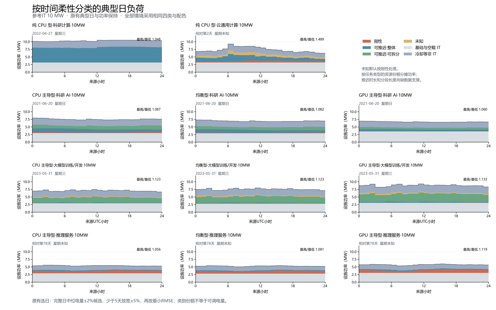
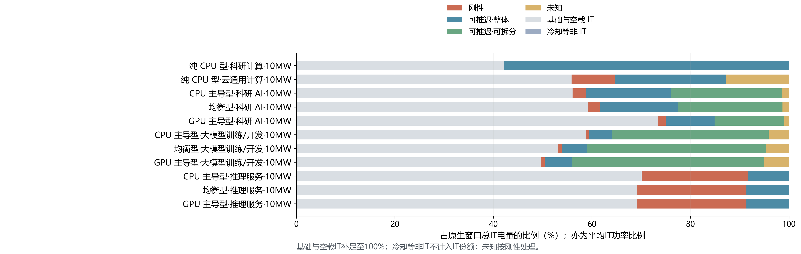
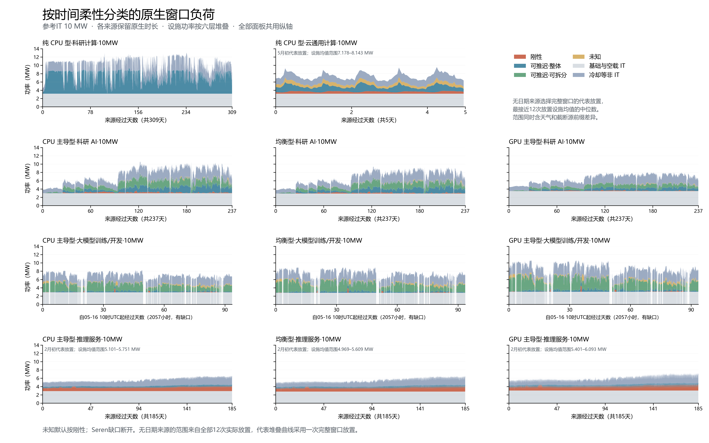
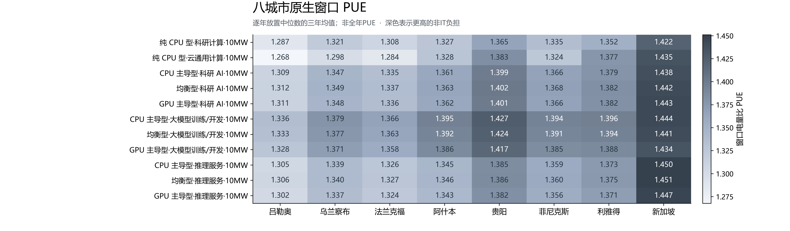
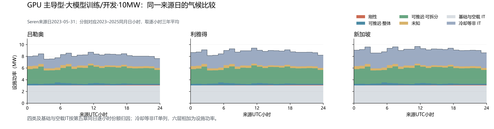
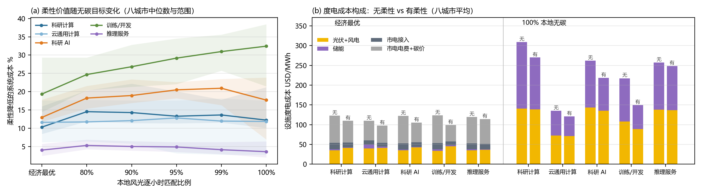
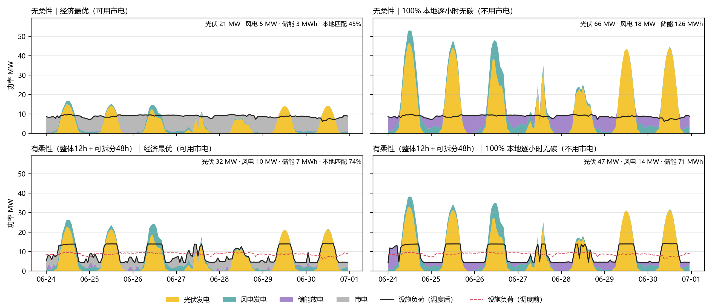

# 数据中心任务时间柔性简表

2026-11-02

## 一、情境定义：服务器规格 × 需求

| 服务器规格 ＼ 需求 | 科研计算 | 云通用计算 | 科研 AI | 大模型训练/开发 | 推理服务 |
| --- | --- | --- | --- | --- | --- |
| A 纯 CPU 型（2∶0） | Lisa | Alibaba 2018（5 个完整日） | — | — | — |
| B CPU 主导型（2∶1） | — | — | MIT Supercloud | Acme Seren | ASI |
| C 均衡型（2∶2） | — | — | MIT Supercloud | Acme Seren | ASI |
| D GPU 主导型（2∶8） | — | — | MIT Supercloud | Acme Seren | ASI |

格中为该情境使用的需求数据，— 表示不设该组合。11 个组合各取参考 IT 功率 1／10／100／500 MW 四档规模，共 44 个情境，命名为“服务器规格·需求·规模”，例如 GPU 主导型·大模型训练/开发·100MW。括号内为每台服务器的 CPU∶GPU。

## 二、任务时间柔性分类

① 刚性：不能推迟、不能拆分，有人在等或持续在线服务。② 可推迟·整体：可以晚点运行，开始后一次完成。③ 可推迟·可拆分：可以晚点运行，也可在存档点暂停后续跑。未知：数据看不出用途，保守处理。

| 用途 | ① 刚性 | ② 可推迟·整体 | ③ 可推迟·可拆分 | 未知 |
| --- | --- | --- | --- | --- |
| 科研计算 | 交互 | 批作业 | — | 课程等 |
| 云通用计算 | 在线服务 | 离线批处理 | — | 未对账 |
| 科研 AI | 交互 | 批量作业 | 模型训练 | 无法判断 |
| 大模型训练/开发 | 调试 | 评测 | 训练 | 其他 |
| 推理服务 | 在线推理 | 离线推理 | — | — |

表中每格为原始细类按任务用途及推迟、拆分能力合并后的一个代表名称，完整映射见配套数值文件，未知默认按刚性处理。

此表采用统一的情景分类；用途标签与运行形态本身不提供服务期限、检查点或暂停恢复的实测证据，实际调度仍需核实业务约束。

原生窗口的分类份额见第五章；推迟时长、分段长度和恢复成本作为情景假设另述，本次不给出可调电量结论。

## 三、各数据源概况

| 数据源 | 对应需求 | 时间跨度 | 记录方式与规模 | 作业时长／功率证据 | 任务分类有多细 | 主要缺口 |
| --- | --- | --- | --- | --- | --- | --- |
| Lisa（荷兰 SURF 超算） | 科研计算 | 2021-12 至 2022-11，约 10 个月 | 逐作业 159.7 万条（CPU 分区 139.6 万、GPU 分区 20.1 万） | CPU 分区 25 秒／55 分钟；GPU 分区 4.6 分钟／5.0 小时 | 粗：只有 17 个分区（CPU／GPU、Jupyter、课程），无用途和算法 | GPU 卡数 |
| Alibaba 2018 | 云通用计算 | 8天，采用5个完整日 | 4,034台机器；接入在线容器和离线实例用量 | 离线实例P50 10秒、P90 99秒 | 粗：在线19.79%、离线51.13%、未对账29.08%（核心小时） | 未对账量、业务期限 |
| MIT Supercloud | 科研 AI | 237天需求；六月功率标定 | 39.6万作业，GPU 9.82万；六月12,181文件完成 | 原提交类P50 2.2–3.0小时、P90 22–37小时 | 中：OTHER已分12类；DNN用途证据占OTHER 4.6%（含推断）；图统一四类 | 有效监测覆盖68.33%；用途真值与恢复 |
| Acme Seren | 大模型训练/开发 | 作业2023-02至08；正文2057小时、55完整日 | 81.83万作业：GPU45.06万、独立CPU36.77万 | 预训练5.08分钟／7.08小时；功率报送≥80%、采样≥95% | 细：六类含MLLM；集群逐小时反推，无作业映射 | 189小时缺口；在线库存及缺测代表性 |
| ASI（Alibaba GPU 2026） | 推理服务 | 185天，4,440小时 | 逐类型、优先级GPU小时；附执行跨度分布 | 离线执行跨度P50 10–30分钟、P90 3–6小时 | 中：6类业务＋优先级＋模型；INF只取在线和离线推理 | 真实日期、连续运行时间；1个零资源异常小时 |
| BurstGPT／Azure 2024 | 推理日内形状 | 119日／代码和对话各7日 | 请求及输入／输出token按小时聚合 | 请求日内比2.455／8.963／1.783 | 中央用BurstGPT输入／输出各50%；Azure为敏感性 | 到达与执行时差；时钟、批量及缓存 |
| Seren同期GPU监测 | 训练GPU功率 | 2023-05-16 10时至08-17 23时UTC；合格2057小时 | 2288卡在线库存；报送均功率外推后扣除未分配GPU空闲 | GPU/TDP均值0.76；P10/P50/P90=0.61/0.77/0.90 | 同小时共同功率比例；任务层按分配份额归因 | A100→H100按TDP迁移；无逐作业映射 |
| SPECpower（三配置） | 全部CPU响应 | 2023—2024公开结果 | 3条整机AC曲线，共33个点 | 空闲76–163W；满载318–915W | 归一化平均、单调平滑；保留端点 | Java负载与目标配置迁移 |

作业时长数字为P50／P90。Lisa GPU分区仅计宿主CPU核心小时；ASI执行跨度含生命周期及调度影响。MIT监测覆盖68.33%、合格验证3小时，跨设备与空载迁移为假设。无任务整机敏感性（科研AI另计）：A 120–320、B 195–500、C 270–680、D 1370–4110 W/台；科研AI只变基础及CPU空闲。

## 四、各情境典型日负荷曲线



选日：先取完整日中位电量±2%内的候选日，少于5天放宽至±5%，再取与全部完整日平均24小时曲线RMSE最小者；GPU需求按GPU主导型筛选，三种规格共用日期。

统一模型：两章同用#38 Seren正文2057个合格小时、#35推理请求GPU、#36 CPU及基础/空闲、cooling-20261028-v2。训练仅55个完整UTC日参选，选中2023-05-31；缺口不填充。

无日期来源：先限定完整原生窗口，再取设施均值最接近12次放置中位数的放置用于选日；三种规格共用放置。第五章报告全部放置统计，日内比取全窗口按来源小时平均。

训练GPU/TDP由同期监测反推，源GPU采样时间加权均值0.76，P10–P90为0.61–0.90。A100 400W按TDP比例迁移至H100 PCIe 350W或SXM 700W，吞吐未标定；逐任务功率未测。

四类按第二章映射合并，基础与空载IT、冷却等非IT单列，所有图共用六项图例与配色；未知默认按刚性处理。曲线按原有任务资源份额分摊，不代表可调电量。

## 五、各情境原生窗口负荷曲线

各来源有多长使用多长，不循环或补齐全年。Lisa 309天（2021-12-27至2022-10-31），时区未知，按UTC对应为假设；MIT 237天（2021-02-06至09-30），保留Slurm epoch小时。Seren为2023-05-16 10时至08-17 23时UTC内2057个合格小时（约86天，有缺口），按同期集群GPU监测反推已分配功率。三者按源月日小时对应气象年。Alibaba相对第2–6天共120小时，ASI相对第0–184天共185天；两者日期及时区未知，在12个月初00时UTC放置，年末截断。下表为参考网格2025年、参考IT 10MW。

| 情境（参考IT 10MW） | 原生<br>长度 | IT平均<br>MW | IT峰值<br>MW | 设施平均<br>MW | 设施峰值<br>MW | 设施日内<br>峰谷比 | 设施平均范围<br>MW |
| --- | --- | --- | --- | --- | --- | --- | --- |
| 纯 CPU 型·科研计算·10MW | 309天 | 7.520 | 10.000 | 9.963 | 13.033 | 1.097 | — |
| 纯 CPU 型·云通用计算·10MW | 5天 | 5.669 | 7.158 | 7.275 | 9.410 | 1.429 | 7.178–8.143 |
| CPU 主导型·科研 AI·10MW | 237天 | 5.318 | 7.844 | 7.252 | 10.762 | 1.044 | — |
| 均衡型·科研 AI·10MW | 237天 | 4.906 | 6.920 | 6.702 | 9.523 | 1.041 | — |
| GPU 主导型·科研 AI·10MW | 237天 | 4.758 | 5.741 | 6.487 | 8.064 | 1.027 | — |
| CPU 主导型·大模型训练/开发·10MW | 2057小时<br>约86天<br>有缺口 | 4.935 | 5.995 | 6.937 | 8.292 | 1.029 | — |
| 均衡型·大模型训练/开发·10MW | 2057小时<br>约86天<br>有缺口 | 5.244 | 6.600 | 7.355 | 9.076 | 1.033 | — |
| GPU 主导型·大模型训练/开发·10MW | 2057小时<br>约86天<br>有缺口 | 6.118 | 7.882 | 8.542 | 10.789 | 1.036 | — |
| CPU 主导型·推理服务·10MW | 185天 | 4.137 | 4.602 | 5.526 | 6.143 | 1.076 | 5.101–5.751 |
| 均衡型·推理服务·10MW | 185天 | 4.031 | 4.583 | 5.389 | 6.107 | 1.120 | 4.969–5.609 |
| GPU 主导型·推理服务·10MW | 185天 | 4.392 | 5.074 | 5.855 | 6.742 | 1.159 | 5.401–6.093 |

IT均值与峰值取完整原生窗口；设施均值、峰值及日内比取各实际放置窗口统计的中位数，范围为设施均值最小–最大。有日期来源仅一次对应。日内比为全窗口按源小时分组均值的最大/最小，区别于第四章所选日24小时比值。

Alibaba仅5天，不报告周形状；ASI的周形状仅为相对七日。ASI七至十二月放置实际为184／153／122／92／61／31天，设施范围同时包含气象和源前缀差异。44情境的最小值、日内/周内比及窗口电量见配套数值表，均不年化。

训练分配GPU功率/TDP＝[报送均功率×2288−未分配卡数×60W]/[分配卡数×400W]，依赖在线库存与缺测代表性假设；Seren无逐作业设备映射。A100→H100按TDP比例迁移，均值0.76、P10–P90为0.61–0.90；保留8个超过TDP的小时及标记。4192小时补缺方案仅作对照。MIT为六月单月标定迁移H100。

### 原生窗口四类任务份额

下表与条形图均以同一原生窗口的总IT电量为分母；该类电量占比也等于该类平均功率占总IT平均功率的比例。基础与空载IT单列，与四类合计100%；冷却等非IT不计入IT分母。单位：%。

| 情境（参考IT 10MW） | ① 刚性<br>% | ② 可推迟·整体<br>% | ③ 可推迟·可拆分<br>% | 未知<br>% | 基础与空载 IT<br>% |
| --- | --- | --- | --- | --- | --- |
| 纯 CPU 型·科研计算·10MW | 0.01 | 57.88 | 0.00 | 0.00 | 42.11 |
| 纯 CPU 型·云通用计算·10MW | 8.72 | 22.59 | 0.00 | 12.83 | 55.86 |
| CPU 主导型·科研 AI·10MW | 2.75 | 17.19 | 22.61 | 1.38 | 56.07 |
| 均衡型·科研 AI·10MW | 2.51 | 15.80 | 21.20 | 1.33 | 59.16 |
| GPU 主导型·科研 AI·10MW | 1.55 | 9.93 | 14.14 | 0.96 | 73.43 |
| CPU 主导型·大模型训练/开发·10MW | 0.66 | 4.56 | 31.88 | 4.14 | 58.76 |
| 均衡型·大模型训练/开发·10MW | 0.74 | 5.16 | 36.29 | 4.69 | 53.12 |
| GPU 主导型·大模型训练/开发·10MW | 0.79 | 5.53 | 39.03 | 5.03 | 49.61 |
| CPU 主导型·推理服务·10MW | 21.55 | 8.35 | 0.00 | 0.00 | 70.10 |
| 均衡型·推理服务·10MW | 22.28 | 8.63 | 0.00 | 0.00 | 69.09 |
| GPU 主导型·推理服务·10MW | 22.26 | 8.62 | 0.00 | 0.00 | 69.12 |



份额由任务类型的CPU/GPU资源份额分摊模型IT功率得到；“能推迟多久、拆成多长一段”及存档恢复成本尚无数据支撑，作为情景假设另述，本次不据此计算可调电量。未知默认按刚性处理。



六层相加为设施功率，四类及配色与第四章相同。训练横轴保留真实UTC时间，缺口断开；无日期来源先限定完整原生窗口，再选设施均值最接近12次实际放置均值中位数的一次放置。图内注释给出全部放置的设施均值范围，包含气象与截断源前缀差异；该代表曲线区别于第五章表中跨放置汇总。

## 六、八城市气候下的负荷与柔性

同第五章原生窗口和组合模型，使用冻结2023–2025逐小时气温、露点、气压；冷却为cooling-20261028-v2风冷。

| 城市（由冷到热） | 平均气温<br>°C | 平均露点<br>°C | 气温≥30°C<br>小时% | 露点≥20°C<br>小时% |
| --- | --- | --- | --- | --- |
| 吕勒奥 | 4.0 | 0.5 | 0.0 | 0.1 |
| 乌兰察布 | 5.4 | -4.3 | 0.2 | 0.2 |
| 法兰克福 | 11.5 | 6.7 | 0.8 | 0.1 |
| 阿什本 | 14.5 | 7.3 | 4.3 | 10.4 |
| 贵阳 | 16.1 | 12.1 | 1.2 | 15.6 |
| 菲尼克斯 | 24.0 | 3.4 | 32.8 | 0.9 |
| 利雅得 | 26.9 | 2.3 | 39.9 | 0.0 |
| 新加坡 | 27.6 | 24.6 | 13.2 | 100.0 |

### 10MW代表情境设施平均功率（MW）

| 城市 | 纯 CPU 型·科研计算·10MW | 纯 CPU 型·云通用计算·10MW | GPU 主导型·科研 AI·10MW | GPU 主导型·大模型训练/开发·10MW | GPU 主导型·推理服务·10MW |
| --- | --- | --- | --- | --- | --- |
| 吕勒奥 | 9.675 | 7.186 | 6.237 | 8.125 | 5.685 |
| 乌兰察布 | 9.932 | 7.360 | 6.413 | 8.387 | 5.840 |
| 法兰克福 | 9.836 | 7.281 | 6.357 | 8.307 | 5.786 |
| 阿什本 | 9.980 | 7.527 | 6.479 | 8.480 | 5.871 |
| 贵阳 | 10.264 | 7.839 | 6.664 | 8.673 | 6.045 |
| 菲尼克斯 | 10.042 | 7.505 | 6.501 | 8.472 | 5.916 |
| 利雅得 | 10.170 | 7.806 | 6.573 | 8.491 | 5.998 |
| 新加坡 | 10.695 | 8.135 | 6.867 | 8.775 | 6.347 |

主表取五种用途的纯CPU型或GPU主导型代表情境，单位MW；完整8城市×11情境见配套city-summary.csv。设施均值逐年对实际放置取中位数，再平均三年；有日期来源每年一次对应。

城市间设施平均功率的绝对差异以纯 CPU 型·科研计算·10MW最大，为1.021MW（吕勒奥至新加坡）；相对差异以纯 CPU 型·云通用计算·10MW最大，为13.2%。

同一GPU主导型训练情境，吕勒奥至年平均最热的新加坡设施均值由8.125增至8.775MW，差0.651MW；城市间冷却等非IT为2.006–2.657MW。



PUE为窗口设施/IT电量比，逐年对放置取中位数后平均三年，非全年PUE。



四类及基础空载IT按第五章原生窗口份额归因城市IT，冷却等非IT单列；三城典型日采用第五章同日逐小时IT份额。

IT推迟可能同时改变冷却功率，方向和幅度取决于执行时刻的温湿度与设备负载；此处未改变调度，不能据此给出柔性可调电量。

仅三年气象、各来源不同原生窗口；无日期来源的放置和年末截断影响比较。新加坡采用1.50°N、104.00°E柔佛陆地占优格点（陆地比例0.729），为区域代理。风冷采用水侧经济器和水冷冷机，室外适用−40至50°C；设备、湿度及压降参数为工程情景，未作目标设施实测拟合。

## 七、柔性调度的经济价值（初算）

调度对象为第二章四类：刚性、未知与基础空载IT不动；可推迟·整体最多推迟12小时，可推迟·可拆分最多推迟48小时，均在原生窗口内完成，执行后不超过IT装机。供电侧配置光伏、风电、储能与市电，容量与逐小时调度一并按成本最小求解（杉数COPT，八城市×11情境原生窗口）。“本地匹配比例”指本地风光（含储能）逐小时覆盖设施用电的比例，从经济最优逐步收紧至100%（不用市电）。成本：风光IRENA 2024，储能ATB 2025，市电100 USD/MWh，碳价100 USD/t，接入费120 USD/kW·年。

| 代表情境 | 可推迟IT电量% | 经济最优：度电成本<br>无→有 USD/MWh | 经济最优：<br>柔性价值% | 100%无碳：度电成本<br>无→有 USD/MWh | 100%无碳：<br>柔性价值% | 100%无碳：储能<br>无→有 MWh |
| --- | --- | --- | --- | --- | --- | --- |
| 纯 CPU 型·科研计算 | 58 | 124→110 | 10.3 | 345→303 | 12.3 | 375→282 |
| 纯 CPU 型·云通用计算 | 23 | 117→98 | 11.6 | 130→113 | 11.9 | 92→72 |
| GPU 主导型·科研 AI | 24 | 126→109 | 13.0 | 272→222 | 17.7 | 160→107 |
| GPU 主导型·大模型训练/开发 | 45 | 125→102 | 19.4 | 204→143 | 32.4 | 188→73 |
| GPU 主导型·推理服务 | 9 | 119→115 | 4.1 | 259→251 | 3.6 | 136→127 |

表中为八城市中位数；度电成本按设施用电计，有、无柔性两种情况都重新优化容量。可推迟IT电量%＝可推迟·整体＋可推迟·可拆分占原生窗口IT电量（第五章）。



柔性价值主要取决于可拆分任务：训练可推迟约45%的IT电量，100%本地无碳时省约三成成本，主要来自少建储能；推理只有约9%可推迟，价值约4%。经济最优下，有柔性时最优市电接入容量约为平均设施负荷的0.7–1.0倍；若风光只按平均负荷建设，本地匹配≥99%在所有城市均不可行。

### 调度前后对比（法兰克福·GPU 主导型·大模型训练/开发）



法兰克福2025-06-24至06-30（UTC）连续7天。上排无柔性、下排有柔性，四种情况各自重新优化容量（图内标注）；红虚线为调度前设施负荷，黑线为调度后。堆叠面积为光伏、风电、储能放电与市电，高出负荷部分为储能充电或弃电。有柔性后训练负荷集中到光伏时段，夜间由储能或市电供给的电量明显减少。

局限：可推迟·整体只按截止期近似，未约束开始后不可中断；存档恢复损耗、分时电价与向电网售电未计；推迟时长为情景假设；Alibaba仅120小时，训练窗口内缺口按连续小时处理。完整结果见results/flex-econ-copt-20261102。

## 数字来源与说明

- 原始任务标签来自PR #26分类结果、#28 MIT细分及#31 c16ac75的[Seren统计](../../results/scenario-typical-day-by-task-20261101-v7/seren-job-statistics.json)。第二章采用用户确认的三类加未知代表名称表；完整计算映射见[task-class-mapping.csv](../../results/flex-class-20261101/task-class-mapping.csv)，未知默认按刚性处理。
- 情境命名沿用PR #27的 `docs/scenario-naming.md`，11个风冷组合各四档，共44情境。
- 分类表示统一的研究情景：推迟时长、分段长度和存档恢复成本尚无数据支撑，另作为情景假设讨论；本次仅汇总任务资源份额归因的IT电量及平均功率比例，不给出可调电量结论。功率使用共同的Seren逐小时反推比例，未赋予各类型独立文献功率值。
- MIT OTHER依据PR #28 d3fd452的[细分表](../../results/mit-other-breakdown-20261031/other-breakdown.csv)；原始任务层按确认映射合入四类。DNN用途证据占OTHER 4.6%（含推断），运行形态、用途与实际调度权限仍分别判断；逐作业输入不进入仓库。
- ASI使用PR #32的[185天统计](../../results/asi-185day-workload-types-20261031/README.md)，INF仅在线及离线推理，LP候选占比来自v3的flexibility-source-statistics.json。
- Alibaba使用PR #33的[完整窗口及在线/离线拆分](../../results/alibaba-cpu-cld-20261031/README.md)，未对账量独立保留。
- 推理GPU采用PR #35 520f68d的[请求驱动模型](../../results/inf-diurnal-20261101/README.md)，BurstGPT输入/输出token各50%，Azure作为敏感性。请求到达与GPU执行功率的相位对应为假设。
- 训练采用PR #38 bd6c8cd的[Seren正文main](../../results/trn-seren-20261101/README.md)：2023-05-16 10:00至08-17 23:00 UTC范围内2057个合格小时，189个内部缺口小时不填充，54个连续片段。GPU功率/TDP由同期报送GPU均功率外推2288卡、扣除未分配GPU×60W反推，源GPU采样时间加权均值0.7623，P10/P50/P90=0.6139/0.7683/0.8963。A100 400W按TDP迁移至H100 PCIe 350W或SXM 700W，吞吐未标定；无逐作业设备映射，依赖在线库存与缺测代表性。4192小时补缺仅为对照。CPU、基础空闲采用#36中央值，冷却cooling-20261028-v2。
- 第四章图与逐小时分任务汇总：[flex-class-20261101](../../results/flex-class-20261101/README.md)。按确认的四类映射合并原始任务功率层，保留基础与空载IT和冷却等非IT。11个典型日日期、小时功率及选日规则与Seren组合结果保持；native-hourly及selected-days分别保存原生与典型日六层值。全套图统一六项图例与配色。
- 第五章44情境、25组地点年份及原生时序：[typical-load-curves-20261101-v4-seren](../../results/typical-load-curves-20261101-v4-seren/README.md)。训练固定#38 bd6c8cd正文main，推理固定#35 520f68d，CPU及基础空闲沿用#36。native-summary.csv、placement-summary.csv和window-summary-all-locations.csv保留汇总；training-10MW-comparison.csv对照PR #37上一版训练数字，来源、窗口、归一化与模型同时变化，差值为描述性比较。manifest.json记录上游指纹及其余情境原字节保留校验。
- Alibaba 第6小时尖峰：[原始数据核查与5分钟/10秒汇总](../../results/scenario-typical-day-by-task-20261031/cld-spike-audit-20261101/README.md)，包含原始包 SHA-256、八天复现、机器覆盖、保持上限敏感性、业务对账及非线性功率映射。

- 第六章八城市气候与负荷：[eight-city-native-flex-20261102](../../results/eight-city-native-flex-20261102/README.md)。核验8份冻结气象及1320份10MW城市原生小时，复用#35/#36组合与#38 Seren结果；case-summary.csv、year-summary.csv、city-summary.csv分别保存逐窗口、逐年和三年汇总。facility-composition.csv保留六层功率，冷却非IT单列；典型日采用第五章同日逐小时IT份额。verification.json保存SHA-256及24组冷却复算，brief-audit.json保存文档检查。

- 第七章柔性调度经济价值：[flex-econ-copt-20261102](../../results/flex-econ-copt-20261102/README.md)。COPT求解5808个算例（runs.csv），brief/保存本章两张图与表格数据，逐小时调度在服务器out/hourly。

## 重新生成

以已核验的 `results/typical-load-curves-20261101-v4-seren` 为输入，保留该目录全部原始字节。本机既有分类资源小时位于 `data/processed/scenario-typical-day-by-task-20261101-v3`，逐份匹配其manifest；Seren直接读取正文小时的六类GPU资源列。在仓库根目录运行：

```powershell
python dc-flexibility-project/analysis/build_flex_classes.py
```

新结果为 `results/flex-class-20261101`。11情境原生和典型日逐小时总IT、设施功率、既有典型日日期保持；原始任务层仅按确认映射合并。典型日、原生时序均按四类加基础空载与冷却六层堆叠，全部图采用同一配色与六项图例。第五章新增原生IT份额表及紧邻下方的堆叠条形图，四类与基础层合计100%，冷却不计IT分母。无日期来源选择完整窗口中设施均值最接近12次放置中位数的一次放置，并注释全部放置范围；Seren缺口断开，不插入功率值。

在本目录运行（也可设置NODE_PATH使用Codex runtime中已安装的docx）：

```powershell
npm install
node build.js 数据中心任务时间柔性简表.docx README.md
```

第六章使用 `results/eight-city-native-flex-20261102`，核验并复用八城市1320个10MW原生窗口：非训练1248个来自组合模型，训练72个来自#38 Seren正文。八份2023–2025逐小时温度、露点和气压与#34/#38冻结SHA-256一致。汇总每年先对实际放置取中位数，再平均三年；范围保留所有年与放置极值。四类及基础空载按第五章IT份额归因，冷却等非IT单列。新加坡采用柔佛1.50°N、104.00°E陆地占优格点，作为区域天气代理。

复现城市章节：先运行 `analysis/collect_eight_city_native.py --prepare --inputs <缓存目录>` 准备冻结索引；服务器共享卷运行 `analysis/launch_eight_city_native.sh`，以setsid nohup核验气象/小时指纹及汇总，并对24个城市年份训练窗口重算冷却核对。结果下载至新目录后运行 `analysis/report_eight_city_native.py`，再生成Word。完整8×11城市情境、264个城市年份、六层构成及PUE见对应CSV；正文主表选五个代表情境，热力图保留全部11个。

使用 `analysis/export_brief_pdf.ps1` 由本机Microsoft Word导出PDF，Poppler生成逐页PNG。逐页检查中文、分页、图件和表格边界，再运行 `analysis/audit_eight_city_native.py`，审计结果为八城市新结果目录的brief-audit.json。全文八页：第二、三章在第2页接排；第六章新增第7–8页，包含气候表、设施平均功率主表、PUE热力图及同一训练来源日三城市六层对比。七张表均位于单页。

依赖审阅顺序：#27；#30→#32、#33；#34、#35、#36→#38；#31；#37。保持待审，不合并。
