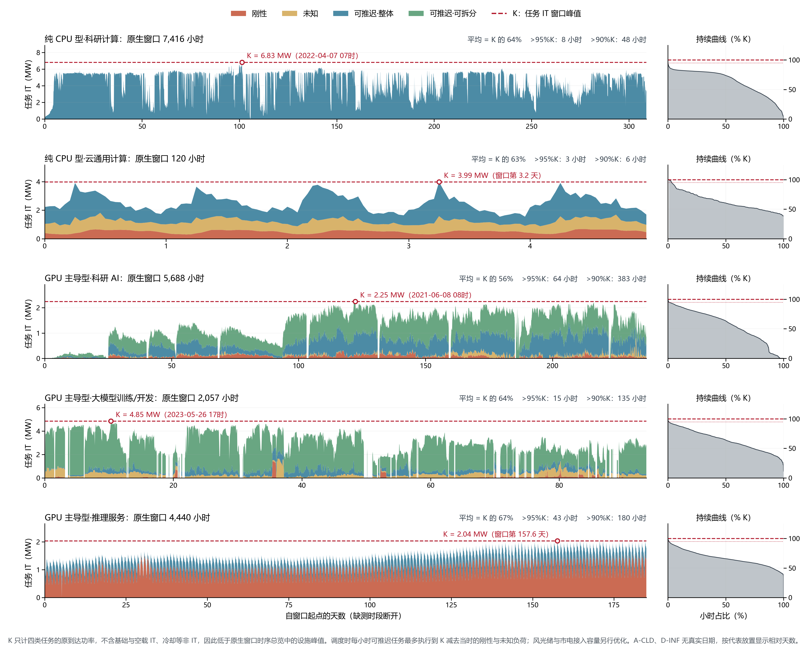
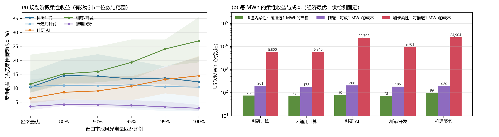
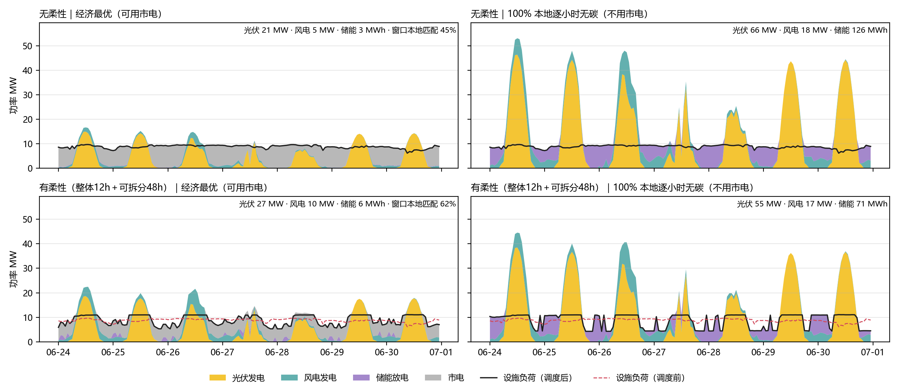
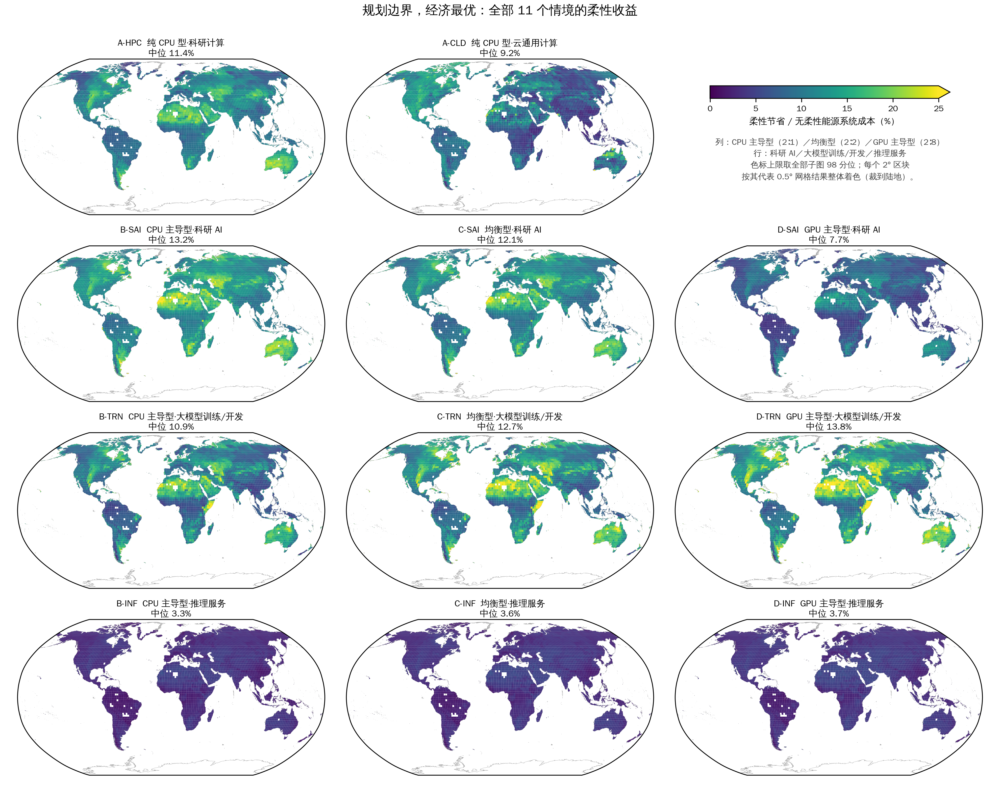
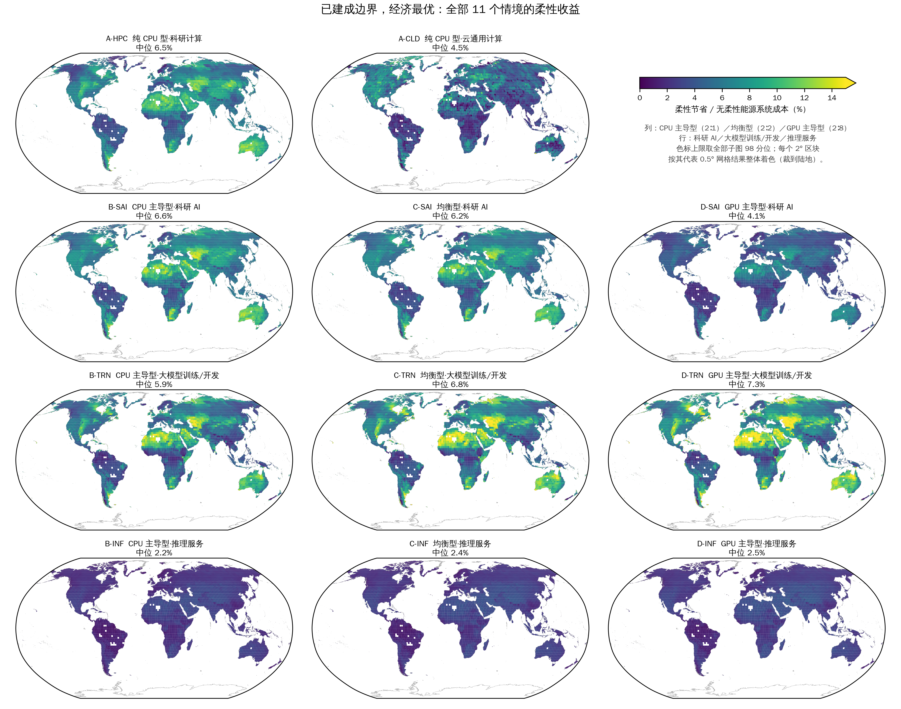
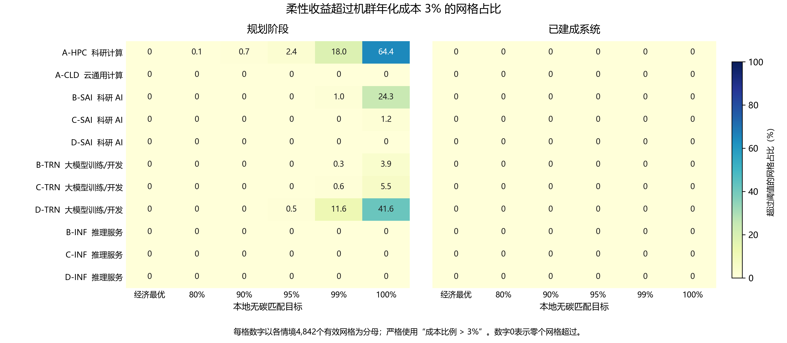
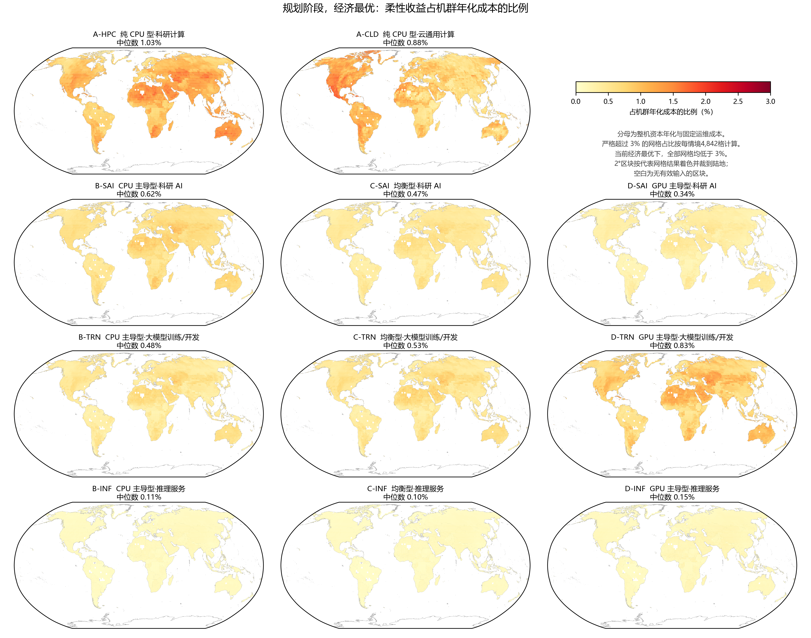
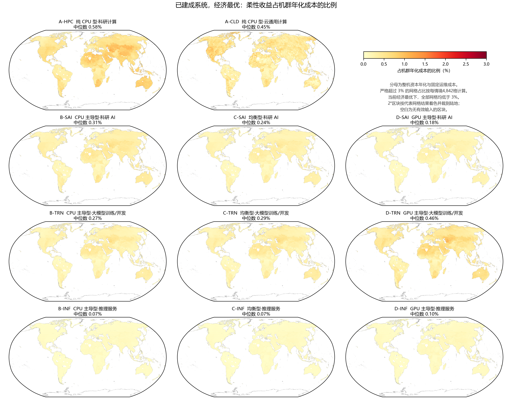
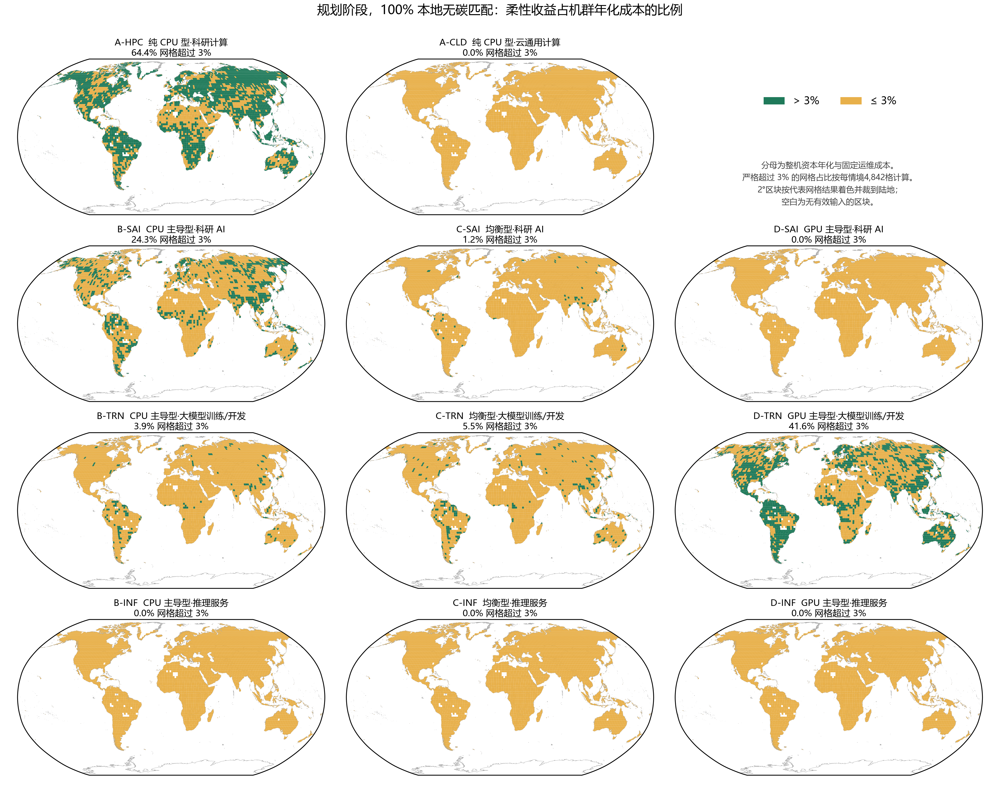
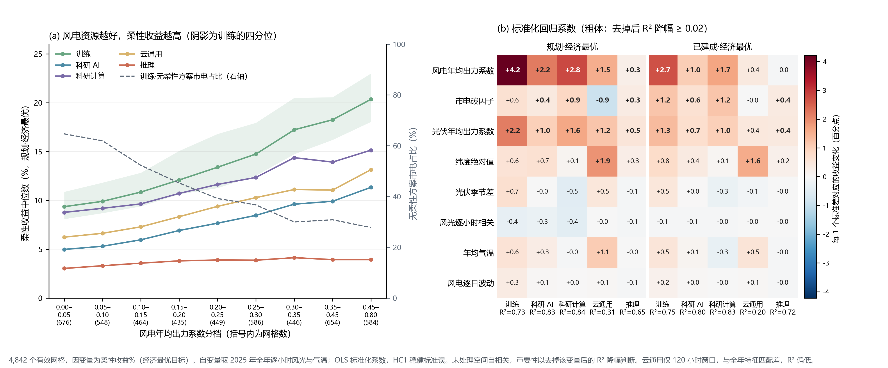

# 数据中心任务时间柔性简表

2026-11-07 的 Word 版增加第九章“新建数据中心的算力与供能联合规划”。该章以八城市和 11 个情境为范围，记录原时序、固定机群柔性和联合规划三个配对情境，列出已核验的基准设备台数与已有配对结果。更新时使用本目录的 `update_joint_capacity.py` 和 `joint-capacity-city-snapshot.json` 生成新增两页。

2026-11-04

## 一、情境定义：服务器规格 × 需求

| 服务器规格 ＼ 需求 | 科研计算 | 云通用计算 | 科研 AI | 大模型训练/开发 | 推理服务 |
| --- | --- | --- | --- | --- | --- |
| A 纯 CPU 型（2∶0） | Lisa | Alibaba 2018（5 个完整日） | — | — | — |
| B CPU 主导型（2∶1） | — | — | MIT Supercloud | Acme Seren | ASI |
| C 均衡型（2∶2） | — | — | MIT Supercloud | Acme Seren | ASI |
| D GPU 主导型（2∶8） | — | — | MIT Supercloud | Acme Seren | ASI |

格中为该情境使用的需求数据，— 表示不设该组合。11 个组合各取参考 IT 功率 1／10／100／500 MW 四档规模，共 44 个情境，命名为“服务器规格·需求·规模”，例如 GPU 主导型·大模型训练/开发·100MW。括号内为每台服务器的 CPU∶GPU。

## 二、任务时间柔性分类

① 刚性：不能推迟、不能拆分，有人在等或持续在线服务。② 可推迟·整体：可以晚点运行，开始后一次完成。③ 可推迟·可拆分：可以晚点运行，也可在存档点暂停后续跑。未知：数据看不出用途，保守处理。

| 用途 | ① 刚性 | ② 可推迟·整体 | ③ 可推迟·可拆分 | 未知 |
| --- | --- | --- | --- | --- |
| 科研计算 | 交互 | 批作业 | — | 课程等 |
| 云通用计算 | 在线服务 | 离线批处理 | — | 未对账 |
| 科研 AI | 交互 | 批量作业 | 模型训练 | 无法判断 |
| 大模型训练/开发 | 调试 | 评测 | 训练 | 其他 |
| 推理服务 | 在线推理 | 离线推理 | — | — |

表中每格为原始细类按任务用途及推迟、拆分能力合并后的一个代表名称，完整映射见配套数值文件，未知默认按刚性处理。

此表采用统一的情景分类；用途标签与运行形态本身不提供服务期限、检查点或暂停恢复的实测证据，实际调度仍需核实业务约束。

原生窗口的分类份额见第五章；推迟时长、分段长度和恢复成本作为情景假设另述，本次不给出可调电量结论。

## 三、各数据源概况

| 数据源 | 对应需求 | 时间跨度 | 记录方式与规模 | 作业时长／功率证据 | 任务分类有多细 | 主要缺口 |
| --- | --- | --- | --- | --- | --- | --- |
| Lisa（荷兰 SURF 超算） | 科研计算 | 2021-12 至 2022-11，约 10 个月 | 逐作业 159.7 万条（CPU 分区 139.6 万、GPU 分区 20.1 万） | CPU 分区 25 秒／55 分钟；GPU 分区 4.6 分钟／5.0 小时 | 粗：只有 17 个分区（CPU／GPU、Jupyter、课程），无用途和算法 | GPU 卡数 |
| Alibaba 2018 | 云通用计算 | 8天，采用5个完整日 | 4,034台机器；接入在线容器和离线实例用量 | 离线实例P50 10秒、P90 99秒 | 粗：在线19.79%、离线51.13%、未对账29.08%（核心小时） | 未对账量、业务期限 |
| MIT Supercloud | 科研 AI | 237天需求；六月功率标定 | 39.6万作业，GPU 9.82万；六月12,181文件完成 | 原提交类P50 2.2–3.0小时、P90 22–37小时 | 中：OTHER已分12类；DNN用途证据占OTHER 4.6%（含推断）；图统一四类 | 有效监测覆盖68.33%；用途真值与恢复 |
| Acme Seren | 大模型训练/开发 | 作业2023-02至08；正文2057小时、55完整日 | 81.83万作业：GPU45.06万、独立CPU36.77万 | 预训练5.08分钟／7.08小时；功率报送≥80%、采样≥95% | 细：六类含MLLM；集群逐小时反推，无作业映射 | 189小时缺口；在线库存及缺测代表性 |
| ASI（Alibaba GPU 2026） | 推理服务 | 185天，4,440小时 | 逐类型、优先级GPU小时；附执行跨度分布 | 离线执行跨度P50 10–30分钟、P90 3–6小时 | 中：6类业务＋优先级＋模型；INF只取在线和离线推理 | 真实日期、连续运行时间；1个零资源异常小时 |
| BurstGPT／Azure 2024 | 推理日内形状 | 119日／代码和对话各7日 | 请求及输入／输出token按小时聚合 | 请求日内比2.455／8.963／1.783 | 中央用BurstGPT输入／输出各50%；Azure为敏感性 | 到达与执行时差；时钟、批量及缓存 |
| Seren同期GPU监测 | 训练GPU功率 | 2023-05-16 10时至08-17 23时UTC；合格2057小时 | 2288卡在线库存；报送均功率外推后扣除未分配GPU空闲 | GPU/TDP均值0.76；P10/P50/P90=0.61/0.77/0.90 | 同小时共同功率比例；任务层按分配份额归因 | A100→H100按TDP迁移；无逐作业映射 |
| SPECpower（三配置） | 全部CPU响应 | 2023—2024公开结果 | 3条整机AC曲线，共33个点 | 空闲76–163W；满载318–915W | 归一化平均、单调平滑；保留端点 | Java负载与目标配置迁移 |

作业时长数字为P50／P90。Lisa GPU分区仅计宿主CPU核心小时；ASI执行跨度含生命周期及调度影响。MIT监测覆盖68.33%、合格验证3小时，跨设备与空载迁移为假设。无任务整机敏感性（科研AI另计）：A 120–320、B 195–500、C 270–680、D 1370–4110 W/台；科研AI只变基础及CPU空闲。

## 四、各情境典型日负荷曲线


选日：先取完整日中位电量±2%内的候选日，少于5天放宽至±5%，再取与全部完整日平均24小时曲线RMSE最小者；GPU需求按GPU主导型筛选，三种规格共用日期。

统一模型：两章同用#38 Seren正文2057个合格小时、#35推理请求GPU、#36 CPU及基础/空闲、cooling-20261028-v2。训练仅55个完整UTC日参选，选中2023-05-31；缺口不填充。

无日期来源：先限定完整原生窗口，再取设施均值最接近12次放置中位数的放置用于选日；三种规格共用放置。第五章报告全部放置统计，日内比取全窗口按来源小时平均。

训练GPU/TDP由同期监测反推，源GPU采样时间加权均值0.76，P10–P90为0.61–0.90。A100 400W按TDP比例迁移至H100 PCIe 350W或SXM 700W，吞吐未标定；逐任务功率未测。

四类按第二章映射合并，基础与空载IT、冷却等非IT单列，所有图共用六项图例与配色；未知默认按刚性处理。曲线按原有任务资源份额分摊，不代表可调电量。

## 五、各情境原生窗口负荷曲线

各来源有多长使用多长，不循环或补齐全年。Lisa 309天（2021-12-27至2022-10-31），时区未知，按UTC对应为假设；MIT 237天（2021-02-06至09-30），保留Slurm epoch小时。Seren为2023-05-16 10时至08-17 23时UTC内2057个合格小时（约86天，有缺口），按同期集群GPU监测反推已分配功率。三者按源月日小时对应气象年。Alibaba相对第2–6天共120小时，ASI相对第0–184天共185天；两者日期及时区未知，在12个月初00时UTC放置，年末截断。下表为参考网格2025年、参考IT 10MW。

| 情境（参考IT 10MW） | 原生<br>长度 | IT平均<br>MW | IT峰值<br>MW | 设施平均<br>MW | 设施峰值<br>MW | 设施日内<br>峰谷比 | 设施平均范围<br>MW |
| --- | --- | --- | --- | --- | --- | --- | --- |
| 纯 CPU 型·科研计算·10MW | 309天 | 7.520 | 10.000 | 9.963 | 13.033 | 1.097 | — |
| 纯 CPU 型·云通用计算·10MW | 5天 | 5.669 | 7.158 | 7.275 | 9.410 | 1.429 | 7.178–8.143 |
| CPU 主导型·科研 AI·10MW | 237天 | 5.318 | 7.844 | 7.252 | 10.762 | 1.044 | — |
| 均衡型·科研 AI·10MW | 237天 | 4.906 | 6.920 | 6.702 | 9.523 | 1.041 | — |
| GPU 主导型·科研 AI·10MW | 237天 | 4.758 | 5.741 | 6.487 | 8.064 | 1.027 | — |
| CPU 主导型·大模型训练/开发·10MW | 2057小时<br>约86天<br>有缺口 | 4.935 | 5.995 | 6.937 | 8.292 | 1.029 | — |
| 均衡型·大模型训练/开发·10MW | 2057小时<br>约86天<br>有缺口 | 5.244 | 6.600 | 7.355 | 9.076 | 1.033 | — |
| GPU 主导型·大模型训练/开发·10MW | 2057小时<br>约86天<br>有缺口 | 6.118 | 7.882 | 8.542 | 10.789 | 1.036 | — |
| CPU 主导型·推理服务·10MW | 185天 | 4.137 | 4.602 | 5.526 | 6.143 | 1.076 | 5.101–5.751 |
| 均衡型·推理服务·10MW | 185天 | 4.031 | 4.583 | 5.389 | 6.107 | 1.120 | 4.969–5.609 |
| GPU 主导型·推理服务·10MW | 185天 | 4.392 | 5.074 | 5.855 | 6.742 | 1.159 | 5.401–6.093 |

IT均值与峰值取完整原生窗口；设施均值、峰值及日内比取各实际放置窗口统计的中位数，范围为设施均值最小–最大。有日期来源仅一次对应。日内比为全窗口按源小时分组均值的最大/最小，区别于第四章所选日24小时比值。

Alibaba仅5天，不报告周形状；ASI的周形状仅为相对七日。ASI七至十二月放置实际为184／153／122／92／61／31天，设施范围同时包含气象和源前缀差异。44情境的最小值、日内/周内比及窗口电量见配套数值表，均不年化。

训练分配GPU功率/TDP＝[报送均功率×2288−未分配卡数×60W]/[分配卡数×400W]，依赖在线库存与缺测代表性假设；Seren无逐作业设备映射。A100→H100按TDP比例迁移，均值0.76、P10–P90为0.61–0.90；保留8个超过TDP的小时及标记。4192小时补缺方案仅作对照。MIT为六月单月标定迁移H100。

### 原生窗口四类任务份额

下表与条形图均以同一原生窗口的总IT电量为分母；该类电量占比也等于该类平均功率占总IT平均功率的比例。基础与空载IT单列，与四类合计100%；冷却等非IT不计入IT分母。单位：%。

| 情境（参考IT 10MW） | ① 刚性<br>% | ② 可推迟·整体<br>% | ③ 可推迟·可拆分<br>% | 未知<br>% | 基础与空载 IT<br>% |
| --- | --- | --- | --- | --- | --- |
| 纯 CPU 型·科研计算·10MW | 0.01 | 57.88 | 0.00 | 0.00 | 42.11 |
| 纯 CPU 型·云通用计算·10MW | 8.72 | 22.59 | 0.00 | 12.83 | 55.86 |
| CPU 主导型·科研 AI·10MW | 2.75 | 17.19 | 22.61 | 1.38 | 56.07 |
| 均衡型·科研 AI·10MW | 2.51 | 15.80 | 21.20 | 1.33 | 59.16 |
| GPU 主导型·科研 AI·10MW | 1.55 | 9.93 | 14.14 | 0.96 | 73.43 |
| CPU 主导型·大模型训练/开发·10MW | 0.66 | 4.56 | 31.88 | 4.14 | 58.76 |
| 均衡型·大模型训练/开发·10MW | 0.74 | 5.16 | 36.29 | 4.69 | 53.12 |
| GPU 主导型·大模型训练/开发·10MW | 0.79 | 5.53 | 39.03 | 5.03 | 49.61 |
| CPU 主导型·推理服务·10MW | 21.55 | 8.35 | 0.00 | 0.00 | 70.10 |
| 均衡型·推理服务·10MW | 22.28 | 8.63 | 0.00 | 0.00 | 69.09 |
| GPU 主导型·推理服务·10MW | 22.26 | 8.62 | 0.00 | 0.00 | 69.12 |


份额由任务类型的CPU/GPU资源份额分摊模型IT功率得到；“能推迟多久、拆成多长一段”及存档恢复成本尚无数据支撑，作为情景假设另述，本次不据此计算可调电量。未知默认按刚性处理。


六层相加为设施功率，四类及配色与第四章相同。训练横轴保留真实UTC时间，缺口断开；无日期来源先限定完整原生窗口，再选设施均值最接近12次实际放置均值中位数的一次放置。图内注释给出全部放置的设施均值范围，包含气象与截断源前缀差异；该代表曲线区别于第五章表中跨放置汇总。

## 六、八城市气候下的负荷与柔性

同第五章原生窗口和组合模型，使用冻结2023–2025逐小时气温、露点、气压；冷却为cooling-20261028-v2风冷。

| 城市（由冷到热） | 平均气温<br>°C | 平均露点<br>°C | 气温≥30°C<br>小时% | 露点≥20°C<br>小时% |
| --- | --- | --- | --- | --- |
| 吕勒奥 | 4.0 | 0.5 | 0.0 | 0.1 |
| 乌兰察布 | 5.4 | -4.3 | 0.2 | 0.2 |
| 法兰克福 | 11.5 | 6.7 | 0.8 | 0.1 |
| 阿什本 | 14.5 | 7.3 | 4.3 | 10.4 |
| 贵阳 | 16.1 | 12.1 | 1.2 | 15.6 |
| 菲尼克斯 | 24.0 | 3.4 | 32.8 | 0.9 |
| 利雅得 | 26.9 | 2.3 | 39.9 | 0.0 |
| 新加坡 | 27.6 | 24.6 | 13.2 | 100.0 |

### 10MW代表情境设施平均功率（MW）

| 城市 | 纯 CPU 型·科研计算·10MW | 纯 CPU 型·云通用计算·10MW | GPU 主导型·科研 AI·10MW | GPU 主导型·大模型训练/开发·10MW | GPU 主导型·推理服务·10MW |
| --- | --- | --- | --- | --- | --- |
| 吕勒奥 | 9.675 | 7.186 | 6.237 | 8.125 | 5.685 |
| 乌兰察布 | 9.932 | 7.360 | 6.413 | 8.387 | 5.840 |
| 法兰克福 | 9.836 | 7.281 | 6.357 | 8.307 | 5.786 |
| 阿什本 | 9.980 | 7.527 | 6.479 | 8.480 | 5.871 |
| 贵阳 | 10.264 | 7.839 | 6.664 | 8.673 | 6.045 |
| 菲尼克斯 | 10.042 | 7.505 | 6.501 | 8.472 | 5.916 |
| 利雅得 | 10.170 | 7.806 | 6.573 | 8.491 | 5.998 |
| 新加坡 | 10.695 | 8.135 | 6.867 | 8.775 | 6.347 |

主表取五种用途的纯CPU型或GPU主导型代表情境，单位MW；完整8城市×11情境见配套city-summary.csv。设施均值逐年对实际放置取中位数，再平均三年；有日期来源每年一次对应。

城市间设施平均功率的绝对差异以纯 CPU 型·科研计算·10MW最大，为1.021MW（吕勒奥至新加坡）；相对差异以纯 CPU 型·云通用计算·10MW最大，为13.2%。

同一GPU主导型训练情境，吕勒奥至年平均最热的新加坡设施均值由8.125增至8.775MW，差0.651MW；城市间冷却等非IT为2.006–2.657MW。


PUE为窗口设施/IT电量比，逐年对放置取中位数后平均三年，非全年PUE。


四类及基础空载IT按第五章原生窗口份额归因城市IT，冷却等非IT单列；三城典型日采用第五章同日逐小时IT份额。

IT推迟可能同时改变冷却功率，方向和幅度取决于执行时刻的温湿度与设备负载；此处未改变调度，不能据此给出柔性可调电量。

仅三年气象、各来源不同原生窗口；无日期来源的放置和年末截断影响比较。新加坡采用1.50°N、104.00°E柔佛陆地占优格点（陆地比例0.729），为区域代理。风冷采用水侧经济器和水冷冷机，室外适用−40至50°C；设备、湿度及压降参数为工程情景，未作目标设施实测拟合。

## 七、柔性调度的经济性（计入加卡，初算）

参考IT 10MW，杉数COPT求解八城市×11情境原生窗口。两组均允许按基准购置价格情境增加算力。柔性收益＝无柔性模型成本－有柔性模型成本；收益%以无柔性模型成本为分母，仅计能源系统与新增算力，既有机群资本、延误与恢复成本未计入。窗口本地匹配率＝1－窗口市电电量/窗口设施电量；95%约束窗口总量，100%要求各时段市电为0。下表为有效城市配对的中位数，年化金额由原生窗口折算。

### 7.1 规划阶段（风光储重新优化）

| 代表情境 | 可推迟IT<br>电量% | 柔性收益%<br>经济最优／95%／100% | 等效年化收益 万美元/年<br>经济最优／95%／100% | 100%无碳储能MWh<br>无柔性→有柔性 | 新增算力<br>MW任务功率 |
| --- | --- | --- | --- | --- | --- |
| 纯 CPU 型·科研计算 | 58 | 10.3／13.3／12.3 | 111／215／348 | 375→282 | 0 |
| 纯 CPU 型·云通用计算 | 23 | 10.6／11.2／10.4 | 61／72／76 | 92→72 | 0 |
| GPU 主导型·科研 AI | 24 | 6.4／10.7／14.5 | 46／104／222 | 160→117 | 0 |
| GPU 主导型·大模型训练/开发 | 45 | 11.5／19.3／27.0 | 101／220／367 | 188→96 | 0 |
| GPU 主导型·推理服务 | 9 | 3.5／3.9／2.8 | 22／35／35 | 136→129 | 0 |

有柔性与无柔性分别优化风光、储能和市电接入容量。可推迟IT电量为第二章情景分类份额；新增算力以等效任务功率计量，表中报告该情境各城市与目标的最大值，小于10⁻⁶MW记为0。

### 7.2 已建成（风光储固定）

| 代表情境 | 柔性收益%<br>经济最优／95%／100% | 等效年化收益 万美元/年<br>经济最优／95%／100% | 每推迟1MWh<br>节省 USD | 储能每放<br>1MWh USD | 若加卡：每推迟<br>1MWh成本 USD | 新增算力<br>MW任务功率 |
| --- | --- | --- | --- | --- | --- | --- |
| 纯 CPU 型·科研计算 | 5.6／1.9／0.0 | 63／30／0 | 76 | 201 | 5,800 | 0 |
| 纯 CPU 型·云通用计算 | 4.7／3.6／0.0 | 29／28／0 | 75 | 173 | 5,946 | 0 |
| GPU 主导型·科研 AI | 3.5／1.8／0.0 | 24／18／0 | 80 | 206 | 22,705 | 0 |
| GPU 主导型·大模型训练/开发 | 5.7／3.8／0.0 | 50／47／0 | 73 | 186 | 9,701 | 0 |
| GPU 主导型·推理服务 | 2.5／0.8／0.0 | 16／6／0 | 99 | 202 | 24,904 | 0 |

风光、储能与市电接入固定为无柔性最优配置，只优化运行调度与新增算力。每推迟1MWh的分母为两类任务分别逐小时累计的max(到达功率－执行功率,0)×1h，即移出原时段的任务IT电量。该项与储能单位成本取经济最优目标；“若加卡”假设新增卡每天承接8小时推迟负荷。有效城市数（经济最优/95%/100%）：纯 CPU 型·云通用计算 8/7/8；GPU 主导型·推理服务 8/7/8；其余代表情境均为8/8/8。

GPU主导型训练在100%目标下，规划阶段储能中位数为188→96MWh，模型成本收益为27.0%，年化节省367万美元。固定已建成容量时，同一目标的模型成本收益约为0.0%。该结果取决于本章固定电价、容量固定和成本项目；储能退化、备用与其他服务价值未纳入。

### 两个收益指标的计算方法

在同一网格、情境、目标和供能边界内配对：C_E,0为无柔性能源系统成本，C_E,1为有柔性能源系统成本，C_add为新增算力费用，ΔC为模型节省金额；当前全部最优解C_add为零。能源费用含风光储、市电及碳成本，延误、检查点恢复和有效产出损失未计入。

ΔC = C_E,0 − C_E,1 − C_add。

指标一为能源侧柔性收益率η_E，表示柔性节省占无柔性能源系统成本的比例。

η_E = ΔC / C_E,0 × 100%。

指标二为柔性收益占机群年化成本的比例ρ_K。T为实际参与优化的原生窗口小时数；ΔC×8760/T为等效年化节省，缺测小时不补齐，折算值不代表完整全年实际收益。

ρ_K = [ΔC × (8760/T)] / A_K × 100%。

机群年化成本沿用当前设备计价：折现率r=8%、寿命L=4年、固定运维比例f=3%，CRF为资本回收系数，合计年化系数0.331921。N_eff为参考服务器台数乘原生窗口峰值利用率的等效台数，P为整机价；两者为模型参数，未核实完整实物库存。下表列出各情境分母。

A_K = N_eff × P × [CRF(r,L) + f]。

| 情境 | 等效服务器台数 | 整机价 万美元/台 | 机群年化成本 万美元/年 |
| --- | --- | --- | --- |
| A-HPC | 16666.00 | 2 | 11063.6 |
| A-CLD | 9979.60 | 2 | 6624.9 |
| B-SAI | 10000.00 | 4.75 | 15766.2 |
| C-SAI | 7142.00 | 7.5 | 17779.3 |
| D-SAI | 1234.00 | 35 | 14335.7 |
| B-TRN | 9260.00 | 4.75 | 14599.5 |
| C-TRN | 6613.49 | 7.5 | 16463.7 |
| D-TRN | 1142.68 | 35 | 13274.8 |
| B-INF | 10000.00 | 4.75 | 15766.2 |
| C-INF | 7142.00 | 7.5 | 17779.3 |
| D-INF | 1234.00 | 35 | 14335.7 |

严格采用ρ_K>3%作为经济意义筛选条件，即等效年化节省覆盖机群年化成本的3%以上。该比例用于衡量节省规模，有效产出损失的盈亏平衡判断另需产出价值假设。

### 算力容量 K 的来源：任务 IT 窗口峰值



本章“不加卡”的算力容量 K 取原生窗口内任务 IT 功率（刚性＋未知＋两类可推迟任务，按原到达时刻）的最大值，不含基础与空载 IT 和冷却等非 IT，因此低于第五章时序总览中的设施峰值。纯 CPU 型·科研计算 K＝6.83MW，平均为K的64%，超过95%K仅8小时；纯 CPU 型·云通用计算 K＝3.99MW，平均为K的63%，超过95%K仅3小时；GPU 主导型·科研 AI K＝2.25MW，平均为K的56%，超过95%K仅64小时；GPU 主导型·大模型训练/开发 K＝4.85MW，平均为K的64%，超过95%K仅15小时；GPU 主导型·推理服务 K＝2.04MW，平均为K的67%，超过95%K仅43小时。多数时段离K尚有30–40%空档，两类可推迟任务可在12/48小时内利用这些空档移位，因而柔性最优解不需加卡。K由单一最高时刻决定，对尖峰敏感：科研计算平时约5.5MW，K来自第101天的6.83MW尖峰；若改用较稳健的分位数定容量，空档与柔性收益会相应减小。

### 柔性收益与单位成本



调度固定刚性、未知和基础空载IT；两类可推迟任务的上限分别设为12和48小时，按源记录的真实时间间隔约束，缺测小时不补写任务或执行量。算力容量以调度前任务功率峰值近似，超过时须付新增服务器年化费用并计全时待机耗电。服务器价情景：纯CPU 2万、配置1/2张H100 PCIe为4.75/7.5万、DGX H100为35万美元；年化系数0.332。风光成本取IRENA 2024、储能取ATB 2025；市电100 USD/MWh、碳价100 USD/t、接入费120 USD/kW·年。

解释边界：任务用途与利用率不提供业务调度权限；12/48小时为情景设定。容量尚无逐卡约束；可推迟·整体尚未约束启动后连续执行。服务器价为公开估计与量级假设，推迟和存档恢复的运营成本未知；分时电价与售电未计，Alibaba窗口仅120小时。等效年化收益按观测窗口小时折算，缺测小时未计算，不能视为完整全年收益。三个单位指标的分母分别为推迟电量、储能放电量和假设新增卡承接电量。完整结果见results/flex-card-cost-calendar-20261102。

### 调度前后对比（法兰克福·GPU 主导型·大模型训练/开发）



法兰克福2025-06-24至06-30（UTC）。上排无柔性、下排有柔性，四种情况各自重新优化容量。红虚线为调度前设施负荷，黑线为调度后；面积为光伏、风电、储能放电和市电，高出负荷部分为储能充电或弃电。100%本地无碳下储能为126→71MWh；这是单城示例，与两表的跨城市中位数分别报告。

## 八、全球网格的柔性经济性（2° 抽样试算）

把第七章模型从八城市铺到全球：全球4,900个2°区块各取一个可建设0.5°网格，用该格ERA5 2025年逐小时气象重算风光出力与PUE，11情境×6档匹配目标×规划/已建成两种边界全部求解；4,842格有效，全部线性规划最优，另58格无陆地气象点未算。成本、电价、碳价与加卡口径同第七章，市电碳因子按所在国家取Ember 2024年均值。下表为有效网格等权中位数。

| 代表情境 | 规划阶段 柔性收益%<br>经济最优／95%／100% | 规划阶段 经济最优<br>四分位 P25–P75 | 已建成 柔性收益%<br>经济最优／95% | 对照：八城市中位<br>规划·经济最优 |
| --- | --- | --- | --- | --- |
| 纯 CPU 型·科研计算 | 11.4／15.4／14.4 | 9.3–14.1 | 6.5／2.2 | 10.3 |
| 纯 CPU 型·云通用计算 | 9.2／10.5／10.1 | 6.3–12.5 | 4.5／3.4 | 10.6 |
| GPU 主导型·科研 AI | 7.7／11.1／15.3 | 5.8–9.9 | 4.1／2.2 | 6.4 |
| GPU 主导型·大模型训练/开发 | 13.8／21.1／26.7 | 10.4–18.1 | 7.3／4.1 | 11.5 |
| GPU 主导型·推理服务 | 3.7／4.3／3.0 | 3.2–4.3 | 2.5／0.9 | 3.5 |

已建成边界下100%匹配的收益全部约为0（最大0.0016%），表中略去；全部柔性最优解均不需新增算力。八城市列取第七章7.1表经济最优中位数，两者口径相同、样本不同。

### 训练（GPU主导型）规划阶段经济最优：各大洲与主要国家中位数

| 训练·规划·经济最优 | 非洲 | 亚洲 | 欧洲 | 北美 | 大洋洲 | 南美 | 中国 | 美国 | 印度 | 巴西 | 澳大利亚 | 沙特 |
| --- | --- | --- | --- | --- | --- | --- | --- | --- | --- | --- | --- | --- |
| 中位节省% | 15.6 | 13.0 | 12.8 | 15.0 | 19.0 | 10.1 | 11.6 | 13.3 | 11.4 | 9.7 | 19.4 | 19.9 |
| 网格数 | 729 | 999 | 1199 | 1135 | 340 | 440 | 250 | 348 | 82 | 173 | 225 | 45 |

训练（GPU主导型）规划阶段经济最优的全球中位节省为13.8%，四分位10.4–18.1%。收益高低主要取决于本地风电资源：风电年均出力系数低于0.05的网格中位收益9.4%，高于0.45的为20.4%；风光都好的地区（北非、中东、澳洲内陆、中亚等）可达30%以上，风弱、主要依赖市电的地区（亚马孙、刚果盆地等）最低。推理在各地都在3–4%，地域差别小。归因见本章末页。

解释边界：2°抽样、成本全球统一、单一气象年与年均碳因子；低于−40°C（534格）与高于50°C（3格）的小时在冷却模型输入端夹到边界值；负荷沿用各来源原生窗口，收益不是完整全年值。完整结果见results/global-flex-econ-20261103。

### 全球柔性收益地图（11个情境）





首行为纯CPU型科研计算与云通用计算，其余三行依次为科研AI、大模型训练/开发、推理服务，三列为CPU主导型、均衡型、GPU主导型，子图标题给出中位数。同一幅图共用色标，上限取全部子图98分位，超出用三角标示。每个2°区块按其代表网格的结果整体着色（裁到陆地），表示抽样代表值；空白为无可建设网格或无陆地气象点的区块。同一用途的三种规格空间格局几乎相同（相关系数0.97–1.00），差别在数值高低；云通用仅120小时窗口，格局主要反映这几天的天气。

### 柔性收益占机群年化成本的比例与3%阈值

| 情境 | 能源侧收益率%<br>规划／已建成 | 机群年化成本比例%<br>规划／已建成 | 超过3%网格占比%<br>规划／已建成 |
| --- | --- | --- | --- |
| A-HPC | 11.36／6.49 | 1.03／0.58 | 0.00／0.00 |
| A-CLD | 9.24／4.52 | 0.88／0.45 | 0.00／0.00 |
| B-SAI | 13.22／6.61 | 0.62／0.31 | 0.00／0.00 |
| C-SAI | 12.12／6.25 | 0.47／0.24 | 0.00／0.00 |
| D-SAI | 7.70／4.10 | 0.34／0.18 | 0.00／0.00 |
| B-TRN | 10.91／5.88 | 0.48／0.27 | 0.00／0.00 |
| C-TRN | 12.69／6.77 | 0.53／0.29 | 0.00／0.00 |
| D-TRN | 13.84／7.32 | 0.83／0.46 | 0.00／0.00 |
| B-INF | 3.33／2.17 | 0.11／0.07 | 0.00／0.00 |
| C-INF | 3.62／2.40 | 0.10／0.07 | 0.00／0.00 |
| D-INF | 3.74／2.49 | 0.15／0.10 | 0.00／0.00 |



上表两项收益指标为经济最优下各情境的网格等权中位数。3%阈值应用于柔性节省金额占机群年化成本的比例；图中每个单元以该情境4,842个有效网格为分母，严格统计比例大于3%的网格。经济最优下，全部11情境、两种边界均为0个网格超过3%，全局最高比例为1.87%。已建成系统在六档目标下均未超过3%；规划阶段部分约束目标出现超过3%的网格。该阈值为研究设定的筛选标准，延误、恢复与有效产出损失尚未计价。

### 机群年化成本比例全球地图 经济最优





数值为同一窗口模型节省金额按8760/有效小时数折算后，占既有机群年化成本的百分比。两幅经济最优地图共用0–3%色标；当前所有网格均低于3%。各情境分母采用模型等效机群的整机资本年化与固定运维成本，非逐卡实物库存。每个2°区块以代表网格结果着色并裁到陆地，空白为无有效输入的区块。

### 机群年化成本比例超过3%的区域 规划阶段 100%本地无碳匹配



规划阶段100%本地无碳匹配下，绿色为柔性节省金额超过机群年化成本3%的网格，黄色为小于或等于3%的网格。各情境超过阈值的占比：科研计算64.4%，云通用计算0.0%；科研AI 24.3%／1.2%／0.0%；训练 3.9%／5.5%／41.6%；推理 0.0%／0.0%／0.0%（B／C／D）。分母均为4,842个有效网格；该图仅包括能源侧调度节省，未重新优化既有算力容量。

### 收益差异归因：风电资源与市电依赖

对4,842个有效网格分别回归柔性收益%（经济最优），自变量为2025年风光年均出力系数、风光逐小时相关、风电逐日波动、光伏季节差、年均气温、市电碳因子与纬度，均标准化，系数为每1个标准差对应的百分点。表中列出去掉后R²降幅最大的两个因素。

| 代表情境 | 解释度 R²<br>规划／已建成 | 规划阶段主要因素<br>（每1标准差，百分点） | 已建成主要因素<br>（每1标准差，百分点） |
| --- | --- | --- | --- |
| 纯 CPU 型·科研计算 | 0.84／0.83 | 风电年均出力系数 +2.8；光伏年均出力系数 +1.6 | 市电碳因子 +1.2；风电年均出力系数 +1.7 |
| 纯 CPU 型·云通用计算 | 0.31／0.20 | 风电年均出力系数 +1.5；市电碳因子 -0.9 | 纬度绝对值 +1.6；光伏年均出力系数 +0.4 |
| GPU 主导型·科研 AI | 0.83／0.80 | 风电年均出力系数 +2.2；光伏年均出力系数 +1.0 | 风电年均出力系数 +1.0；市电碳因子 +0.7 |
| GPU 主导型·大模型训练/开发 | 0.73／0.75 | 风电年均出力系数 +4.2；光伏年均出力系数 +2.2 | 风电年均出力系数 +2.7；市电碳因子 +1.2 |
| GPU 主导型·推理服务 | 0.65／0.72 | 光伏年均出力系数 +0.5；市电碳因子 +0.3 | 市电碳因子 +0.4；光伏年均出力系数 +0.4 |



机制：模型中市电全天同价，柔性只能靠让任务对准本地风光出力来省钱。风资源好的网格，无柔性最优方案主要靠本地风光加储能（训练的市电占比中位数28%），柔性可少建储能、少弃电；风弱的网格主要买市电（占比65%），推迟任务省不下电费。训练收益与无柔性方案市电占比的相关系数为-0.88。已建成边界下市电碳因子更重要：碳因子越高市电越贵、本地风光装得越多，柔性越值钱。推理可推迟电量少，主要随光照和碳因子变化。

局限：OLS未处理空间自相关，t值偏乐观，重要性以R²降幅判断；资源特征取全年，与各来源原生窗口不完全对应，云通用仅120小时窗口，R²只有0.2–0.3；在分时电价下依赖市电的地区也能通过推迟获益，归因会改变。

## 数字来源与说明

- 原始任务标签来自PR #26分类结果、#28 MIT细分及#31 c16ac75的[Seren统计](../../results/scenario-typical-day-by-task-20261101-v7/seren-job-statistics.json)。第二章采用用户确认的三类加未知代表名称表；完整计算映射见[task-class-mapping.csv](../../results/flex-class-20261101/task-class-mapping.csv)，未知默认按刚性处理。
- 情境命名沿用PR #27的 `docs/scenario-naming.md`，11个风冷组合各四档，共44情境。
- 第二、五章分类表示统一的研究情景，汇总任务资源份额归因的IT电量及平均功率比例；第七章在明确的时间与容量假设下另行求解。推迟时长、分段长度和存档恢复成本仍缺少业务权限证据。功率使用共同的Seren逐小时反推比例，未赋予各类型独立文献功率值。
- MIT OTHER依据PR #28 d3fd452的[细分表](../../results/mit-other-breakdown-20261031/other-breakdown.csv)；原始任务层按确认映射合入四类。DNN用途证据占OTHER 4.6%（含推断），运行形态、用途与实际调度权限仍分别判断；逐作业输入不进入仓库。
- ASI使用PR #32的[185天统计](../../results/asi-185day-workload-types-20261031/README.md)，INF仅在线及离线推理，LP候选占比来自v3的flexibility-source-statistics.json。
- Alibaba使用PR #33的[完整窗口及在线/离线拆分](../../results/alibaba-cpu-cld-20261031/README.md)，未对账量独立保留。
- 推理GPU采用PR #35 520f68d的[请求驱动模型](../../results/inf-diurnal-20261101/README.md)，BurstGPT输入/输出token各50%，Azure作为敏感性。请求到达与GPU执行功率的相位对应为假设。
- 训练采用PR #38 bd6c8cd的[Seren正文main](../../results/trn-seren-20261101/README.md)：2023-05-16 10:00至08-17 23:00 UTC范围内2057个合格小时，189个内部缺口小时不填充，54个连续片段。GPU功率/TDP由同期报送GPU均功率外推2288卡、扣除未分配GPU×60W反推，源GPU采样时间加权均值0.7623，P10/P50/P90=0.6139/0.7683/0.8963。A100 400W按TDP迁移至H100 PCIe 350W或SXM 700W，吞吐未标定；无逐作业设备映射，依赖在线库存与缺测代表性。4192小时补缺仅为对照。CPU、基础空闲采用#36中央值，冷却cooling-20261028-v2。
- 第四章图与逐小时分任务汇总：[flex-class-20261101](../../results/flex-class-20261101/README.md)。按确认的四类映射合并原始任务功率层，保留基础与空载IT和冷却等非IT。11个典型日日期、小时功率及选日规则与Seren组合结果保持；native-hourly及selected-days分别保存原生与典型日六层值。全套图统一六项图例与配色。
- 第五章44情境、25组地点年份及原生时序：[typical-load-curves-20261101-v4-seren](../../results/typical-load-curves-20261101-v4-seren/README.md)。训练固定#38 bd6c8cd正文main，推理固定#35 520f68d，CPU及基础空闲沿用#36。native-summary.csv、placement-summary.csv和window-summary-all-locations.csv保留汇总；training-10MW-comparison.csv对照PR #37上一版训练数字，来源、窗口、归一化与模型同时变化，差值为描述性比较。manifest.json记录上游指纹及其余情境原字节保留校验。
- Alibaba 第6小时尖峰：[原始数据核查与5分钟/10秒汇总](../../results/scenario-typical-day-by-task-20261031/cld-spike-audit-20261101/README.md)，包含原始包 SHA-256、八天复现、机器覆盖、保持上限敏感性、业务对账及非线性功率映射。

- 第六章八城市气候与负荷：[eight-city-native-flex-20261102](../../results/eight-city-native-flex-20261102/README.md)。核验8份冻结气象及1320份10MW城市原生小时，复用#35/#36组合与#38 Seren结果；case-summary.csv、year-summary.csv、city-summary.csv分别保存逐窗口、逐年和三年汇总。facility-composition.csv保留六层功率，冷却非IT单列；典型日采用第五章同日逐小时IT份额。verification.json保存SHA-256及24组冷却复算，brief-audit.json保存文档检查。


- 第八章全球网格：[global-flex-econ-20261103](../../results/global-flex-econ-20261103/README.md)。4,900个2°代表网格×11情境×6档目标×两种边界，958,716个COPT线性规划；brief/brief-facts.json由analysis/global_flex_brief_facts.py从grid-summary.parquet生成，地图为figures/planning-economic与fixed-economic。

- 两个收益指标与机群成本：[计算方法、结果和验证](../../results/global-flex-econ-20261103/compute-cost/README.md)。逐网格指标来自639,144组有效配对，新增四张图、整机年化成本分母和两个收益指标的可编辑公式；全部原始优化结果保持原样。


- 第七章柔性调度经济性：[flex-card-cost-calendar-20261102](../../results/flex-card-cost-calendar-20261102/README.md)。COPT规划阶段3168个算例（runs-cards.csv）与固定供给侧1584个算例（runs-fixed.csv）；训练按实际UTC时间约束12/48小时延迟，brief/保存本章图表、输入校验值及核验记录。

## 重新生成

以已核验的 `results/typical-load-curves-20261101-v4-seren` 为输入，保留该目录全部原始字节。本机既有分类资源小时位于 `data/processed/scenario-typical-day-by-task-20261101-v3`，逐份匹配其manifest；Seren直接读取正文小时的六类GPU资源列。在仓库根目录运行：

```powershell
python dc-flexibility-project/analysis/build_flex_classes.py
```

新结果为 `results/flex-class-20261101`。11情境原生和典型日逐小时总IT、设施功率、既有典型日日期保持；原始任务层仅按确认映射合并。典型日、原生时序均按四类加基础空载与冷却六层堆叠，全部图采用同一配色与六项图例。第五章新增原生IT份额表及紧邻下方的堆叠条形图，四类与基础层合计100%，冷却不计IT分母。无日期来源选择完整窗口中设施均值最接近12次放置中位数的一次放置，并注释全部放置范围；Seren缺口断开，不插入功率值。

在本目录运行（也可设置NODE_PATH使用Codex runtime中已安装的docx）：

```powershell
npm install
node build.js 数据中心任务时间柔性简表.docx README.md
```

第六章使用 `results/eight-city-native-flex-20261102`，核验并复用八城市1320个10MW原生窗口：非训练1248个来自组合模型，训练72个来自#38 Seren正文。八份2023–2025逐小时温度、露点和气压与#34/#38冻结SHA-256一致。汇总每年先对实际放置取中位数，再平均三年；范围保留所有年与放置极值。四类及基础空载按第五章IT份额归因，冷却等非IT单列。新加坡采用柔佛1.50°N、104.00°E陆地占优格点，作为区域天气代理。

复现城市章节：先运行 `analysis/collect_eight_city_native.py --prepare --inputs <缓存目录>` 准备冻结索引；服务器共享卷运行 `analysis/launch_eight_city_native.sh`，以setsid nohup核验气象/小时指纹及汇总，并对24个城市年份训练窗口重算冷却核对。结果下载至新目录后运行 `analysis/report_eight_city_native.py`，再生成Word。完整8×11城市情境、264个城市年份、六层构成及PUE见对应CSV；正文主表选五个代表情境，热力图保留全部11个。

第七章读取 `results/flex-card-cost-calendar-20261102` 中的原始求解汇总。使用 `analysis/plot_flex_card_brief.py --result <结果目录> --hourly-index <完整逐小时归档目录>/hourly-index.csv --shares results/flex-class-20261101/shares-10MW.csv` 生成两组表格与两张图；逐小时文件按索引路径读取并核验SHA-256，归档位置见结果目录的 `hourly-storage.json`。完成后运行本目录 `build.js`，Word与本说明由同一组数据生成。

使用 `analysis/export_brief_pdf.ps1` 由Microsoft Word导出PDF，Poppler生成逐页PNG。全文21页：第1–8页为前六章；第9页为规划阶段与已建成系统收益表，第10页为两个指标的计算方法和机群成本分母，第11–13页为容量K、单位成本与调度图，第14–16页为全球能源侧结果，第17页为两个指标的全球中位数和3%阈值占比，第18–20页为机群成本比例及阈值地图，第21页为收益差异归因。14张表均位于单页。

新增指标的复现与检查使用 `analysis/plot_global_compute_cost.py --geography-run <地图缓存目录>` 和 `analysis/verify_global_compute_cost.py --baseline-docx <更新前简表>`。独立复核覆盖639,144组配对和132组情境目标边界统计，检查原有数据表、前六章文字与图片、四个可编辑公式和四张新增图；记录见 `results/global-flex-econ-20261103/compute-cost/document-verification.json`。设备年化成本与既有八城市求解记录逐情境一致。

第七章依赖审阅顺序：#41→#42→#43→本次分表。既有章节依赖：#27；#30→#32、#33；#34、#35、#36→#38；#31；#37。保持待审，不合并。
