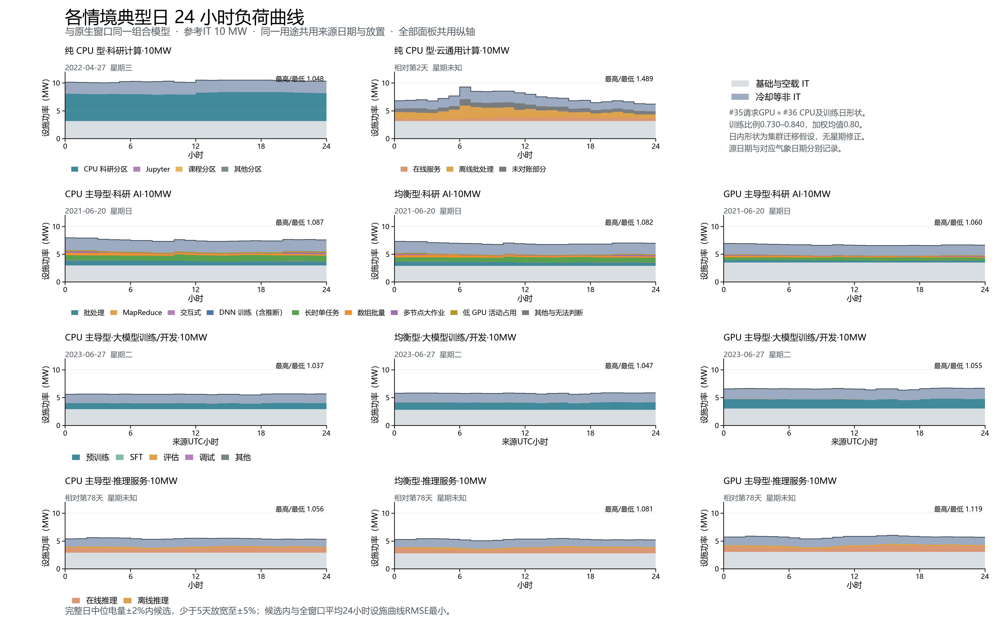
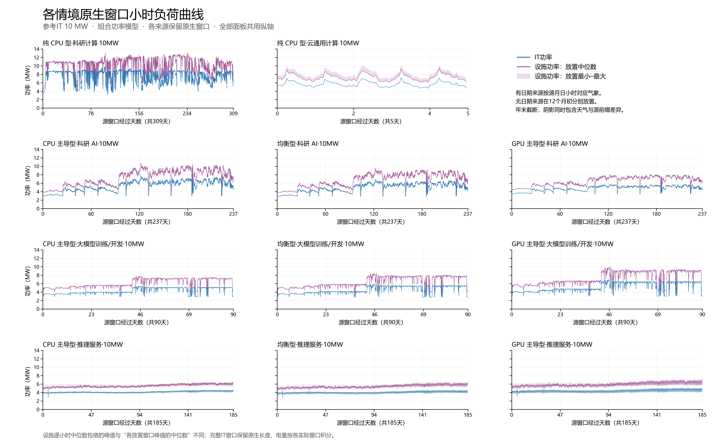

# 数据中心任务时间柔性简表

2026-11-01

## 一、情境定义：服务器规格 × 需求

| 服务器规格 ＼ 需求 | 科研计算 | 云通用计算 | 科研 AI | 大模型训练/开发 | 推理服务 |
| --- | --- | --- | --- | --- | --- |
| A 纯 CPU 型（2∶0） | Lisa | Alibaba 2018（5 个完整日） | — | — | — |
| B CPU 主导型（2∶1） | — | — | MIT Supercloud | Acme | ASI |
| C 均衡型（2∶2） | — | — | MIT Supercloud | Acme | ASI |
| D GPU 主导型（2∶8） | — | — | MIT Supercloud | Acme | ASI |

格中为该情境使用的需求数据，— 表示不设该组合。11 个组合各取参考 IT 功率 1／10／100／500 MW 四档规模，共 44 个情境，命名为“服务器规格·需求·规模”，例如 GPU 主导型·大模型训练/开发·100MW。括号内为每台服务器的 CPU∶GPU。

## 二、任务类型与时间柔性

✓ 可以　◐ 有条件　✗ 不行　？ 未知；MIT／OTHER分母分别为全部GPU小时／其中OTHER小时，跨数据集不相加。

| 任务类型 | 主要占比与分母 | 时间迁移 | 迁移代价参考／现状排队 P50／P90 | 中途拆分 | 拆分损失／最短分段 | 关键约束 |
| --- | --- | --- | --- | --- | --- | --- |
| 预训练／SFT | Acme 95.5%／0.2% | ✓ | 预训练13秒／1.5分钟；SFT 11秒／13秒 | ◐ 检查点处 | 预训练43–512卡时；≥1.6–9.5小时。SFT 0.8–11卡时；≥0.3–3.2小时 | 整组卡同停同启 |
| 训练（未细分） | ASI全业务 21.02% | ◐ 低优先级 | 独立提交时间未公开 | ◐ 需验证 | 检查点与恢复成本未测 | 全业务背景；INF只取推理 |
| 离线推理 | ASI推理子集 27.92% | ◐ 核实期限 | 独立提交时间未公开；延后成本待核 | ◐ 按批次 | 加载模型1–5分钟为假设；每批≥19–95分钟 | 断点续跑、输出不重复 |
| 评估 | Acme 0.2% | ✓ | 18秒／4.4分钟；作业时长P50 44秒 | ✗ 无需拆 | — | 保持训练依赖 |
| 科研／云批处理 | MIT 22.18%；Lisa CPU 99.98%；Alibaba离线 51.13% | ◐ 整体延后 | MIT批处理9秒／3.3小时；MapReduce 1.3／70小时；云任务期限未知 | ✗ 基准不拆 | 无检查点时中断重算：损失＝已运行小时×卡数 | 多节点；云任务保持DAG |
| 在线推理 | ASI推理子集 72.08% | ✗ | — | ✗ | — | 持续在线、时延与可用性 |
| 交互式／开发／调试 | MIT 4.19%；ASI全业务开发 3.45%；Acme 1.4% | ✗ | — | ✗ | — | 即时响应；含Lisa Jupyter |
| MIT DNN训练（含推断） | 3.41% MIT；4.64% OTHER | ◐ 核实后延后 | 官方标签14.6／47.8小时；推断用途需确认 | ◐ 官方待验证 | 官方需验证检查点；推断基准不拆，恢复成本未测 | 标签用途；推断需人工确认 |
| MIT 长时／多节点 | 50.64% MIT | ◐ 整体延后 | 排队P90：长时13.8小时；多节点15.0小时 | ✗ 基准不拆 | 检查点未观测；中断重算 | 仅运行形态，核实用途和期限 |
| MIT 数组批量 | 14.33% MIT；19.46% OTHER | ◐ 成员改序 | 44分钟／30.2小时 | ◐ 成员之间 | 成员内部恢复未知；开销未测 | 核实依赖、并发与期限 |
| MIT 低GPU活动占用 | 1.41% MIT；1.91% OTHER | ？ | 低GPU活动不证明业务空闲 | ？ | 恢复与释放成本未知 | 核实后台CPU和释放权限 |
| 其他与无法判断 | 3.85% MIT；5.23% OTHER；Acme 2.6% | ？ | — | ✗ 基准不拆 | 用途与恢复能力待核实 | 含OTHER余项，保留原执行 |

占比为GPU小时；Lisa、Alibaba为核心小时。ASI注明“全业务”或“推理子集”；INF只用推理。现状排队不等于允许延后时长，运行形态不证明用途或调度权限。

H＝保存＋释放与调度＋加载恢复＋重算；损失卡数×H，5%开销要求每段≥19H。预训练H取5–30分钟，其余H为假设；预训练/SFT沿用512–1024／48–64卡。训练状态H100 SXM板卡GPU小时加权参考 0.560 kWh/卡时；中央日形状0.511–0.588，中央水平敏感性0.455–0.665。恢复阶段功率未测，整机与设施按小时模型计算。

候选量级：ASI离线且LP占推理GPU小时 26.61%；Alibaba离线占核心小时 51.13%。实际可调功率仍需期限、权限及补做容量。

## 三、各数据源概况

| 数据源 | 对应需求 | 时间跨度 | 记录方式与规模 | 作业时长／功率证据 | 任务分类有多细 | 主要缺口 |
| --- | --- | --- | --- | --- | --- | --- |
| Lisa（荷兰 SURF 超算） | 科研计算 | 2021-12 至 2022-11，约 10 个月 | 逐作业 159.7 万条（CPU 分区 139.6 万、GPU 分区 20.1 万） | CPU 分区 25 秒／55 分钟；GPU 分区 4.6 分钟／5.0 小时 | 粗：只有 17 个分区（CPU／GPU、Jupyter、课程），无用途和算法 | GPU 卡数 |
| Alibaba 2018 | 云通用计算 | 8天，采用5个完整日 | 4,034台机器；接入在线容器和离线实例用量 | 离线实例P50 10秒、P90 99秒 | 粗：在线19.79%、离线51.13%、未对账29.08%（核心小时） | 未对账量、业务期限 |
| MIT Supercloud | 科研 AI | 237天需求；六月功率标定 | 39.6万作业，GPU 9.82万；六月12,181文件完成 | 原提交类P50 2.2–3.0小时、P90 22–37小时 | 中：OTHER已分12类，图合并6层；DNN用途证据占OTHER 4.6%（含推断） | 有效监测覆盖68.33%；用途真值与恢复 |
| Acme（Kalos／Seren） | 大模型训练/开发 | 作业90天；功率原生重叠16.50小时 | Kalos逐作业6.2万；集群GPU监测（无作业映射） | 预训练11分钟／11.8小时；固定271卡181–208W/卡 | 细：用途标签；小时形状含混合业务 | 已分配功率、检查点记录 |
| ASI（Alibaba GPU 2026） | 推理服务 | 185天，4,440小时 | 逐类型、优先级GPU小时；附执行跨度分布 | 离线执行跨度P50 10–30分钟、P90 3–6小时 | 中：6类业务＋优先级＋模型；INF只取在线和离线推理 | 真实日期、连续运行时间；1个零资源异常小时 |
| BurstGPT／Azure 2024 | 推理日内形状 | 119日／代码和对话各7日 | 请求及输入／输出token按小时聚合 | 请求日内比2.455／8.963／1.783 | 中央用BurstGPT输入／输出各50%；Azure为敏感性 | 到达与执行时差；时钟、批量及缓存 |
| OLMo及Acme训练证据 | 训练GPU功率依据 | OLMo前300步；Acme固定271卡 | H100阶段功率；Kalos集群日形状 | 活跃训练>600W/卡；检查点约100W/卡 | GPU/TDP 0.730–0.840，加权0.80；敏感性0.65–0.95 | 集群形状迁移、逐类功率未识别 |
| SPECpower（三配置） | 全部CPU响应 | 2023—2024公开结果 | 3条整机AC曲线，共33个点 | 空闲76–163W；满载318–915W | 归一化平均、单调平滑；保留端点 | Java负载与目标配置迁移 |

作业时长数字为P50／P90。Lisa GPU分区仅计宿主CPU核心小时；ASI执行跨度含生命周期及调度影响。MIT监测覆盖68.33%、合格验证3小时，跨设备与空载迁移为假设。无任务整机敏感性（科研AI另计）：A 120–320、B 195–500、C 270–680、D 1370–4110 W/台；科研AI只变基础及CPU空闲。

## 四、各情境典型日负荷曲线



选日：先取完整日中位电量±2%内的候选日，少于5天放宽至±5%，再取与全部完整日平均24小时曲线RMSE最小者；GPU需求按GPU主导型筛选，三种规格共用日期。

统一模型：与第五章同源，直接取新原生窗口小时功率及重算PUE。推理GPU采用#35请求映射；CPU、基础/空闲及训练采用#36，训练日内比例0.730–0.840，GPU小时加权均值0.80。

无日期来源：先限定完整原生窗口，再取设施均值最接近12次放置中位数的放置用于选日；三种规格共用放置。第五章报告全部放置统计，日内比取全窗口按来源小时平均。

敏感性与边界：训练形状幅度0–1.5、固定集合95%–99.9%，中央水平0.65–0.95；推理及空闲范围沿用来源报告，独立改变。MIT六月标定迁移H100，DNN含推断。

Alibaba原始相对06时高值保留，SPEC平滑后50%→60%动态增量约125→41W；ASI与Alibaba真实日期未知，请求与来源小时采用合成相位。

## 五、各情境原生窗口负荷曲线

各来源有多长使用多长，不循环或补齐全年。Lisa 309天（2021-12-27至2022-10-31），原文件时区未知，月日小时对应UTC为假设；MIT 237天（2021-02-06至09-30），保留Slurm epoch小时；Acme 90天（2023-05-18至08-15 UTC）。三者按源月日小时对应目标气象年。Alibaba为相对第2–6天共120小时，ASI为相对第0–184天共185天，两者真实日期及时区未知，分别在12个月初00时UTC放置，年末截断。下表为参考网格2025年、参考IT 10MW。

| 情境（参考IT 10MW） | 原生<br>天数 | IT平均<br>MW | IT峰值<br>MW | 设施平均<br>MW | 设施峰值<br>MW | 设施日内<br>峰谷比 | 设施平均范围<br>MW |
| --- | --- | --- | --- | --- | --- | --- | --- |
| 纯 CPU 型·科研计算·10MW | 309 | 7.520 | 10.000 | 9.963 | 13.033 | 1.097 | — |
| 纯 CPU 型·云通用计算·10MW | 5 | 5.669 | 7.158 | 7.275 | 9.410 | 1.429 | 7.178–8.143 |
| CPU 主导型·科研 AI·10MW | 237 | 5.318 | 7.844 | 7.252 | 10.762 | 1.044 | — |
| 均衡型·科研 AI·10MW | 237 | 4.906 | 6.920 | 6.702 | 9.523 | 1.041 | — |
| GPU 主导型·科研 AI·10MW | 237 | 4.758 | 5.741 | 6.487 | 8.064 | 1.027 | — |
| CPU 主导型·大模型训练/开发·10MW | 90 | 4.320 | 5.458 | 6.119 | 7.793 | 1.046 | — |
| 均衡型·大模型训练/开发·10MW | 90 | 4.514 | 5.919 | 6.385 | 8.431 | 1.064 | — |
| GPU 主导型·大模型训练/开发·10MW | 90 | 5.214 | 7.001 | 7.343 | 9.926 | 1.078 | — |
| CPU 主导型·推理服务·10MW | 185 | 4.137 | 4.602 | 5.526 | 6.143 | 1.076 | 5.101–5.751 |
| 均衡型·推理服务·10MW | 185 | 4.031 | 4.583 | 5.389 | 6.107 | 1.120 | 4.969–5.609 |
| GPU 主导型·推理服务·10MW | 185 | 4.392 | 5.074 | 5.855 | 6.742 | 1.159 | 5.401–6.093 |

IT均值与峰值取完整原生窗口；设施均值、峰值及日内比取各实际放置窗口统计的中位数，范围为设施均值最小–最大。有日期来源仅一次对应。日内比为全窗口按源小时分组均值的最大/最小，区别于第四章所选日24小时比值。

Alibaba仅5天，不报告周形状；ASI的周形状仅为相对七日。ASI七至十二月放置实际为184／153／122／92／61／31天，设施范围同时包含气象和源前缀差异。44情境的最小值、日内/周内比及窗口电量见配套数值表，均不年化。

两章同用#35请求GPU、#36平滑CPU与训练日形状、基础/空闲中央值及cooling-20261028-v2。训练分配功率反推＝[集群估计总功率−未分配卡数×空闲功率]/分配卡数；原生重叠16.50小时、功率报送覆盖11.45%–35.84%，合格直接标定小时为零。采用固定271卡集群UTC日形状迁移，无作业映射，不能识别预训练专属周期及检查点原因。MIT为六月单月标定迁移H100。



蓝线为完整原生IT，紫线与阴影为逐源小时可用放置的设施中位数及最小–最大；有日期来源只有一条设施曲线。ASI后段可用放置数减少；逐小时中位数包络的峰值与表中窗口峰值的中位数不同。

## 数字来源与说明

- 任务类别、占比、排队与作业时长、卡数：PR #26 结果目录 `dc-flexibility-project/results/job-flexibility-constraints-20261030/`（`server-classes.csv`、`asi-classes.csv`、`mit-classes.csv`、`candidate-bounds.csv`、`checkpoint-sensitivity.csv`）。本简表依赖 PR #26，建议先审 PR #26。
- 情境命名沿用 PR #27 的规范（`docs/scenario-naming.md`）；2026-10-31 已移出 E 纯 GPU 型（整柜液冷），剩 11 个组合。
- 拆分代价中的 H：预训练取 5–30 分钟，依据 Google 多级检查点案例（恢复不到 1 分钟至 30 分钟）；其余任务的 H 为研究假设，数据中均未测到。损失保留卡时口径；训练状态H100 SXM板卡GPU小时加权参考0.560 kWh/卡时，中央日形状为0.511–0.588；中央水平独立敏感性0.455–0.665。恢复阶段功率未测，整机及设施电量按逐小时模型计算。
- MIT OTHER 细分依据 PR #28（`d3fd452`）的 [`other-breakdown.csv`](../../results/mit-other-breakdown-20261031/other-breakdown.csv) 和 [`README.md`](../../results/mit-other-breakdown-20261031/README.md)：12 类合并为 6 层，DNN 用途证据占 OTHER 4.6%（含推断）；运行形态、用途证据与调度权限分别判断。本机逐作业分类仅用于资源小时分层，不进入仓库。
- ASI 使用 PR #32 的 [`185 天统计`](../../results/asi-185day-workload-types-20261031/README.md)，第三章执行跨度与全业务占比见 `execution-by-type-summary.csv`、`task-type-summary.csv`；第二章推理子集与 LP 候选占比来自 v3 的 `flexibility-source-statistics.json`，INF 只含在线与离线推理。
- Alibaba 使用 PR #33 的 [`完整窗口及在线／离线拆分`](../../results/alibaba-cpu-cld-20261031/README.md)，五日核心小时占比见 `complete-component-window.csv`。未对账量保留为单独层，调度期限与权限未知。

- 请求级形状与推理GPU功率来自 PR #35（520f68d）的 [`请求与功率报告`](../../results/inf-diurnal-20261101/README.md)，中央采用BurstGPT 119日输入／输出token各50%，Azure 2024代码与对话各7日作为敏感性；请求到达时钟不等同于GPU执行功率测量。
- 训练功率、CPU响应及基础/空闲依据来自 PR #36（1594fb7，日内形状实现d7f6bca）的 [`功率模型核查`](../../results/trn-power-model-20261101/README.md)及[Acme日内形状](../../results/trn-power-model-20261101/diurnal-acme/README.md)：固定271卡的集群GPU小时监测无作业映射，形状迁移后GPU小时加权中央0.80，比例0.730–0.840；形状幅度0–1.5、固定集合阈值95%–99.9%。0.65–0.95中央水平及基础空载独立敏感性沿用原报告；分配功率反推缺少合格小时，不用于直接标定。
- 第四章图与逐小时分任务汇总：[`组合模型原生窗口 selected-days`](../../results/typical-load-curves-20261101-v3-native-combined/README.md)。图、24小时表及分任务表均取第五章相同小时结果，保留中位电量窗口内最小RMSE规则；无日期来源先限定完整窗口，再选最接近全部放置设施均值中位数者。候选及诊断见 `selected-days`，#31最新v6与本版对照及两章零差异核对见 `chapter4-comparison.csv`；[v6训练敏感性与反推审计](../../results/scenario-typical-day-by-task-20261101-v6/README.md)保持原样。

- Alibaba 第6小时尖峰：[原始数据核查与5分钟/10秒汇总](../../results/scenario-typical-day-by-task-20261031/cld-spike-audit-20261101/README.md)，包含原始包 SHA-256、八天复现、机器覆盖、保持上限敏感性、业务对账及非线性功率映射。

- 第五章44情境、25组地点年份及原生时序：[`组合模型原生窗口`](../../results/typical-load-curves-20261101-v3-native-combined/README.md)。`native-summary.csv`保存完整IT及逐放置设施中位数与范围，`placement-summary.csv`保存参考网格220个窗口，`old-model-comparison.csv`对照#34同窗口旧模型；`manifest.json`及`verification.json`记录指纹与上游逐小时验证。训练日形状固定#36 1594fb7，推理固定#35 520f68d；第四章与第五章采用同一模型及小时输出。

## 重新生成

先在服务器运行 `analysis/launch_native_combined.sh` 并用 `analysis/verify_native_combined.py` 全量核验，读取固定的#34原生小时与#35、#36输入。将新结果目录复制到本机后，在仓库根目录运行：

```powershell
python dc-flexibility-project/analysis/prepare_native_combined_brief.py --resources dc-flexibility-project/data/processed/scenario-typical-day-by-task-20261101-v3
python dc-flexibility-project/analysis/plot_native_combined.py
python dc-flexibility-project/analysis/report_native_combined.py
```

分类资源小时汇总保存在本机忽略目录，来自已核验的#31工作区，不重新读取逐作业原始记录。第四章、第五章数据均来自 `results/typical-load-curves-20261101-v3-native-combined`。在本目录运行：

```
npm install
node build.js 数据中心任务时间柔性简表.docx README.md
```

也可设置 `NODE_PATH` 为 Codex runtime 的 `dependencies/node/node_modules`，使用其中的Node执行同一脚本。脚本保留“数字来源与说明”和“重新生成”两节。Word以本机Microsoft Word原生导出PDF，使用Poppler生成逐页图像，检查中文、分页及表格边界。最终六页：前三章各一页，第四章典型日一页，第五章汇总表和原生时序各一页。

数值依赖沿用 `analysis/requirements-scenario-typical-days-v3.txt`。简表审计使用Python 3.12、python-docx 1.2.0、pypdf 6.10.0、PyArrow 20.0.0；Parquet读取需要PyArrow。`analysis/export_brief_pdf.ps1`导出PDF并记录各表所在页，`analysis/audit_native_combined_brief.py`核对44条完整IT曲线、汇总统计、两章取值及Word表格。实际逐页检查后才传入 `--visual-qa-confirmed`；审计结果保存在组合模型结果目录的 `brief-audit.json`。
