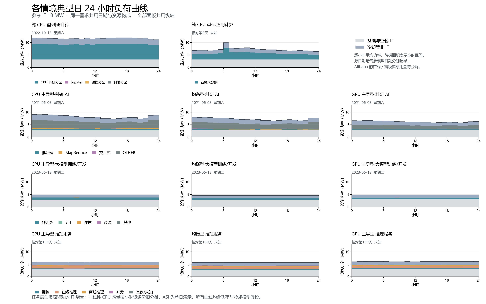

# 数据中心任务时间柔性简表

2026-10-31

## 一、情境定义：服务器规格 × 需求

| 服务器规格 ＼ 需求 | 科研计算 | 云通用计算 | 科研 AI | 大模型训练/开发 | 推理服务 |
| --- | --- | --- | --- | --- | --- |
| A 纯 CPU 型（2∶0） | Lisa | Alibaba 2018（5 个完整日） | — | — | — |
| B CPU 主导型（2∶1） | — | — | MIT Supercloud | Acme | ASI |
| C 均衡型（2∶2） | — | — | MIT Supercloud | Acme | ASI |
| D GPU 主导型（2∶8） | — | — | MIT Supercloud | Acme | ASI |

格中为该情境使用的需求数据，— 表示不设该组合。11 个组合各取参考 IT 功率 1／10／100／500 MW 四档规模，共 44 个情境，命名为“服务器规格·需求·规模”，例如 GPU 主导型·大模型训练/开发·100MW。括号内为每台服务器的 CPU∶GPU。

## 二、任务类型与时间柔性

✓ 可以　　◐ 有条件　　✗ 不行　　？ 未知　　（占比为各数据集自身的 GPU 小时，Lisa 为核心小时，不同数据集之间不能相加）

| 任务类型 | 主要占比 | 时间迁移 | 迁移代价参考：现状排队 P50／P90 | 中途拆分 | 拆分代价：每拆一次损失卡时；每段最短时长 | 关键约束 |
| --- | --- | --- | --- | --- | --- | --- |
| 预训练 | Acme 95.5% | ✓ | 13 秒／1.5 分钟（作业时长 P90 11.8 小时） | ◐ 检查点处 | 512–1024 卡 × H 5–30 分钟 ＝ 43–512 卡时；每段 ≥ 1.6–9.5 小时 | 整组卡同停同启 |
| 微调 SFT | Acme 0.2% | ✓ | 11 秒／13 秒（作业时长 P50 0.9 小时） | ◐ 检查点处 | 48–64 卡 × H 1–10 分钟 ＝ 0.8–11 卡时；每段 ≥ 0.3–3.2 小时 | 同预训练，规模小 |
| 训练（未细分） | ASI 22.7% | ◐ 低优先级部分 | 调度 1.9 分钟／5.7 分钟 | ◐ 需支持检查点 | 1–16 卡 × H 1–10 分钟 ＝ 0.02–2.7 卡时；每段 ≥ 0.3–3.2 小时 | 分不出预训练与微调 |
| 离线推理 | ASI 22.4% | ✓ | 调度 0 秒／4.0 分钟 | ✓ 按批次 | 1–4 卡 × 重新加载模型 1–5 分钟 ＝ 0.02–0.3 卡时；每批 ≥ 19–95 分钟 | 断点续跑、输出不重复 |
| 评估 | Acme 0.2% | ✓ | 18 秒／4.4 分钟（作业时长 P50 44 秒） | ✗ 无需拆 | — | 不能卡住下一轮训练 |
| 科研批处理（含 MapReduce） | MIT 22.2%；Lisa CPU 分区 99.98%、GPU 科研分区 97.9% | ✓ 整体延后 | MIT 批处理 9 秒／3.3 小时；MapReduce 1.3／70 小时；Lisa CPU 3.4 分钟／12 小时 | ✗ 启动后连续 | 没有检查点：中断即从头重算，损失 ＝ 已运行时长 × 卡数 | 多节点同时分配 |
| 在线推理 | ASI 49.5% | ✗ | — | ✗ | — | 时延与可用性，须持续在线 |
| 交互式／开发／调试 | MIT 4.2%；ASI 3.7%；Acme 1.4%；Lisa Jupyter | ✗ | — | ✗ | — | 有人在用，需即时响应 |
| 用途未知 | MIT OTHER 73.6%（未用 LLsub 提交，用途未标注）；Acme 2.6%；ASI 1.7%；Lisa 课程 1.9% | ？ | — | ？ | — | 暂按不迁移、不拆分 |

迁移代价：同样的工作量换个时段完成，额外耗电很少，主要代价是完成时间推迟。现状排队可作参考：科研集群用户已习惯数小时排队（P90 约 3–70 小时），AI 训练和推理集群几乎不排队（P90 不超过 6 分钟），延后数小时会明显改变服务水平。

拆分代价：每拆一次损失“卡数 × H”卡时，H ＝ 保存＋释放与重新调度＋加载恢复＋重算。开销控制在 5% 以内要求每段至少 19H。预训练 H 取 5–30 分钟（Google 多级检查点案例：恢复不到 1 分钟至 30 分钟）；其余 H 为假设，数据中均未测到。1 卡时约合 1.3 kWh（DGX H100 整机 10.2 kW ÷ 8 卡），预训练每拆一次约 0.05–0.65 MWh。

目前最有依据的柔性候选：ASI 低优先级训练＋离线推理，占 GPU 小时 22.7%。这是上限，实际可调比例未知。

## 三、各数据源概况

| 数据源 | 对应需求 | 时间跨度 | 记录方式与规模 | 作业时长 P50／P90 | 任务分类有多细 | 主要缺口 |
| --- | --- | --- | --- | --- | --- | --- |
| Lisa（荷兰 SURF 超算） | 科研计算 | 2021-12 至 2022-11，约 10 个月 | 逐作业 159.7 万条（CPU 分区 139.6 万、GPU 分区 20.1 万） | CPU 分区 25 秒／55 分钟；GPU 分区 4.6 分钟／5.0 小时 | 粗：只有 17 个分区（CPU／GPU、Jupyter、课程），无用途和算法 | GPU 卡数 |
| Alibaba 2018 | 云通用计算 | 8 天，采用 5 个完整日 | 4,034 台机器的 CPU 小时汇总 | 仅小时观测 | 粗：CPU 总用量，在线／离线实际占用未分解 | 在线／离线实际占用 |
| MIT Supercloud | 科研 AI | 2021-01 至 2021-10，约 9 个月 | 逐作业 39.6 万条，其中 GPU 作业 9.8 万；另有逐秒 GPU 监测 | 各类 2.2–3.0 小时／22–37 小时 | 粗：只有 4 种提交方式，OTHER 占 73.6%；官方标签约 3,425 个 DNN 作业（细分进行中） | 用途、算法 |
| Acme（上海 AI Lab Kalos 集群） | 大模型训练/开发 | 2023-05 至 2023-08，约 3 个月 | 逐作业 6.2 万条（GPU 1.99 万、CPU 4.25 万） | 预训练 11 分钟／11.8 小时；评估 44 秒／14 分钟 | 细：预训练、SFT、评估、调试、其他 | RL 标签、检查点记录 |
| ASI（Alibaba GPU 2026） | 推理服务 | 原始 185 天，目前只用 1 天（第 109 天） | 按 pod×服务器×小时观测 282 万条，52.5 万个 GPU pod | 无法计算（只有小时观测） | 中：6 类业务（训练、在线推理、离线推理、开发等）＋高／低优先级＋模型领域 | 完整作业时长；只有 1 天 |

作业时长为单个作业从开始到结束的时长。Lisa 的 GPU 分区没有卡数字段，只能用宿主 CPU 核心小时计量。

## 四、各情境典型日负荷曲线



选日：完整日先按日电量接近中位数选取，并列时取日内 RMSE 最小者；GPU 需求以 GPU 主导型选日，三种规格共用日期和任务构成。

规模：参考 IT 10 MW，沿用整机台数取整；其他规模按台数比例缩放，曲线形状不变。

来源：Lisa、MIT、Acme 按作业与小时重叠秒数累计资源小时，ASI 用第 109 天小时观测；Alibaba 用五个完整日 CPU 汇总，业务未分解。

不确定性：基础与空载 IT 独立列示；v2 功率与冷却均含假设，气象采用既有参考网格重放；ASI 及 Alibaba 的日历日期和星期未知。

## 数字来源与说明

- 任务类别、占比、排队与作业时长、卡数：PR #26 结果目录 `dc-flexibility-project/results/job-flexibility-constraints-20261030/`（`server-classes.csv`、`asi-classes.csv`、`mit-classes.csv`、`candidate-bounds.csv`、`checkpoint-sensitivity.csv`）。本简表依赖 PR #26，建议先审 PR #26。
- 情境命名沿用 PR #27 的规范（`docs/scenario-naming.md`）；2026-10-31 已移出 E 纯 GPU 型（整柜液冷），剩 11 个组合。
- 拆分代价中的 H：预训练取 5–30 分钟，依据 Google 多级检查点案例（恢复不到 1 分钟至 30 分钟）；其余任务的 H 为研究假设，数据中均未测到。卡时折算电量按 DGX H100 整机 10.2 kW ÷ 8 卡。
- MIT 的 OTHER 类（73.6%）正在 PR #28 中用官方模型标签和作业特征细分，结果出来后更新“用途未知”一行。

- 第四章图与逐小时分任务汇总：[`results/scenario-typical-day-by-task-20261031`](../../results/scenario-typical-day-by-task-20261031/README.md)，选日评分见 `*-day-selection.csv`，日期、峰谷与全年电量核对见 `summary.csv`；生成与功率分层见 `analysis/build_scenario_typical_days.py` 和 `plot_scenario_typical_days.py`，功率和 PUE 沿用 `results/typical-load-curves-20261029-v2/` 中央口径。

## 重新生成

```
npm install
node build.js 数据中心任务时间柔性简表.docx README.md
```

脚本重新生成时会保留“数字来源与说明”和“重新生成”两节，并补充第四章图件与数据来源。
