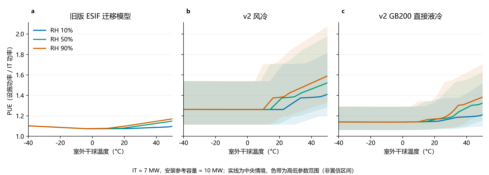

# 风冷与 GB200 直接液冷冷却模型

输入基线为 `origin/main` 的 `8b7c6eb`（已合并PR #13），模型版本 `cooling-20261028-v2`。本目录保存重新建立的物理/半经验模型、参数敏感性、2025年真实天气重放及外部量级校验。目标设施尚无成套电表与供回水测量，新模型的工程情境参数不解释为实测拟合值。

## 旧模型的适用范围与外推

旧版以ESIF 5447个同时间小时拟合非负分段线性响应。ESIF的[官方设计说明](https://www.nlr.gov/computational-science/hpc-data-center)明确采用温水液冷，没有机械或压缩机冷却，并报告年化PUE1.036。将该系统的低辅助能耗系数用于普通风冷设施，缺少冷却结构匹配依据。低PUE本身在高效设施中确实存在；[Google公开实测](https://www.datacenters.google/efficiency/)的2024年第四季度全年滚动PUE为1.09。

旧模型未显式识别送风/供液设定、冷机COP、经济器控制、UPS或配电效率。以本次相同7 MW IT、10 MW参考容量和真实天气为例，原模型冷却电量/IT电量为8.270%，`other_mw`仅为0.191%；v2中央风冷分别为23.710%和8.150%。新设定的UPS和配电损耗进入电量及散热链，改变了设施边界的辅助用电量。ESIF的672小时留出RMSE只检验原场站的短期响应，不保证其他冷却系统或气候的精度。

标定范围为干球−19.3096～38.1269°C、露点−29.4160～17.6794°C、IT/安装参考功率0.23148～1。该范围是边际包络，包络内部也不代表温湿度所有组合都有测量。湿度限制随干球改变，不能转换为一个适用于所有温度的固定RH区间。例如30°C时，高露点边界对应RH约48%；更湿的天气超出露点范围。

网格 `g05_r100_c592`、中心原生节点289905的2025年天气为：干球−12.5148～40.1422°C、露点−32.2972～28.0754°C、RH 4.779～100%。共1903小时超出旧温湿度范围，分项没有重叠：

| 条件 | 小时 |
| --- | ---: |
| 干球低于−19.3096°C | 0 |
| 干球高于38.1269°C | 17 |
| 露点低于−29.4160°C | 9 |
| 露点高于17.6794°C | 1877 |

旧版 `extrapolation="flag"` 继续对真实温度、露点应用原铰链函数：热端和高露点端线性延长末段斜率；低露点端正部函数逐渐归零；低温端继续延长伴热项。没有裁切天气，没有引入COP变化或容量不足判定。`"error"`拒绝超范围输入。原结果与原参数保持可复现，v2在明确的−40～50°C、RH 0～100%计算域内采用物理关系，域外报错。

逐条件统计见[legacy-diagnosis.json](legacy-diagnosis.json)，温度×湿度分箱见[legacy-weather-bins.csv](legacy-weather-bins.csv)。

## 结构、参数及来源

[完整参数表](parameter-register.csv)逐项保存中央/高/低值、单位、来源URL及assumption标记；[机器可读资产](../../analysis/compute_load/assets/cooling-20261028-v2.json)同时保存固定假设。来源阅读范围和访问记录见[来源元数据](../../data/metadata/cooling-recalibration-20261028-v2.json)。

| 参数 | 低能耗 / 中央 / 高能耗 | 依据与性质 |
| --- | --- | --- |
| 机房送风温度 | 22 / 22 / 20°C | [ASHRAE TC9.9](https://www.ashrae.org/file%20library/technical%20resources/bookstore/supplemental%20files/therm-gdlns-5th-r-e-refcard.pdf) H1推荐18～22°C、A1-A4推荐18～27°C；具体设定为assumption |
| 空气升温、机房压降、风机效率 | 15/12/10 K；600/1000/1400 Pa；75/65/55% | [DOE 2024指南](https://www.energy.gov/sites/default/files/2024-07/best-practice-guide-data-center-design_0.pdf)支持按空气输送与效率分解；具体值为assumption |
| 冷冻水供水、供回温差 | 18/16/13°C；8/6/5 K | 送风减盘管温差4/6/7 K；assumption |
| 塔水与湿球温差、经济器换热温差 | 4/5/6 K；1/2/3 K | assumption；塔水最低5°C并采用低温旁通 |
| 参考冷机COP | 7.5 / 6.5 / 5.5 | [Daikin CAT605-8](https://tahoeweb.daikinapplied.com/api/general/DownloadDocumentByName/media/CAT%20605-8.pdf/)印刷页8满载示例6.5；页14参考工况44°F冷冻水、85°F冷凝器进水。高低值、温度修正及部分负载系数为assumption |
| UPS、设施配电效率 | 98/96/94%；99/98/97% | DOE指南指出现代双变换UPS效率可达95%以上；具体组合及部分负载迁移为assumption |
| 电气固定损耗、照明控制 | 0.2/0.5/1.0%；0.4/0.8/1.5%安装容量 | assumption；IT内部PSU及机内风机已在IT输入中 |
| 液冷热量占比 | 90 / 87.121 / 80% | [QCT GB200资料](https://blog.qct.io/wp-content/uploads/2025/04/QCT-Qoolrack-Stand-Alone_Advanced-Liquid-Cooling-for-NVIDIA-GB200-NVL72-Systems.pdf)第4页115kW液冷、17kW空气；比例转移至目标柜及部分负载为assumption；[NVIDIA硬件说明](https://docs.nvidia.com/dgx/dgxgb200-user-guide/hardware.html)确认CPU/GPU冷板和残余风冷 |
| 二次供液、CDU温差、一次供液 | 40/35/30°C；5 K；35/30/25°C | QCT第3页最高进液45°C、回液65°C；设定值为assumption。设施供液分别位于ASHRAE W40/W32/W27上限以内 |
| 液冷回路温升、干冷器温差 | 12/10/8 K；4/5/7 K | assumption；中央二次回液45°C |
| CDU总用电/所冷却热量 | 0.8 / 1.4963 / 2.5% | [Vertiv手册](https://www.vertiv.com/4aad4c/globalassets/shared/liebert-xdu1350-coolant-distribution-unit-installation-and-commissioning-guide-sl-70625.pdf)表4.5典型20.2kW，借用[1.35MW级容量](https://www.vertiv.com/fr-emea/products-catalog/thermal-management/high-density-solutions/liebert-xdu1350-coolant-distribution-unit/)构成情境比例；含二次泵与CDU控制，不是同工况实测曲线 |
| 一次液冷泵压降、效率 | 100/180/280 kPa；80/70/60% | assumption；流量由热量、温升及防冻液热容推导 |

风冷采用封闭循环机房、水侧经济器、水冷冷机和冷却塔。设空气支路基础热量为 `Q0`，包括对应IT热量、UPS/配电损耗及照明控制。风机比率 `a=压降/(空气密度×1006×空气温升×风机效率)`，计入自身热量后的机房风机功率为 `a×Q0/(1−a)`。水泵采用同样的热反馈关系，泵比率由 `压降/(密度×热容×水温差×效率)`计算。室内空气密度按设定温度、50%RH及输入气压计算，标准气压为缺省假设。

冷却塔可供水温 `max(5°C, 湿球+塔温差)`，经济器可供水再加换热温差。自然冷却热量比例为 `clip((回水温度−可供水温)/供回水温差, 0, 1)`。中央风冷湿球≤9°C为完全自然冷却，9～15°C部分自然冷却；相同网格全年有4271小时完全自然冷却。

机械冷量为剩余热量，压缩机功率为机械冷量/COP。COP先以6.5参考值归一化，乘以蒸发绝对温度之比、参考温升/实际温升之比，再限制中央上限12，并乘以 `1−0.15×(1−min(IT/容量,1))`。中央蒸发/冷凝换热温差为2/3 K，有效最低温升10 K。该代理描述温升增大时效率下降，未假装取得厂商完整选型曲线。

GB200直接液冷把87.1%IT热量送入CDU和设施一次泵，残余12.9%及室内辅助热量进入上述风冷支路。中央一次供回液30/40°C、干冷器温差5 K，干冷比例为 `clip((35−干球)/10,0,1)`。剩余热量先采用塔侧自然冷却；中央湿球≤23°C可提供完全塔侧自然冷却，更高时计算部分经济器和冷机补冷。该网格6695小时可完全干冷，1033小时需要液冷支路的部分机械补冷；空气支路的机械补冷另外核算。

塔风机为排热量乘以最低比率及可变比率，湿球≤5°C保持最低运行，5～25°C按归一化速度三次方增加。干冷器风机在干球−10～25°C按同样方式增加。两者均为assumption；冷凝/塔水泵独立核算并计入自身热量。室外−15°C以下增加伴热，中央为每降低1 K增加0.002%安装容量。−40°C假设室外防冻液隔离回路、旁通和伴热已经配置，未验证具体设备的结霜、黏度或容量降额。

供回液温差固定时，CDU及闭式一次泵主要随IT热量改变；塔侧泵随进入塔的剩余热量及压缩机用电改变。天气通过经济器比例、干冷器分担比例、风机转速和冷凝温度改变冷源电耗。中央机房风机压降/效率推导约0.73 W/cfm，与DOE指南的0.75 W/cfm良好实践指标接近。

所有设施电功率为IT、冷却和其他损耗之和。IT路径经过UPS/设施配电，冷却馈线直接供电，其损耗集总于设备效率。全部室内电气损耗进入空气支路，CDU及水泵自身热量进入水路；风机向室外排热时单独核算。公开W级指设施水温等级，不能代替具体机柜及CDU认证。

## 网格全年对照

以下均采用相同真实天气、8760小时和全年电量之比。标准试验固定IT=7 MW、安装参考=10 MW，用于单独比较冷却结构；不代表观测业务需求。高低参数是联合敏感性情境，非置信区间。

| 输入与冷却方式 | 旧版PUE | v2中央PUE | v2低～高 | 中央冷却电量/IT电量 |
| --- | ---: | ---: | ---: | ---: |
| 相同7 MW IT，风冷 | 1.084609 | 1.318599 | 1.139862～1.661476 | 23.710% |
| 相同7 MW IT，GB200液冷结构 | 原版无液冷模型 | 1.157412 | 1.067656～1.362033 | 7.592% |
| PR13冻结C20×Lisa IT，风冷 | 1.074695 | 1.311211 | 1.136760～1.644557 | 23.278% |
| PR13冻结GB200×Acme IT，直接液冷 | 原版仅IT | 1.162343 | 1.069729～1.374163 | 7.682% |

最后两行只重放两个既有中央IT输入作抽查，其文件SHA-256与PR13完全一致，绝对IT功率继续保留原假设和来源边界。未重新构建全部典型日、周或全年曲线，也未改变Lisa GPU需求。不同设备的两行不代表等吞吐服务比较。

[annual-comparison.csv](annual-comparison.csv)保存完整精度和自然冷却小时数；[g05_r100_c592-2025-hourly.csv](g05_r100_c592-2025-hourly.csv)保存标准试验逐小时旧版、新风冷及新液冷的冷却功率、设施功率、PUE和两种冷却比率。比率分母在字段名中分别为IT与设施。两个冻结IT输入的逐小时抽查见[C20](C20-Lisa-2025-hourly.csv)和[GB200](R-GB200-Acme-2025-hourly.csv)；原始IT文件保持原样。

## 响应图与验证



图：相同7 MW IT和10 MW安装参考容量下，旧版ESIF迁移模型、v2风冷及v2直接液冷的PUE响应。蓝、绿、橙线分别表示室外RH 10%、50%、90%；实线为中央情境，色带为同一湿度下联合改变参数的高低范围。温度每0.25°C计算，色带不表示置信区间。旧版图含超标定范围外推。[PNG](pue-temperature-response.png)为300 dpi，[PDF](pue-temperature-response.pdf)嵌入中文字体，[CSV](response-curves.csv)为作图数值。

五处2025年真实ERA5气候下，标准热负荷中央风冷PUE为1.2795～1.3661、液冷1.1435～1.1708。芬兰卡亚尼为低温端，盖恩斯维尔为暖湿端；这里的地点仅提供气候，不将假设设备解释为各场站真实硬件。

| 2025气候 | 中央风冷PUE | 中央液冷PUE |
| --- | ---: | ---: |
| 芬兰卡亚尼 | 1.2795 | 1.1435 |
| 意大利博洛尼亚 | 1.3198 | 1.1555 |
| 美国橡树岭 | 1.3303 | 1.1585 |
| 美国孟菲斯 | 1.3443 | 1.1644 |
| 美国盖恩斯维尔 | 1.3661 | 1.1708 |

外部校验依据包括[Uptime 2024调查](https://uptimeinstitute.com/uptime_assets/7425ec68d479c5d78a743df94a79b114ed9f9c73f13b6460949d2b8e73373209-GA-2024-07-uptime-institute-global-data-center-survey-results-2024.pdf)：526个回答的平均PUE为1.56，近期新建设施常见1.3或更低；[LBNL 2024报告](https://escholarship.org/content/qt32d6m0d1/qt32d6m0d1.pdf)的2023年美国总体估计约1.4、hyperscale/colocation低于1.4；Google公开实测1.09提供高效率端参照。中央风冷处于现代高效设施量级，高能耗风冷情境约1.60～1.75，低能耗液冷情境约1.06～1.07。本次没有用调查总体平均强制设定每个网格PUE，也未将不同设施的年度数值当作同站点预测误差。

定向验证覆盖227430个明确的温湿度/IT负载边界实验，以及35088个真实天气CPU/GPU旧版回归小时。检查负功率、热量守恒、RH 0/100%、−40/50°C、IT/C=0.05/0.25/0.7/1/1.1、湿度单调性、−15°C以上温度单调性、高低参数顺序、UTC完整平/闰年、17类异常/版本误用、Parquet回读和输入指纹恢复。−15°C以下的小幅伴热上升符合已声明控制。热量平衡误差约10⁻¹⁴ MW；旧版回归逐项完全一致。详见[validation.json](validation.json)、[extreme-conditions.csv](extreme-conditions.csv)和[climate-validation.csv](climate-validation.csv)。

## 调用与复现

接口和全球网格CLI示例见[模块文档第9节](../../docs/compute-load-module.md#9-版本化风冷与-gb200-直接液冷设施模型)。`CoolingModel(cooling_type="air"/"direct_liquid", parameter_set="low"/"central"/"high")`接收已有IT功率，不改变任务或设备功率映射。旧版由 `version="cooling-20261025-v1"`显式调用，旧 `ComputeLoadModel`及全球入口默认继续原版本。

```powershell
python -m pip install -r analysis/requirements-cooling-v2.txt
python analysis/build_cooling_recalibration.py --input-project C:/path/to/restored-project --typical-project C:/path/to/PR13-project
python analysis/verify_cooling_v2.py --input-project C:/path/to/restored-project --typical-project C:/path/to/PR13-project
```

`input-project`需已有PR13天气文件及映射、五地点天气和原资源库；`typical-project`需PR13的两个冻结中央IT Parquet。输入只读，所有新结果保存当前worktree。[manifest.json](manifest.json)记录输入、参数及代码校验值。公共仓库保存链接、事实、参数与派生结果，公开资料全文仅在忽略目录阅读。

## 待解决的科学与工程边界

需要具体目标机柜的供回液/流量、部分负载液冷占比及CDU交流电功率，目标机房风量/压降、冷机完整选型曲线、分项电表和同步气象，才能开展独立实测误差校验。当前压降、换热温差、泵/风机控制及COP温度修正均保留assumption。极端天气覆盖表示模型计算域，未证明工程设备在−40～50°C均无降额地满足容量。

室内封闭循环和50%RH为假设；渗透、通风、湿度控制、建筑得热、蓄热及额外网络/存储需按具体设施补充。塔侧供水和无限制可用补冷容量为情境条件，尚未计算用水、用水约束、结垢、结霜、极寒黏度及容量失效。实际全球网格输入宜提供气压；本次标准气压假设已记录。设备规模效率和冗余控制没有单独标定。全部典型曲线重算、调度收益及CFE验证按后续需求处理。
