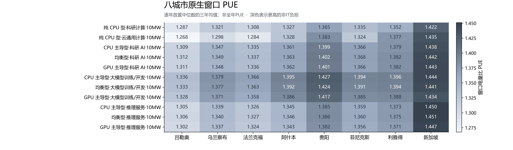
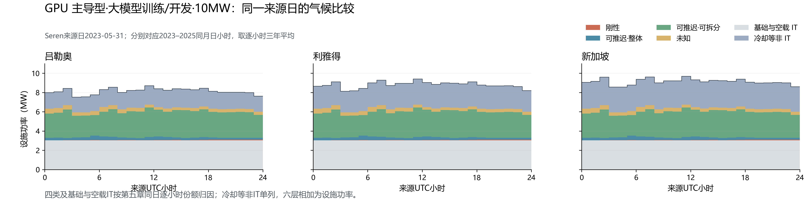

# 八城市原生窗口负荷、冷却与四类任务构成

同第五章原生窗口和组合模型，使用冻结2023–2025逐小时气温、露点、气压；冷却为cooling-20261028-v2风冷。

## 气候概况

每城冻结气象覆盖2023-01-01至2025-12-31 UTC共26304小时；平均气温、露点和阈值小时比例均按实际小时等权。露点≥20°C表示高水汽含量，不等同于相对湿度阈值。气压进入湿空气性质及风机功率计算。

| 城市（由冷到热） | 平均气温°C | 平均露点°C | 气温≥30°C小时% | 露点≥20°C小时% |
| --- | --- | --- | --- | --- |
| 吕勒奥 | 4.0 | 0.5 | 0.0 | 0.1 |
| 乌兰察布 | 5.4 | -4.3 | 0.2 | 0.2 |
| 法兰克福 | 11.5 | 6.7 | 0.8 | 0.1 |
| 阿什本 | 14.5 | 7.3 | 4.3 | 10.4 |
| 贵阳 | 16.1 | 12.1 | 1.2 | 15.6 |
| 菲尼克斯 | 24.0 | 3.4 | 32.8 | 0.9 |
| 利雅得 | 26.9 | 2.3 | 39.9 | 0.0 |
| 新加坡 | 27.6 | 24.6 | 13.2 | 100.0 |

## 10MW设施平均功率（MW）

主表每年对12次实际放置的设施均值取中位数，再等权平均三年；有日期来源每年一次对应。范围保存三年全部放置极值。PUE为各窗口设施/IT电量比的逐年放置中位数再平均，非全年PUE。

正文取纯CPU型科研计算、纯CPU型云通用计算及GPU主导型科研AI/训练/推理五个代表组合；全部8城市×11情境88行及264个城市年份情境、1320个实际窗口见city-summary.csv、year-summary.csv、case-summary.csv。

| 城市 | 纯 CPU 型·科研计算·10MW | 纯 CPU 型·云通用计算·10MW | GPU 主导型·科研 AI·10MW | GPU 主导型·大模型训练/开发·10MW | GPU 主导型·推理服务·10MW |
| --- | --- | --- | --- | --- | --- |
| 吕勒奥 | 9.675 | 7.186 | 6.237 | 8.125 | 5.685 |
| 乌兰察布 | 9.932 | 7.360 | 6.413 | 8.387 | 5.840 |
| 法兰克福 | 9.836 | 7.281 | 6.357 | 8.307 | 5.786 |
| 阿什本 | 9.980 | 7.527 | 6.479 | 8.480 | 5.871 |
| 贵阳 | 10.264 | 7.839 | 6.664 | 8.673 | 6.045 |
| 菲尼克斯 | 10.042 | 7.505 | 6.501 | 8.472 | 5.916 |
| 利雅得 | 10.170 | 7.806 | 6.573 | 8.491 | 5.998 |
| 新加坡 | 10.695 | 8.135 | 6.867 | 8.775 | 6.347 |

城市间设施平均功率的绝对差异以纯 CPU 型·科研计算·10MW最大，为1.021MW（吕勒奥至新加坡）；相对差异以纯 CPU 型·云通用计算·10MW最大，为13.2%。

同一GPU主导型训练情境，吕勒奥至年平均最热的新加坡设施均值由8.125增至8.775MW，差0.651MW；城市间冷却等非IT为2.006–2.657MW。

## 四类与冷却构成

四类及基础空载IT按第五章原生窗口份额归因城市IT，冷却等非IT单列；三城典型日采用第五章同日逐小时IT份额。

设施分解为四类IT增量、基础与空载IT、冷却等非IT六层。固定IT份额是核算归因，不声称各城市具有相同的实际业务构成；冷却未分配给可推迟类。每年偶数个放置的设施中位数取中间两次，同批IT和非IT指标配对平均，确保六层守恒，再等权汇总三年；PUE独立按窗口比值取中位数。

facility-composition.csv提供88组合×6层的平均MW和设施占比；typical-day-city-year.csv保留24个城市年份的同一训练来源日，typical-day-city-three-year.csv为三年逐小时均值。图取吕勒奥、利雅得和新加坡，源日固定2023-05-31，无重新选日；城市三年图不代表特定年份的实测设施曲线。

IT推迟可能同时改变冷却功率，方向和幅度取决于执行时刻的温湿度与设备负载；此处未改变调度，不能据此给出柔性可调电量。

## 原生窗口、复用与验证

Lisa309天、Alibaba120小时、MIT237天、Seren2057个合格小时、ASI185天；不循环、不补全年。日期来源按源月日小时对应各城市目标年；无日期来源在12个月初放置、年末截断，范围含天气及源前缀变化。Seren189内部缺口小时、54连续片段保持。

非训练1248个10MW城市窗口复用组合模型原生结果（#34窗口、#35推理、#36 CPU），训练72个窗口复用#38 Seren正文main；总1320份小时文件逐份核对原manifest SHA-256、温度/露点/气压对应、原生长度、日期或放置及截断、功率电量汇总与IT/冷却/其他分项守恒。8份冻结天气逐份匹配#34/#38相同输入SHA-256，三年UTC索引完整。24个GPU主导型Seren城市年份窗口另用当前同参数冷却模型重算核对。

verification.json记录上游小时和气象指纹、冷却复算误差、输入溯源及方法。manifest.json保存本机文档输入和旧目录指纹；brief-audit.json记录独立汇总及Word/PDF检查。新章节主表选5代表，PUE热力图包含全部11情境。

## 局限

仅三年气象、各来源不同原生窗口；无日期来源的放置和年末截断影响比较。新加坡采用1.50°N、104.00°E柔佛陆地占优格点（陆地比例0.729），为区域代理。风冷采用水侧经济器和水冷冷机，室外适用−40至50°C；设备、湿度及压降参数为工程情景，未作目标设施实测拟合。

## 复现与审阅

collect_eight_city_native.py --prepare准备冻结索引；launch_eight_city_native.sh在共享卷以setsid nohup后台核验并输出进度；report_eight_city_native.py汇总、制图及生成Word输入；build.js生成简表，Word原生导出PDF逐页检查。计算仅读取旧目录，所有新输出独立保存。MIT流式目录、STOP及看门狗保持原状。

同一PR #37继续审阅，依赖#27；#30→#32、#33；#34、#35、#36→#38；#31；#37。不合并。
