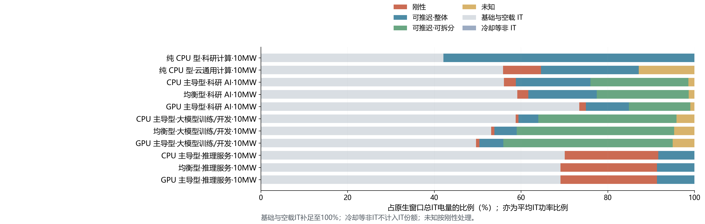
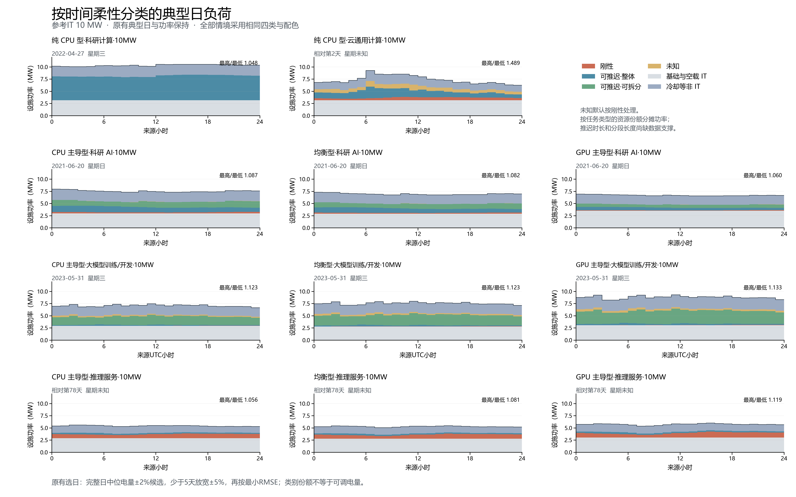
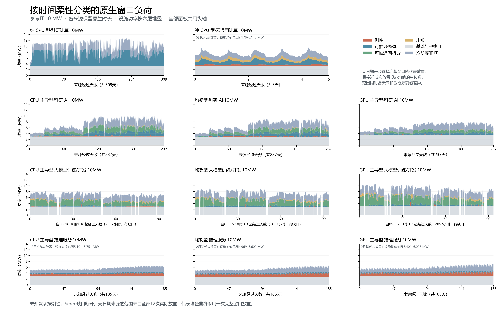

# 按推迟与拆分能力统一的四类任务负荷

采用用户确认的①刚性、②可推迟·整体、③可推迟·可拆分及未知分类；未知默认按刚性处理、仍单列以显示证据缺口。此映射为研究情景分类，未从排队、优先级或运行形态推断真实调度权限。

正文代表名称表每格一个名称，原始细类完整映射见task-class-mapping.csv。评测统一用中文“评测”，源Seren字段Eval对应此类。

## 10MW原生窗口IT份额

分母为参考网格2025气象下同一完整原生窗口的总IT电量。每类平均功率=该类窗口电量/保留小时数，所以平均功率份额与电量份额完全相同；同表报告两者。基础与空载IT单列，与四类合计100%；冷却等非IT不计入IT分母。

按原有模型，用逐小时CPU/GPU任务资源份额分摊超过无任务端点的动态IT功率，再按确认映射合并；推理在线/离线GPU仍采用各自功率公式，Seren共用同小时监测反推比例。表中为模型归因份额，缺少推迟时长、最短分段、存档恢复成本及服务期限数据，不据此给出可调电量。

| 情境（参考IT 10MW） | ① 刚性% | ② 可推迟·整体% | ③ 可推迟·可拆分% | 未知% | 基础与空载 IT% |
| --- | --- | --- | --- | --- | --- |
| 纯 CPU 型·科研计算·10MW | 0.01 | 57.88 | 0.00 | 0.00 | 42.11 |
| 纯 CPU 型·云通用计算·10MW | 8.72 | 22.59 | 0.00 | 12.83 | 55.86 |
| CPU 主导型·科研 AI·10MW | 2.75 | 17.19 | 22.61 | 1.38 | 56.07 |
| 均衡型·科研 AI·10MW | 2.51 | 15.80 | 21.20 | 1.33 | 59.16 |
| GPU 主导型·科研 AI·10MW | 1.55 | 9.93 | 14.14 | 0.96 | 73.43 |
| CPU 主导型·大模型训练/开发·10MW | 0.66 | 4.56 | 31.88 | 4.14 | 58.76 |
| 均衡型·大模型训练/开发·10MW | 0.74 | 5.16 | 36.29 | 4.69 | 53.12 |
| GPU 主导型·大模型训练/开发·10MW | 0.79 | 5.53 | 39.03 | 5.03 | 49.61 |
| CPU 主导型·推理服务·10MW | 21.55 | 8.35 | 0.00 | 0.00 | 70.10 |
| 均衡型·推理服务·10MW | 22.28 | 8.63 | 0.00 | 0.00 | 69.09 |
| GPU 主导型·推理服务·10MW | 22.26 | 8.62 | 0.00 | 0.00 | 69.12 |



## 同一分类与配色的负荷曲线





图例固定为刚性、可推迟·整体、可推迟·可拆分、未知、基础与空载IT、冷却等非IT。典型日日期、小时功率与原版完全相同；仅合并分类并重画。

原生时序保留各来源时长：Lisa7416小时，Alibaba120小时，MIT5688小时，Seren2057个合格小时（189内部缺口小时保留，真实UTC时间不压缩），ASI4440小时。沿用日期气象对应及无日期来源12个月初放置、年末截断；原生统计不年化。

无日期来源先限定覆盖完整原生窗口的放置，再选择设施均值最接近全部12次实际放置设施均值中位数者；代表值是实际一次放置，不是逐小时中位数合成曲线。representative-placements.csv记录选择及全部放置的设施均值范围，范围同时含气象和截断源前缀差异。IT任务份额不受天气放置影响，直接取完整原生窗口；原有第五章汇总仍报告全部放置的中位数和范围。

## 文件与核验

native-class-summary.csv为每情境四类及基础层的窗口MWh、平均MW、电量占比和平均功率占比；shares-10MW.csv为11行情境汇总；native-by-task保留小时级原细类功率归因，native-hourly为六层小时功率；selected-days保留分类后24小时表及11份独立PNG/PDF。三个Word图件为典型日总览、原生堆叠时序及份额条形图。

manifest.json记录所有输入指纹、旧结果目录全部文件指纹及逐小时守恒/典型日不变检查。brief-audit.json记录独立数值核验、Word/PDF版面及逐页检查。未重算功率、冷却或典型日日期；MIT流式目录、STOP、看门狗及旧结果目录保持原状。

```powershell
python dc-flexibility-project/analysis/build_flex_classes.py
```

本机分类资源小时缓存为data/processed/scenario-typical-day-by-task-20261101-v3，逐份匹配既有manifest；Seren直接读取#38的合格小时与六类资源列，不使用旧训练缓存。Word由docs/job-flexibility-brief/build.js生成，用export_brief_pdf.ps1导出PDF并逐页检查，再运行audit_flex_classes.py。

同一PR #37继续审阅；依赖顺序：#27；#30→#32、#33；#34、#35、#36→#38；#31；#37。不合并。
