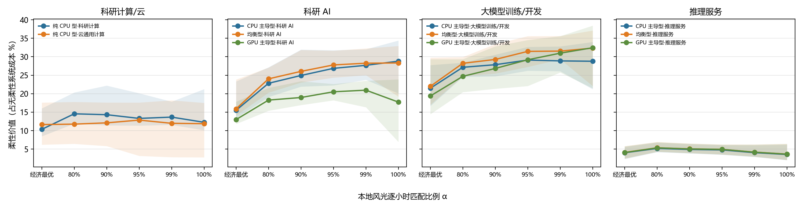
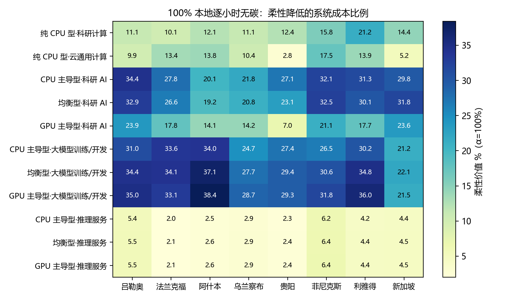

# 四类任务柔性的经济价值：onsite 风光储 + 市电优化（COPT）

第一版估算：在“本地风光逐小时匹配”目标下，数据中心任务柔性能把能源系统成本降低多少。11 个情境（参考 IT 10MW）× 八城市，求解器为杉数 COPT 8.0.7（内点法，单线程/算例），共 5,808 个线性规划。

## 口径（用户 2026-11-02 确认）

- **负荷**：第二章四类柔性小时层（`flex-class-20261101`，PR #37 f158845）。刚性、未知（按刚性）、基础与空载 IT 不可调；可推迟·整体最多推迟 **12 h**，可推迟·可拆分最多推迟 **48 h**，原生窗口末必须全部完成，执行后 IT 不超过装机 IT（≈10 MW）。
- **原生窗口**：Lisa 7,416 h、Alibaba 120 h、MIT 5,688 h、Seren 2,057 个合格小时、ASI 4,440 h，不循环成全年。无日期来源（Alibaba、ASI）用第五章代表放置（m05、m02）。
- **城市**：吕勒奥、法兰克福、阿什本、乌兰察布、贵阳、菲尼克斯、利雅得、新加坡。设施功率 = 逐小时城市 PUE（cooling-20261028-v2，2025 气象；训练取 #38 Seren 城市小时文件，其余取 v3-native-combined）× IT；风光容量因子取 10-29 八城市项目同一天气点 2025 年逐小时值。城市 IT 与 v10 分类层逐小时差值为 0。
- **供电**：光伏、风电、锂电储能（功率/电量独立）、市电。市电不能给储能充电；不向电网卖电。
- **0 碳目标**：α = 本地风光（含储能放电）逐小时覆盖设施用电的比例，扫描“经济最优（不约束）/80/90/95/99/100%”。α=100% 即严格 24/7 本地无碳（市电为 0）。
- **容量设计**：`opt` 风光储和市电接入容量全部由成本最优决定；`re_mean` 风光装机满足“窗口平均发电 = 无柔性平均设施负荷”（即“按均值建设”），其余仍优化。
- **成本**（2024 USD，沿用 `eight-city-flex-value-20261029.json`）：光伏 691、风电 1041 USD/kW（IRENA 2024），储能 361 USD/kW + 234 USD/kWh（ATB 2025），折现率 8%；市电 100 USD/MWh + 碳价 100 USD/t × 国家平均排放因子（Ember 2025）；新增市电接入容量费 120 USD/kW-年（10 USD/kW-月，情景假设，另做 0 的敏感性）。资本年费按窗口小时数/8760 分摊。
- **柔性价值** = 无柔性最优成本 − 有柔性最优成本（两者都重新优化容量）。“折算年值”= 窗口价值 × 8760/窗口小时，仅为量级换算，不是全年模拟。

## 主要结果（两类柔性同时启用，8 城市中位数（最小–最大））

柔性价值占无柔性系统成本的比例：

| 情境 | 经济最优 | 95% | 100% |
| --- | ---: | ---: | ---: |
| 纯 CPU 型·科研计算 | 10.3（8.5–16.0） | 13.3（11.4–20.1） | 12.3（10.1–21.2） |
| 纯 CPU 型·云通用计算 | 11.6（6.2–17.6） | 12.9（3.2–17.6） | 11.9（2.8–17.5） |
| CPU 主导型·科研 AI | 15.5（13.4–23.3） | 26.9（22.3–31.8） | 28.8（20.1–34.4） |
| 均衡型·科研 AI | 15.9（14.1–23.8） | 27.8（24.3–31.6） | 28.3（19.2–32.9） |
| GPU 主导型·科研 AI | 13.0（11.8–17.8） | 20.5（18.2–22.6） | 17.7（7.0–23.9） |
| CPU 主导型·大模型训练/开发 | 21.5（16.7–27.7） | 29.1（26.2–32.7） | 28.8（21.2–34.0） |
| 均衡型·大模型训练/开发 | 22.0（17.0–29.8） | 31.4（27.2–35.6） | 32.3（22.1–37.1） |
| GPU 主导型·大模型训练/开发 | 19.4（14.4–29.3） | 29.2（22.1–34.5） | 32.4（21.5–38.4） |
| CPU 主导型·推理服务 | 4.0（2.3–5.6） | 4.8（3.5–6.1） | 3.5（2.0–6.2） |
| 均衡型·推理服务 | 4.1（2.4–5.8） | 4.9（3.6–6.3） | 3.6（2.1–6.4） |
| GPU 主导型·推理服务 | 4.1（2.5–5.8） | 4.9（3.6–6.2） | 3.6（2.1–6.4） |



用钱表示（`table-lcoe-and-value.csv`）：

- **经济最优**：设施度电成本约 116–130 USD/MWh，柔性降到约 98–115。训练/开发节省 32–38 USD/MWh-IT（折合约 160–180 万美元/年·10MW），科研 AI 24–29，科研计算/云 14–17，推理约 7。
- **100% 本地无碳**：无柔性度电成本约 130–345 USD/MWh（科研计算 345、科研 AI 272–291、推理 260、训练 203、云 130），柔性节省训练约 76–79 USD/MWh-IT（约 330–420 万美元/年·10MW）、科研 AI 62–112、科研计算 53、推理约 12。
- 每推迟 1 MWh IT 电量的价值：经济最优约 150–180 USD，100% 时训练约 350、科研 AI 530–570 USD。

钱省在哪里（`table-saving-components-pct.csv`，各项占净节省的比例）：经济最优时，柔性让系统**多建风光**（多花的风光费用相当于净节省的 8–59%），换来市电电费+碳价（相当于净节省的 55–123%）和接入容量（9–34%）的下降；α≥95% 时净节省的 65–96% 来自**少建储能**。100% 时储能电量中位数：训练 151–188→65–73 MWh，科研 AI 160–192→87–107 MWh，推理基本不变（125–136→117–127）。

“按均值建设”的启示：经济最优下，有柔性时最优市电接入容量为平均设施负荷的 0.70（训练）–1.04（推理）倍，无柔性为 0.83–1.31 倍（设施峰值约为均值的 1.2–1.4 倍）。但风光若只按“年发电=平均负荷”建（`re_mean`），α=99%/100% 在所有城市都不可行，95% 只有部分城市可行，且 α=95% 时成本比全部优化高 18%（云）到约 20 倍（科研 AI）；100% 本地无碳需要风光发电量达用电量的 1.2–2.6 倍（弃电 14–59%）。

其他：

- **分解**：训练的价值几乎全来自“可推迟·可拆分 48h”（只开整体时 2–3%）；科研 AI 两者都有贡献（拆分约占 2/3）；科研计算、云、推理只有“整体”一类。
- **推迟时长**（两类同用 D，`table-deadline-sensitivity.csv`）：D=2/4/8/24h 时训练价值约 4–5/7–9/11–15/19–29%，基本随 D 近线性增长；推理 24h 也只有 5–7%。
- **市电接入费取 0**：经济最优下价值降 0.3–4 个百分点（训练 16–20%、科研 AI 11–13%），α≥95% 基本不变。
- **城市差异**（α=100%，`table-city-value-pct-100.csv`）：训练价值在阿什本、利雅得、吕勒奥最高（30–38%），新加坡最低（21–22%）；GPU 主导型·科研 AI 在贵阳仅 7%。



## 解释边界

- “可推迟·整体”只按较短截止期的流体模型近似，未建“开始后不可中断”的约束，价值偏乐观；“可拆分”的存档/恢复损耗未计。
- 推迟时长和可调份额均为情景假设（第二章分类不提供服务期限证据）；基础与空载 IT（占 IT 电量 42–73%）不可调，未考虑关机或降频。
- PUE 用逐小时比值线性化（推迟 IT 时冷却按当时 PUE 同比变化）；市电统一平价，无分时电价，柔性在电价上的套利价值未计；不向电网售电。
- 原生窗口长短不一，Alibaba 仅 120 h，结果受窗口季节影响；训练窗口内 189 h 缺口按连续小时处理。
- 风光装机无土地上限核验；排放因子为国家平均。
- `re_mean` 在 α=95% 有 35 个算例为数值边界未解（COPT 状态 5/7），已在 `status-counts.csv` 列出，不计入中位数。

## 文件

- `runs.csv` 全部 5,808 个算例的容量、成本分项、CFE、推迟电量和残差（最大守恒残差 9.9e-4 MW）；`paired-values.csv` 有/无柔性配对价值。
- `table-*.csv` 文中各表；`input-index.csv` 88 组输入的 SHA-256 与一致性检查。
- 逐小时调度（`opt` 设计，α=经济最优/95%/100%，1,056 份）在服务器 `/data3/dataset/ljt/flex-econ-20261102/out/hourly/`。

## 复现

```bash
# 服务器：venv 含 coptpy 8.0.7 与 pyarrow≥23；COPT_LICENSE_DIR 指向许可目录
python analysis/flex_econ_copt.py prepare --project . --output out \
  --flex-hourly <flex-class-20261101/native-hourly + representative-placements.csv> \
  --source-root /data3/dataset/ljt/global-grid-flexibility-20261023 \
  --supply-root /data3/dataset/ljt/eight-city-flex-value-20261029/inputs/phase-a
python analysis/flex_econ_copt.py run --project . --output out --workers 64
python analysis/report_flex_econ_copt.py --runs out/runs.csv --output results/flex-econ-copt-20261102
```

依赖：PR #37（四类分类）、#38（Seren 训练）、#34/#35/#36（原生窗口与功率模型）。本 PR 基于 #37 分支。
