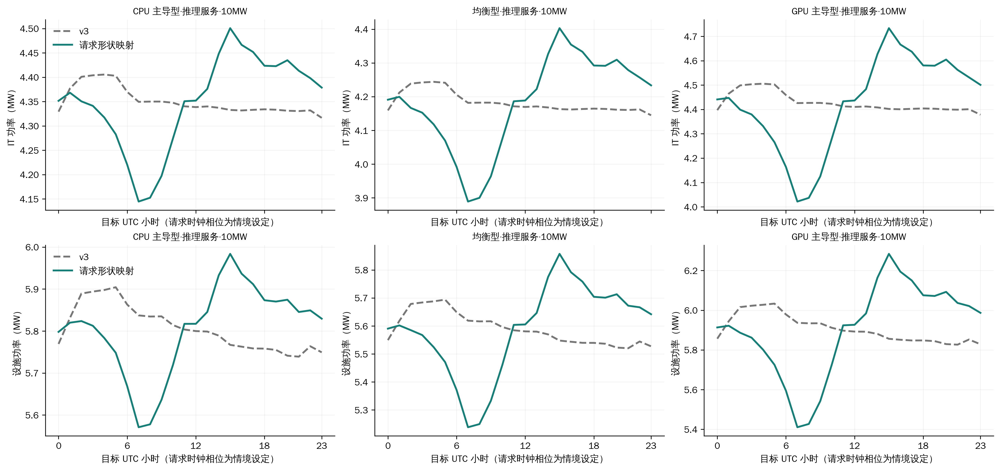
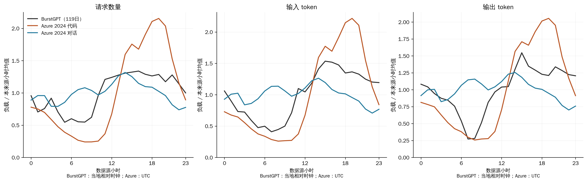
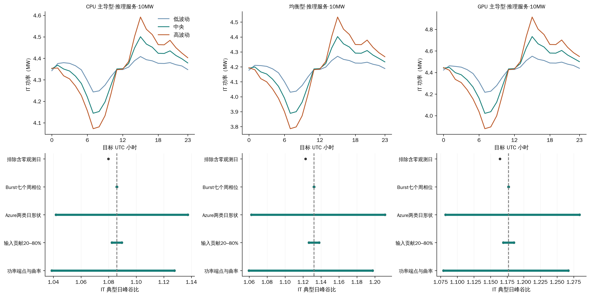
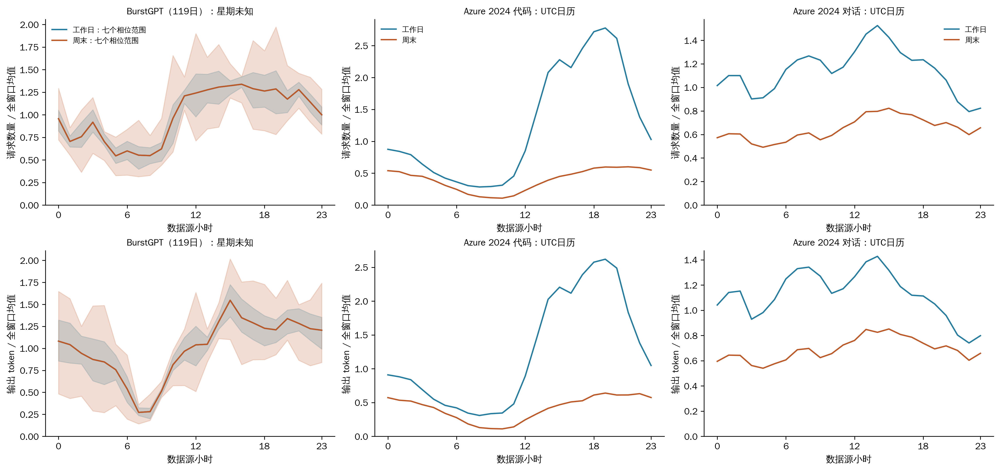

# 推理服务的请求形状与年度功率

输入版本为 PR #34 的 `ab07a41157442e837659535e1a33579ced5af8fa`，请求数据与处理入口依赖 #30。中央结果覆盖 **12 个推理情境、25 个地点×气象年、300 个全年小时文件、2,630,304 行新功率结果**。使用[服务器类型×用途×规模中文全称](../../docs/scenario-naming.md)。中央模型保留 v3 年度 IT 电量，设施电量的变化来自负荷与气象的对应关系及冷却部分负载响应。

## 请求负载的观测结果

各指标先按小时汇总，再除以各自窗口的小时均值。日内比为 24 个小时分组均值的最大/最小；168 小时比为星期相位×小时分组均值的最大/最小。请求/token 都归入**到达小时**，没有完成时间与 GPU 执行区间，不能称为实测执行功率。

数据来源：[BurstGPT 官方发布与KDD 2025论文](https://github.com/HPMLL/BurstGPT)（[DOI](https://doi.org/10.1145/3711896.3737413)）、[Azure 2023 官方说明](https://github.com/Azure/AzurePublicDataset/blob/master/AzureLLMInferenceDataset2023.md)、[Azure 2024 官方说明](https://github.com/Azure/AzurePublicDataset/blob/master/AzureLLMInferenceDataset2024.md)。下载URL和固定版本见审计元数据。

| 来源 | 小时分箱数 | 零观测小时 | 请求日内比 | 输入 token 日内比 | 输出 token 日内比 | 请求峰 / 谷小时 |
| --- | --- | --- | --- | --- | --- | --- |
| BurstGPT | 2856 | 149 | 2.455 | 3.750 | 5.677 | 16 / 05 |
| Azure 2024 代码 | 168 | 0 | 8.963 | 8.524 | 7.975 | 19 / 08 |
| Azure 2024 对话 | 168 | 0 | 1.783 | 1.786 | 1.790 | 14 / 22 |
| Azure 2023 代码 | 2 | 0 | 覆盖不足 | 覆盖不足 | 覆盖不足 | 18 / 19 |
| Azure 2023 对话 | 2 | 0 | 覆盖不足 | 覆盖不足 | 覆盖不足 | 18 / 19 |

BurstGPT 小时为作者定义的当地相对时钟，确切时区和日历起点未知。Azure 2024 时间戳带 `+00:00`，采用 UTC。各数据源时钟没有共同地理基准，曲线叠图只比较发布时钟下的形状。Azure 2023 两个文件的实际小时支持见表，覆盖不足 24 小时，因此不生成该来源的典型日或周内曲线；原小时汇总和 token 分布支持仍保留。2023 无偏移时间戳按 UTC 解析只是坐标标记，不能确认真实时区。

Azure 2023 官方概述写采集于2023-11-11，发布CSV的时间坐标实际为2023-11-16傍晚，各约一小时并跨越两个小时分箱；本次保留原表时间，不按概述改写日期，也不将这两个部分小时当作完整两小时暴露。

BurstGPT 前两文件共有 5,288,173 条请求；按 #30 的边界策略排除首尾日，选相对日1–119，共119日/2856小时。窗口内 5,252,477 条请求、1,853,340,790 输入 token、309,164,730 输出 token。149个零观测小时保留为零观测，采集缺失与真实零请求无法区分。失败/零输出请求保留，输入 token 不删除；无请求ID，不进行无依据去重。全时序含零时，原始小时最大/最小比未定义；表中有限比值只针对聚合典型日。

缺测敏感性排除任何含零观测小时的日期，剩余 **70 日**，请求日内比 **2.457**，输入/输出 token 日内比分别为 **3.364/5.498**。该筛选可能偏向高活动日期，作为覆盖敏感性，未当作缺失插补真值。

Azure 2024 两个文件完整读取，核对首尾时间戳距午夜边界均小于一分钟，保留各自7个完整日；小时空缺补零只限该窗口。两个服务日期并不完全相同，分别统计，不拼接成更长服务时序。仅七天，星期差异不能外推为稳定全年规律。

| 来源 | 窗口请求数量 | 平均输入 token/请求 | 平均输出 token/请求 |
| --- | --- | --- | --- |
| BurstGPT | 5252477 | 352.9 | 58.9 |
| Azure 2024 代码 | 16803695 | 2511.3 | 22.7 |
| Azure 2024 对话 | 27303999 | 1631.6 | 105.5 |
| Azure 2023 代码 | 8819 | 2047.8 | 27.9 |
| Azure 2023 对话 | 19366 | 1154.7 | 211.1 |

## 周内与工作日/周末

BurstGPT 119日恰为17周；报告 day modulo 7 的168小时形状，并额外逐完整周除以该周均值，检查增长与周形状的混杂，结果见 `request-shape-168h.csv`。真实星期未知，枚举 day0 为周一至周日的七种相位。工作日/周末比采用每小时均值，避免5日和2日天数造成偏差。

| 来源 | 请求168小时比 | 输入168小时比 | 输出168小时比 | 逐周归一化请求168小时比 |
| --- | --- | --- | --- | --- |
| BurstGPT | 11.365 | 12.931 | 20.752 | 23.738 |
| Azure 2024 代码 | 33.139 | 33.291 | 31.349 | 33.139 |
| Azure 2024 对话 | 3.560 | 3.354 | 2.898 | 3.560 |

| 来源 | 指标 | 周末均值 / 工作日均值 |
| --- | --- | --- |
| Azure 2024 代码 | 输入 token | 0.277 |
| Azure 2024 代码 | 输出 token | 0.338 |
| Azure 2024 代码 | 请求数量 | 0.319 |
| Azure 2024 对话 | 输入 token | 0.571 |
| Azure 2024 对话 | 输出 token | 0.612 |
| Azure 2024 对话 | 请求数量 | 0.568 |
| BurstGPT | 输入 token | 0.800–1.196 |
| BurstGPT | 输出 token | 0.694–1.355 |
| BurstGPT | 请求数量 | 0.708–1.203 |

BurstGPT 表中区间来自七种假定日历，不能识别真实工作日/周末。中央模型只叠加24小时形状；七个168小时相位以及 Azure 实际 UTC 周形状列入敏感性。目标年周内峰谷比同时受到 ASI 分配重放及目标日历影响，不能解读为观测到的全年服务周期。

## 请求负载到 GPU 功率

令 `I_h`、`O_h` 为24小时输入/输出 token 曲线，`W_h = α I_h/mean(I) + (1−α) O_h/mean(O)`，中央 `α=0.5`，敏感性为0.2/0.8，并提供纯请求数曲线。α代表两类 token 对**平均动态功率的假定贡献**；未测量每 token GPU 秒或焦耳，没有将输入和输出 token 按相同单价直接相加。缓存、模型、精度与批量差异保留为不确定性。

每张已分配在线 GPU：

`p_on,h = p_idle + (p_high−p_idle) × min(g W_h^γ, 1)`。

`g` 通过二分求解满足 `Σ a_on,h p_on,h = P_alloc,v3 × Σ a_on,h`，按目标年份和服务器类型校准。分配份额来自 ASI 的同一185日重放，未改变在线与离线资源口径。该公式为有界占空/负载响应近似，饱和仅限制平均功率；未验证吞吐或尾延迟，不能据此宣称给定硬件满足全部请求。

| 波动敏感性 | H100 PCIe 空闲/高负载 W | H100 SXM 空闲/高负载 W | γ |
| --- | --- | --- | --- |
| 低 | 80 / 175 | 160 / 350 | 0.7 |
| 中央 | 60 / 262.5 | 120 / 525 | 1.0 |
| 高 | 50 / 350 | 100 / 700 | 1.3 |

参数依据与假设边界：

- [微软 POLCA](https://arxiv.org/html/2308.12908v1)描述交互推理机群的日内功率及 prefill/decode 差异；实验为 A100，只作为机制依据。
- [Splitwise，ISCA 2024](https://arxiv.org/html/2311.18677v2)在 DGX H100 上说明 prefill 功率随 batch 上升，decode 对 batch 的功率响应较平，700→350W 功率限制对 decode 延迟影响很小。350–700W用于构建 SXM 高负载端点敏感性；中央525W为工程插值，没有声称为论文实测点。
- [DynamoLLM，HPCA 2025](https://arxiv.org/html/2408.00741v1)提供 H100 上输入/输出长度、负载、频率、并行度与能量的差异，支持分别处理两类 token。本文没有套用其关机、扩缩容或频率调节节电比例。
- [Model Parking Tax，2026预印本](https://arxiv.org/html/2605.23918v1)受控 H100 SXM 测得裸空闲71.8W、CUDA常驻空闲121.7W，生产样本常驻空闲均值145.5W。中央120W取常驻实验的近似值，100–160W为工程范围。PCIe 按350/700的TDP比例迁移，50–80W并无目标 PCIe 配对实测。γ和α均为情境假设，低中高范围均非置信区间。

总 GPU 功率：`P_GPU = N_GPU × [a_on p_on + a_off P_alloc,v3 + (1−a_on−a_off) P_unallocated,v3]`。中央分配功率仍锚定 `P_alloc,v3/TDP = 0.3358858887`，对应 PCIe **117.560W/张**、SXM **235.120W/张**，来自 v3 沿用的 MIT V100 P50 比例迁移，尚无 H100 同步表计校准。未分配 GPU 保留 v3 的50W/70W假设；离线批推理保留 ASI 原分配与固定每卡功率，不叠加用户日内形状。宿主 CPU 仍采用 v3 的0.25倍组合分配代理；基础IT和设备台数保持。

中央模型参考网格的实际在线每卡功率范围：

| 情境 | 实际最小–最大 W/张 | 校准均值 W/张 | 饱和小时 |
| --- | --- | --- | --- |
| CPU 主导型·推理服务·10MW | 79.634–148.735 | 117.560 | 0 |
| 均衡型·推理服务·10MW | 79.634–148.735 | 117.560 | 0 |
| GPU 主导型·推理服务·10MW | 159.268–297.469 | 235.120 | 0 |

## 与 v3 的全年对比

下表全部数值为**旧 / 新**，功率MW，参考网格2025年。峰值为全年小时最大值，日内比为24个同小时均值的比值。四档规模保留原整数台数及参考安装功率，未按新峰值重新定容。

| 情境 | IT 年均 MW | IT 峰值 MW | 设施年均 MW | 设施峰值 MW | IT 日内比 | 设施日内比 |
| --- | --- | --- | --- | --- | --- | --- |
| CPU 主导型·推理服务·1MW | 0.435 / 0.435 | 0.467 / 0.475 | 0.581 / 0.581 | 0.676 / 0.690 | 1.021 / 1.086 | 1.029 / 1.074 |
| CPU 主导型·推理服务·10MW | 4.351 / 4.351 | 4.674 / 4.753 | 5.807 / 5.806 | 6.761 / 6.897 | 1.021 / 1.086 | 1.029 / 1.074 |
| CPU 主导型·推理服务·100MW | 43.507 / 43.507 | 46.744 / 47.533 | 58.065 / 58.060 | 67.610 / 68.967 | 1.021 / 1.086 | 1.029 / 1.074 |
| CPU 主导型·推理服务·500MW | 217.537 / 217.537 | 233.718 / 237.665 | 290.326 / 290.302 | 338.050 / 344.836 | 1.021 / 1.086 | 1.029 / 1.074 |
| 均衡型·推理服务·1MW | 0.418 / 0.418 | 0.453 / 0.469 | 0.559 / 0.559 | 0.656 / 0.681 | 1.024 / 1.132 | 1.031 / 1.118 |
| 均衡型·推理服务·10MW | 4.183 / 4.183 | 4.535 / 4.691 | 5.589 / 5.589 | 6.560 / 6.810 | 1.024 / 1.132 | 1.031 / 1.118 |
| 均衡型·推理服务·100MW | 41.836 / 41.836 | 45.356 / 46.913 | 55.901 / 55.894 | 65.611 / 68.111 | 1.024 / 1.132 | 1.031 / 1.118 |
| 均衡型·推理服务·500MW | 209.180 / 209.180 | 226.784 / 234.564 | 279.506 / 279.473 | 328.057 / 340.558 | 1.024 / 1.132 | 1.031 / 1.118 |
| GPU 主导型·推理服务·1MW | 0.441 / 0.441 | 0.485 / 0.508 | 0.589 / 0.589 | 0.699 / 0.736 | 1.029 / 1.177 | 1.035 / 1.161 |
| GPU 主导型·推理服务·10MW | 4.428 / 4.428 | 4.864 / 5.101 | 5.906 / 5.905 | 7.011 / 7.386 | 1.029 / 1.177 | 1.035 / 1.161 |
| GPU 主导型·推理服务·100MW | 44.296 / 44.296 | 48.661 / 51.034 | 59.084 / 59.075 | 70.134 / 73.887 | 1.029 / 1.177 | 1.035 / 1.161 |
| GPU 主导型·推理服务·500MW | 221.491 / 221.491 | 243.317 / 255.184 | 295.436 / 295.389 | 350.687 / 369.455 | 1.029 / 1.177 | 1.035 / 1.161 |

| 10MW情境 | IT周内比：旧 / 新 | 设施周内比：旧 / 新 |
| --- | --- | --- |
| CPU 主导型·推理服务·10MW | 1.022 / 1.088 | 1.033 / 1.078 |
| 均衡型·推理服务·10MW | 1.026 / 1.135 | 1.036 / 1.123 |
| GPU 主导型·推理服务·10MW | 1.032 / 1.181 | 1.041 / 1.167 |

周内比采用目标星期×小时168个分组均值，四档规模保留同一比值。中央请求形状不额外指定真实星期，表中周内变化还包含ASI重放相位。

中央每个地点×年份的在线 GPU 电量按 ASI 分配加权守恒，离线GPU、未分配GPU、CPU和基础IT分别保持，因此年度IT电量不变。这是为了隔离日内功率形状的显式标定约束，不能作为已知真实年耗电量的证据。风冷重新计算完整气象链路，保留 `cooling-20261028-v2`、相同温湿度/气压和原安装容量；设施年均变化在全部25个地点×年份中为 **-0.0168% 至 +0.0196%**。变化包含负荷与气象相位的协方差及制冷部分负载非线性，未将新旧PUE直接相乘。

完整年均、峰值、日内及168小时周内比见 [v3-comparison.csv](v3-comparison.csv) 和 [annual-summary-all-locations.csv](annual-summary-all-locations.csv)。ASI 全源零资源异常（索引126）继续标识，未确认真实停机；全年原始极值和排除此异常的诊断分别保存。

## 敏感性与解释边界

| 10MW情境 | 低中高IT日内比 | 低中高IT峰值MW | 在线均值±10%时总IT年均变化 |
| --- | --- | --- | --- |
| CPU 主导型·推理服务·10MW | 1.039–1.128 | 4.644–4.861 | -1.46%–+1.46% |
| 均衡型·推理服务·10MW | 1.060–1.197 | 4.535–4.847 | -2.17%–+2.17% |
| GPU 主导型·推理服务·10MW | 1.079–1.267 | 4.886–5.320 | -2.83%–+2.83% |

`sensitivity-summary.csv` 包含功率低/高端点与曲率、token贡献20%/80%、纯请求数、排除含零观测日、Azure两类日/周形状、Burst七个星期相位、±8小时时钟相位和年度在线每卡功率±10%。前述形状敏感性分别重新校准至同一在线GPU电量；±10%均值是另外的能量假设，不作为观测校准范围。默认24小时与各周内情境均保留ASI资源分配的全年变化。

主要不确定性包括：Burst零观测语义与增长/服务混合；真实日历和跨来源时区；Azure仅七天或更短的选择性发布；异构ASI归属GPU小时与H100容量未做吞吐等价；模型、上下文、缓存、量化、批量、并行和尾延迟未知；到达与跨小时执行存在时差；V100年度能量锚点与H100 PCIe端点未经配对标定。在线请求日内变化不赋予推迟、暂停或电力柔性权限。

## 文件与复现

原始请求CSV仅在服务器共享卷 `data/raw/inference-alternatives-20261031/`；仓库只保存小时聚合、形状、参数、年度汇总和功率情境曲线。下载逐文件限制5GiB，保留32GiB磁盘余量，以250000行CSV分块聚合。来源、原始字节数、SHA-256、首尾秒数、字段、请求数和失败数见 [request-input-audit.json](request-input-audit.json)。

| 数据源 | 原表起始时间坐标 | 原表结束时间坐标 |
| --- | --- | --- |
| azure-code | 2024-05-10 00:00:00.009929895+00:00 | 2024-05-16 23:59:59.929500818+00:00 |
| azure-conv | 2024-05-12 00:00:00.001163006+00:00 | 2024-05-18 23:59:59.995460033+00:00 |
| azure-2023-code | 2023-11-16 18:17:03.979959965+00:00 | 2023-11-16 19:14:19.928015947+00:00 |
| azure-2023-conv | 2023-11-16 18:15:46.680590153+00:00 | 2023-11-16 19:14:08.402527094+00:00 |

上述时间坐标按Unix秒解析展示；2023未声明的时区限制仍然适用。

| 数据文件 | 字节数 | SHA-256 |
| --- | --- | --- |
| BurstGPT_1.csv | 52283111 | `4bb3783693d0a435686fbfc885615d2349bd067239079fa4b749f2e679e12122` |
| BurstGPT_2.csv | 144819209 | `44bf5942b03fca42c01a226a545ad3a750ec62688faecd67b6831c56a8928bf7` |
| AzureLLMInferenceTrace_code_1week.csv | 691989454 | `71de5c55cbc35f8f1ed0b6b7806b4cd1e9764b0058469725a6aac98023a1448f` |
| AzureLLMInferenceTrace_conv_1week.csv | 1135195393 | `a0cc9b969a9bbf0fd811802cbf4323edd3a209ace791e3799ad4f9207f213941` |
| AzureLLMInferenceTrace_code.csv | 320117 | `54e9a6d2a4bd06ba1e060304b900abbc74cbea53de96506e60fe5bb4f2277fb6` |
| AzureLLMInferenceTrace_conv.csv | 719188 | `2f1e5b666d4e3055fdbba98598ce2ec307767b9064e03e2fa46676dbcc7d0bf8` |

参考网格12个小时文件在 `hourly/`，城市288个小时文件在服务器 `data/processed/inf-diurnal-20261101/<city>/`，manifest记录逐文件SHA-256。全部正式结果在 `/data3/dataset/ljt/global-grid-flexibility-20261023/results/inf-diurnal-20261101/`。历史v3结果保持原字节。结果目录保留原始字节，本次脚本固定LF换行，Windows检出后可继续核验审计哈希。

依赖沿用 `analysis/requirements-load-curves-v3.txt` 与 `analysis/inference-data-requirements.txt`。在服务器共享卷配置Python环境，设置 `TMPDIR` 和 `MPLCONFIGDIR` 到项目 `.codex-temp/`，依次运行：

```text
python analysis/acquire_inf_diurnal_requests.py --raw <shared-root>/data/raw/inference-alternatives-20261031 --output <project>/results/inf-diurnal-20261101
python analysis/inf_request_shapes.py --output <project>/results/inf-diurnal-20261101
python analysis/build_inf_diurnal.py --project <project> --storage <shared-root>
python analysis/verify_inf_diurnal.py --project <project> --storage <shared-root>
python analysis/plot_inf_diurnal.py --output <project>/results/inf-diurnal-20261101
python analysis/report_inf_diurnal.py --output <project>/results/inf-diurnal-20261101
```

`storage`须含manifest列明的v3冻结输入及城市小时文件；`project`含本分支结果/参数和脚本。`--reference-only`仅用于12个参考网格情境核验，正式交付使用全部地点。`validation.json`记录真实输入的哈希、全年/闰年索引、资源与天气不变、独立GPU公式、年度能量和功率/热平衡检查。图件PNG为300dpi、PDF嵌入中文字体，按用户规范进行字体覆盖与文本边界检查，未调用图像视觉接口。

图1：12个参考网格情境中的10MW代表曲线，新旧IT和设施典型日；纵轴为实际MW，轴范围见图。图2：三个具备24小时支持的数据源，请求、输入和输出token分别归一化。图3：功率低中高与其他敏感性，均为假设范围。图4：Azure实际UTC工作日/周末，以及Burst七个星期相位的范围，阴影为相位范围，非统计置信区间。









审阅顺序：先 #30 的请求数据语义与 #34 的v3功率/天气基线，再审阅本PR。分支基于 #34，PR以其分支为基准，等待用户明确批准后才能合并，未启用自动合并。
