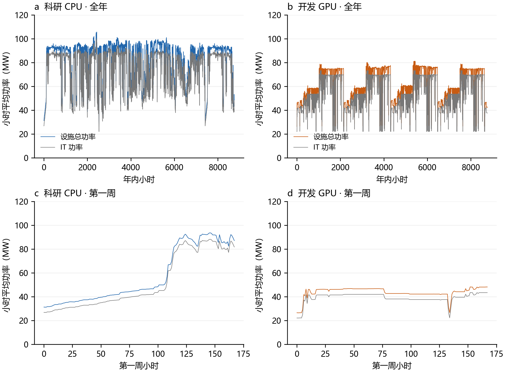

# 算力中心实际配置与 8760 小时负荷计算说明

算力中心实际配置

与 8760 小时负荷计算

规模 × 设备模式 × 需求导向 · 逐小时气象 · 2026 年 10 月 26 日

## 1 设备构成采用什么依据

| 实际系统 | 官方或原始研究的配置 | 支持的设备边界 |

| --- | --- | --- |

| ARCHER2 [1] | 主计算系统 5860 个 CPU 节点，每节点双路 64 核心 CPU；另有 4 个 GPU 开发节点 | 主计算分区可采用纯 CPU 池；GPU 开发平台单列 |

| Frontier [2] | 每计算节点 1 颗宿主 CPU + 4 个 MI250X 封装（8 个 GCD） | 计算节点均为 GPU 加速节点，宿主 CPU 计入整机 |

| Perlmutter [3] | 3072 个 CPU-only 节点 + 1792 个 GPU 节点；每 GPU 节点 1 颗 CPU + 4 张 A100 | 混合计算由两种节点清单确定 |

| Lisa 论文快照 [4] | 287 个 CPU-only 节点 + 51 个 GPU 节点，GPU 硬件异构 | 同一中心可同时运行 CPU 与 GPU 分区 |

CPU 超算可以没有生产 GPU 计算节点；也可能另有小型开发平台。GPU 加速型包含必要的宿主 CPU、内存和机内配套。两类中心按计算节点类型区分，GPU 节点内的 CPU 不再另建独立 CPU 池。

Perlmutter 的 CPU/GPU 节点数量占比为 63.16%/36.84%。对应 IT 功率份额须另用匹配硬件的整机功率计算。Lisa 论文中 GPU 作业能量占比为 38.68%，同样不能用作安装容量份额。[3,4]

这些实例支持设备架构的分类；它们尚未组成可用于估计行业平均配比的代表性样本。

## 2 情境设计与规模参数

基本设计保留 4 档 IT 规模 × 3 类设备模式 × 3 类需求导向，共 36 个设计单元。需求导向为科研超算、大模型开发、生产 AI 服务；每个单元分别登记数据是否足够。

| 设备模式 | 独立 CPU 池 / GPU 整机池 | 配比依据 |

| --- | --- | --- |

| CPU 计算型 | 100% / 0% | 纯 CPU 主计算分区的架构边界 [1] |

| GPU 加速型 | 0% / 100% | 全 GPU 加速计算节点的架构边界；包含宿主 CPU [2] |

| 混合计算型 | 由实际节点清单和整机功率推导 | α=N_C p_C,ref / (N_C p_C,ref+N_G p_G,ref)；未取得匹配功率时留空 |

S 表示参考计算节点高负载 IT 预算，冷却另计。公共网络、独立存储和管理设备须按实际清单另外核算。本说明的 1—500 MW 为计算节点规模；参考整机用于跨规模比较，不代表上述超算原设备复刻。

| IT 预算 | 纯 CPU：节点 / 核心 | 纯 GPU：整机 / H100 参考卡数 |

| --- | --- | --- |

| 1 MW | 1,831 / 234,368 | 118 / 944 |

| 10 MW | 18,315 / 2,344,320 | 1,186 / 9,488 |

| 100 MW | 183,150 / 23,443,200 | 11,862 / 94,896 |

| 500 MW | 915,750 / 117,216,000 | 59,311 / 474,488 |

| 需求导向 | CPU 计算型 | GPU 加速型 | 混合计算型 |

| --- | --- | --- | --- |

| 科研超算 | Lisa 全年重放 | 卡数及监测待补 | 节点功率与双池需求待补 |

| 大模型开发 | Acme CPU 诊断样本 | Acme GPU 全年重放 | 独立 CPU 库存及双池配置待补 |

| 生产 AI 服务 | 独立 CPU 需求待补 | ASI 单日重复演示 | 独立 CPU 需求及设备清单待补 |

现有数据形成 16 条全年代理/演示曲线；其余设计单元保留具体缺口。‘均衡’仅可用作业务描述；数值配比由设备清单决定。

## 3 原始任务如何形成小时需求

### 运行区间积分

作业 i 的执行区间为 [s_i,e_i)，资源数为 n_i。每小时的资源小时为 W_h=Σ_i n_i×overlap_seconds([s_i,e_i),h)/3600。小时长度为 1 小时，因此 W_h 的数值等于小时平均分配核心数或 GPU 数量。

短作业保留实际运行秒数，排队单列。先对完整原始执行区间积分，再选取完整日期，保留窗口内跨小时和跨日执行量；缺失结束时间的 Acme 三条 GPU 记录按既有核验规则排除。

### 当前实际采用的形状与分母

| 需求来源 | 连续完整日 | 资源份额 u_h 的构造 | 使用范围 |

| --- | --- | --- | --- |

| Lisa CPU | 309 | 分配核心数 / 5,411.345（最高小时） | 科研形状代理 |

| Acme CPU | 90 | 分配数量 / 15,360（瞬时并发峰值） | 开发 CPU 诊断，低占用 |

| Acme GPU | 90 | 分配数量 / 1,536（瞬时并发峰值） | 开发 GPU 形状代理 |

| ASI GPU | 1 | 归属 GPU 小时 / 同小时 GPU 库存 | 一天演示，异构 GPU |

这里的分配/归属资源份额是功率映射的输入代理。Lisa 的最高小时归一化、Acme 的观测峰值归一化均不识别完整设施库存；由此得到的 u_h 不等同于芯片实测利用率。ASI 异构卡数也尚未标定成 H100 吞吐等价。

Acme CPU 来自开发集群的无 GPU 作业，少量长作业造成明显尖峰；该序列保留为来源诊断。不同来源分别生成曲线，保留各自变化和任务结构。

## 4 从观测窗口扩展到 8760 小时

### 明确的重放规则

① 选取连续的完整源日期，检查小时连续、无重复、资源非负。② 保留原顺序、逐小时幅度和尖峰。③ 将完整观测窗口循环映射到目标 UTC 年；末尾按需要截取，保留每小时源索引。④ 使用目标网格全年真实天气逐小时重新计算冷却。

设源窗口有 L 小时、目标有 H 小时，基准相位 φ=0：

j(h)=(h+φ) mod L；u_year,h=u_source,j(h)，h=0,…,H−1。

| 输入窗口 | L | 2025 年基准重放结果 |

| --- | --- | --- |

| Lisa：309 日 | 7416 小时 | 完整 1 次 + 前 1344 小时（56 日） |

| Acme：90 日，CPU/GPU 共时 | 2160 小时 | 完整 4 次 + 前 120 小时（5 日） |

| ASI：相对日 109 | 24 小时 | 重复 365 次，仅作为方法演示 |

2025 年 H=8760；闰年按真实 UTC 日历使用 8784。源午夜对应目标 UTC 午夜是显式相位设定。Lisa 原时区与 ASI 实际日期未识别；这里采用相对时钟，不据此恢复原设施与当地气象的历史同步。

### 边界、季节性与敏感性

循环连接处保存 replay_wrap 标记和首尾资源跳变量，不平滑或填造新需求。完整窗口内的自相关和尖峰被保留，连接处会产生人工周期。样本外季节变化、节假日、需求增长及目标日历的星期效应保持未知。

实际检查：Lisa 首尾连接的资源份额跳变为 0.473，源窗口内逐小时变化的 95% 分位为 0.126；基准年在第 7416 小时连接处单独标记。该连接变化属于窗口重放边界。

以全部整数日相位 φ=0,24,…,L−24 重复计算 100 MW 年曲线：Lisa 309 组、Acme CPU/GPU 各 90 组、ASI 1 组，共 490 组。报告全年电量与峰值范围；该范围描述需求与气象配对及截尾影响，不作为统计置信区间。

本次重放用于固定路径能量分析。柔性优化须保留原任务、到达、依赖和跨边界执行状态；不能仅复制小时聚合量后据此判定任务可移动。

## 5 IT、散热与当地温湿度的计算

### 设备取整与整机功率

纯 CPU：N_C=floor(S×106/546)，每节点 128 核心；纯 GPU：N_G=floor(S×106/8430)，每节点 8 张 H100。参考 CPU 的空闲/高负载功率为 120/546 W；GPU 整机为 1860/8430 W。[8,9]

CPU 采用 11 个实测功率锚点，GPU 采用包含宿主的整机锚点插值。P_IT,h=[N_C p_C(u_C,h)+N_G p_G(u_G,h)]/106，单位 MW。实际计算缺失的设备池取零；混合池须先获得对应设备参数。

规模外扩保持同一来源的归一化需求形状，扩大节点数量；不另设平均忙碌比例。节点取整后实际安装参考容量 C 可能略小于 S。同一硬件与资源路径下，功率和电量随 C 近似线性；规模本身不产生新的业务多样性。

### 热负荷与冷却响应

Q_heat,h≈P_IT,h（MW 热），q_h=P_IT,h/C。外生输入为当地逐小时干球温度 T 与相对湿度 RH 或露点 Td；RH 经 PsychroLib 换算为露点。[10]

P_j,h=CΣ_kβ_k,j X_k(q_h,T_h,Td_h)。X 为常数、q、q²、两个干球温度暖侧项、两个露点暖侧项及低温项；β 使用现有 ESIF 8×4 系数。室外冷却、HVAC 和泵相加为 P_cool；其他配套为 P_other。

P_fac,h=P_IT,h+P_cool,h+P_other,h。混合中心按总热量计算共享冷却一次。年度电量 E=Σ_hP_h×1 小时，单位 MWh；年度 PUE=ΣP_fac/ΣP_IT。散热、核心小时及 GPU 小时分别累计。

参考设备全年资源量：CPU 核心小时=128N_CΣ_hu_C,h；GPU 小时=8N_GΣ_hu_G,h。它们记录目标参考设备的资源占用代理，跨代设备的实际完成工作量另需性能标定。

ESIF 参考响应来自 5447 配对小时，留出 672 小时冷却 RMSE 为 17.754 kW。它提供统一冷却比较条件；具体液冷技术和 500 MW 工程效率尚未由这组数据验证。公共网络和独立存储的 IT 电耗需另外加入，不能由冷却配套项代替。

## 6 已处理的全年结果与适用范围

已使用全球网格 g05_r100_c592 的中心 ERA5 节点（原生索引 289905）及 2025 年逐小时干球/露点，生成 4 条需求路径 × 4 档规模 =16 条曲线，共 140160 条小时负荷记录。另保存 4 份源小时映射。

| 100 MW 参考规模 | IT 电量
GWh | 冷却电量
GWh | 设施电量
GWh | 设施峰值
MW |

| --- | --- | --- | --- | --- |

| Lisa CPU | 653.18 | 51.57 | 705.92 | 105.62 |

| Acme CPU | 192.76 | 39.31 | 233.24 | 53.73 |

| Acme GPU | 489.76 | 47.31 | 538.24 | 81.21 |

| ASI GPU | 831.14 | 56.70 | 889.02 | 107.69 |

上述为归一化需求、参考整机及参考冷却耦合后的全年构造结果。设施电量包含另计的其他配套；100 MW 其他配套约 1.17 GWh。各来源分母和业务范围不同，本表不能直接用于比较其真实算力能效。

| 100 MW 全部日相位 | 设施年电量范围（GWh） | 最高小时功率范围（MW） |

| --- | --- | --- |

| Lisa CPU（309 组） | 694.06—710.67 | 105.58—110.62 |

| Acme CPU（90 组） | 233.23—233.26 | 52.48—54.25 |

| Acme GPU（90 组） | 538.24—541.99 | 80.16—82.16 |

| ASI GPU（1 组） | 889.02—889.02 | 107.69—107.69 |

### 逐小时外推标记必须随结果保留

该网格有 1903/8760 小时天气超出 ESIF 标定范围。IT 热负荷比例超范围小时：Lisa CPU 为 3，Acme CPU 为 8748，Acme GPU 为 353，ASI GPU 为 0。Acme CPU 的年曲线主要受持续空闲功率支配，只作为开发样本诊断。

ASI 的全年构造重复同一天，无法由此估计生产服务的跨日波动和季节规律。全部曲线均包含跨数据集功率映射的不确定性；此处没有把相位范围解释为完整预测误差。所有 1/10/100/500 MW 统计见 annual-load-summary.csv。

## 7 8760 小时曲线实际呈现的形状

图：100 MW 参考计算节点规模。a、b 展示全部 8760 个小时；c、d 放大第一周 168 小时。彩色为设施总功率，灰色为 IT 功率；均保留小时平均值，未进行平滑。科研 CPU 使用 Lisa 309 日窗口，开发 GPU 使用 Acme 90 日窗口。

同一来源在不同规模下沿用相同资源形状，纵向随实际节点容量变化。循环窗口会使 IT 变化重复；设施总负荷同时受到全年温湿度影响。短样本扩展后的重复周期是构造方法带来的特征。

全天小时平均曲线无法恢复秒级电气尖峰；原始任务的秒级记录仍保留在任务表中。日/月统计由这些小时值累计，年度峰值指最高小时平均功率。

## 8 柔性权限独立作为控制设计

规模、设备模式和需求导向定义基础情境；柔性权限独立成章。上述 16 条曲线均为给定执行路径的重放结果，没有从业务标签自动赋予延期或暂停权限。

| 控制设置 | 求解变量 | 必需服务与性能信息 |

| --- | --- | --- |

| 固定执行 | 给定运行路径 | 保留同一任务集合与完成要求 |

| 允许延后启动 | 启动时刻 s_i | 到达/数据就绪 r_i、截止 d_i、运行时长 p_i |

| 允许暂停恢复 | 运行状态 x_i,t | 检查点、最小连续运行时间、恢复时长和额外耗能 |

| 允许调整功率或资源 | 节点功率上限、核心或卡数 | 性能关系、内存、最小并行度与服务质量 |

固定资源、固定速度且连续执行时，满足 r_i≤s_i 且 s_i+p_i≤d_i，同时检查 CPU、GPU、内存和依赖约束。训练、评估、低优先级等标签用于候选筛选，不能单独确定可延期时长。

全年任务级扩展时，采用含边界作业的连续任务窗口，给每个重复周期生成独立任务编号，并保留跨年开始前已运行任务与年末未完成任务。对照和控制路径使用相同年度服务集合及边界约束，避免利用年末截尾减少完成工作量。

调度后重新积分资源需求，再计算 IT、散热、冷却和总负荷。当前年度重放代码已实现固定路径；任务级全年复制、检查点与混合节点联合调度尚未实现。

## 9 数据来源、文件与复现

设备配置按 2026-10-26 查阅的一手页面记录。Lisa 论文为 338 节点研究快照；公开硬件文件含 343 行，时间与记录边界有差异，未将其直接当作同时在线库存。全年构造使用已核验的小时资源表。

<a href="https://www.archer2.ac.uk/about/hardware.html" color="#1C5675">[1] ARCHER2 官方硬件：主计算系统与独立 GPU 开发平台。</a>

<a href="https://docs.olcf.ornl.gov/systems/frontier_user_guide.html" color="#1C5675">[2] OLCF Frontier：每个计算节点的宿主 CPU 与 MI250X 配置。</a>

<a href="https://docs.nersc.gov/systems/perlmutter/architecture/" color="#1C5675">[3] NERSC Perlmutter：CPU-only 与 GPU-accelerated 分区清单。</a>

<a href="https://arxiv.org/html/2409.08949v1" color="#1C5675">[4] Chu 等，Lisa 原始研究，Table I、V；ICPADS 2024。</a>

<a href="https://zenodo.org/records/13685426" color="#1C5675">[5] Lisa v3 原始作业、硬件与监测数据。</a>

<a href="https://github.com/InternLM/AcmeTrace" color="#1C5675">[6] AcmeTrace 官方数据；Hu 等 NSDI 2024 开发工作负载研究。</a>

<a href="https://github.com/alibaba/clusterdata/blob/master/cluster-trace-gpu-v2026/docs/schema.md" color="#1C5675">[7] Alibaba ASI 2026 官方小时字段和类型定义。</a>

<a href="https://www.spec.org/power_ssj2008/results/res2021q1/power_ssj2008-20210221-01063.html" color="#1C5675">[8] SPECpower：HPE DL385 / 双路 EPYC 7763，整机实测。</a>

<a href="https://arxiv.org/html/2412.08602v1" color="#1C5675">[9] Latif 等，HGX H100 整机功率，Table I。</a>

<a href="https://github.com/TuzzyT-Laiii/33/blob/main/dc-flexibility-project/docs/compute-load-module.md" color="#1C5675">[10] 本项目通用负荷模块：ERA5 接入、ESIF 标定与适用范围。</a>

### 可复现入口与输出

在项目根目录依次运行：

python analysis/build_task_annual_loads.py --year 2025 --grid-id g05_r100_c592

python analysis/verify_task_annual_loads.py

python analysis/build_scenario_load_methods_note_v2.py

annual-load-summary.csv 保存 16 条年曲线的设备数量、电量、峰值、资源累计与外推小时；annual-phase-sensitivity.csv 保存 490 组日相位结果；annualization-manifest.json 保存源时段、相位规则、输入及输出 SHA-256。scenario-matrix.csv/json 保存 36 个设计单元与实际准备状态。

完整逐小时负荷与源索引保存在项目 data/processed/task-annual-loads-20261026-v2/；代码及汇总进入研究仓库，带来源映射的数据文件保留在本地及服务器研究数据目录。可通过 --weather-path 接入同结构 ERA5 文件；标准逐小时温湿度可直接调用 ComputeLoadModel。