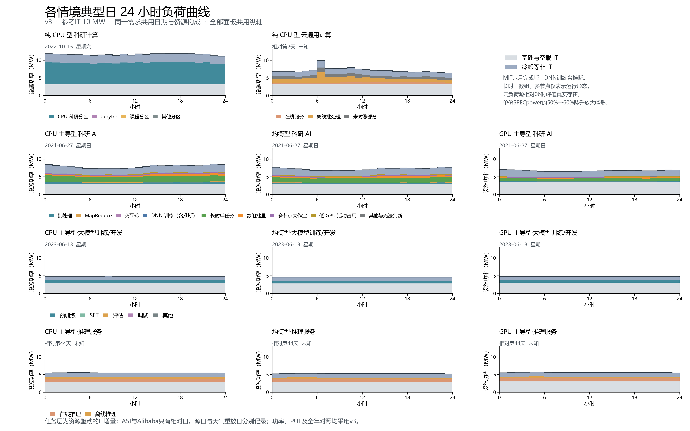

# v3 各情境分任务典型日负荷曲线



采用 PR #34 完成版 v3 的参考网格2025年逐小时 IT、PUE 和设施功率。参考 IT 10 MW；其他规模按整数设备台数比缩放，形状保持。

完整日先按日电量与中位数的绝对距离选取，并列时按与全部日平均24小时曲线的RMSE选取，再按日期排序。科研AI、训练和推理均以GPU主导型选日，三规格共用源日期、任务资源构成和天气对应日。

图中任务层为资源驱动的IT增量，基础与空载IT及冷却等非IT独立列示。CPU非线性响应按小时资源份额分摊；功率、PUE与v3逐值一致，未重新拟合功率模型。

| 情境 | 源典型日 | 星期 | 设施峰值 MW | 设施谷值 MW | 日电量 MWh | 与全年日均之比 | 主要任务构成 |
| --- | --- | --- | ---: | ---: | ---: | ---: | --- |
| 纯 CPU 型·科研计算 | 2022-10-15 | 星期六 | 11.903 | 11.139 | 279.779 | 1.060 | CPU 科研分区 100.0% |
| 纯 CPU 型·云通用计算 | 相对第2天 | 未知 | 9.974 | 6.440 | 172.251 | 0.960 | 离线批处理 51.3%；未对账部分 29.1%；在线服务 19.6% |
| CPU 主导型·科研 AI | 2021-06-27 | 星期日 | 8.615 | 7.347 | 190.676 | 1.108 | 长时单任务 48.4%；数组批量 18.2%；批处理 10.9%；多节点大作业 9.8%；低 GPU 活动占用 6.4%；MapReduce 5.2% |
| 均衡型·科研 AI | 2021-06-27 | 星期日 | 7.763 | 6.791 | 174.057 | 1.103 | 长时单任务 48.4%；数组批量 18.2%；批处理 10.9%；多节点大作业 9.8%；低 GPU 活动占用 6.4%；MapReduce 5.2% |
| GPU 主导型·科研 AI | 2021-06-27 | 星期日 | 7.066 | 6.500 | 161.654 | 1.073 | 长时单任务 48.4%；数组批量 18.2%；批处理 10.9%；多节点大作业 9.8%；低 GPU 活动占用 6.4%；MapReduce 5.2% |
| CPU 主导型·大模型训练/开发 | 2023-06-13 | 星期二 | 4.844 | 4.828 | 115.922 | 0.934 | 预训练 99.8% |
| 均衡型·大模型训练/开发 | 2023-06-13 | 星期二 | 4.590 | 4.576 | 109.873 | 0.927 | 预训练 99.8% |
| GPU 主导型·大模型训练/开发 | 2023-06-13 | 星期二 | 4.745 | 4.733 | 113.630 | 0.916 | 预训练 99.8% |
| CPU 主导型·推理服务 | 相对第44天 | 未知 | 5.563 | 5.422 | 131.847 | 0.946 | 在线推理 66.4%；离线推理 33.6% |
| 均衡型·推理服务 | 相对第44天 | 未知 | 5.360 | 5.200 | 126.755 | 0.945 | 在线推理 66.4%；离线推理 33.6% |
| GPU 主导型·推理服务 | 相对第44天 | 未知 | 5.675 | 5.464 | 133.719 | 0.943 | 在线推理 66.4%；离线推理 33.6% |

## 版本与证据范围

- v3：PR #34，ab07a41；OTHER：PR #28，d3fd452。ASI185天与Alibaba拆分分别来自#32、#33。
- MIT来源：Samsi等，The MIT Supercloud Dataset，DOI:10.1109/HPEC49654.2021.9622850；许可CC BY-NC-ND 4.0。仅发布小时资源与功率聚合，逐作业分类及标识保留本机。
- MIT六月窗口完成版：partial_data=false，12,181文件完成；有效监测覆盖68.33%，合格验证3小时。V100→H100及未分配空载仍为迁移假设，文件完成不等于全设施实测。
- DNN训练合并官方标签和三类推断；长时、数组、多节点为运行形态；低GPU活动不证明整个作业空闲。其他与无法判断合并交互候选、短时异常、测试及待定。六类互斥并逐小时加总回原OTHER。
- MIT完整数据集OTHER六层占比见mit-other-full-source-shares.csv，所选典型日OTHER内部及科研AI总体占比见mit-other-typical-day-shares.csv；分母不同，不能互换。前三类原提交方式分别保留。
- INF按v3仅使用在线和离线推理；训练、开发等全业务不进入推理情境。185天均参与完整日选取，索引126未确认原因的零资源小时沿用v3原值与质量标识。
- ASI与Alibaba没有可核实的日历日期及星期，只报告源相对日；Lisa源时区、MIT当地时区未核实。图内日期是源日期，2025年参考天气对应日另列于CSV。
- Alibaba在线、离线和未对账量来自有效核心小时；未对账部分保留，不任意分到业务。原始数据的源相对06时高值真实存在，单份SPECpower曲线50%→60%的陡升进一步放大功率峰形；见旧版cld-spike-audit-20261101证据包。

## 文件与复现

每情境PNG（300 dpi）/SVG、24行hourly.csv和分层by-task.csv；另有候选日评分、summary.csv/json、输入版本和SHA-256的manifest.json、validation.json。所有逐作业输入和资源累计中间表只留本地忽略目录。

independent-verification.json记录独立核查：逐值对照v3、重新排序选日、直接按区间截断计算OTHER资源小时、全源237天OTHER守恒、PNG分辨率与SVG、Word嵌图和四页PDF。manifest.json另记录人工逐页检查状态及PDF指纹；PDF和页面渲染只留本地。

```powershell
python -m pip install -r dc-flexibility-project/analysis/requirements-scenario-typical-days-v3.txt
$env:OPENBLAS_NUM_THREADS='1'
$env:OMP_NUM_THREADS='1'
python dc-flexibility-project/analysis/build_scenario_typical_days_v3.py --input-project "<原始输入项目>" --mit-root "D:/mit-supercloud-gpu-summary-20261028" --other-jobs "D:/mit-supercloud-gpu-summary-20261028/derived/other-refine-20261101/other-job-categories.parquet"
```

随后在docs/job-flexibility-brief目录运行`node build.js 数据中心任务时间柔性简表.docx README.md`，将Word导出PDF并逐页检查，再在仓库根目录运行：

```powershell
python dc-flexibility-project/analysis/verify_scenario_typical_days_v3.py --other-jobs "D:/mit-supercloud-gpu-summary-20261028/derived/other-refine-20261101/other-job-categories.parquet" --pdf "<本机检查后的PDF路径>" --visual-qa-confirmed
```

MIT按20,000行读取Slurm，仅加载76,404条类别的必要字段；不访问流式数据库、锁或STOP文件。旧版结果保留在scenario-typical-day-by-task-20261031。
