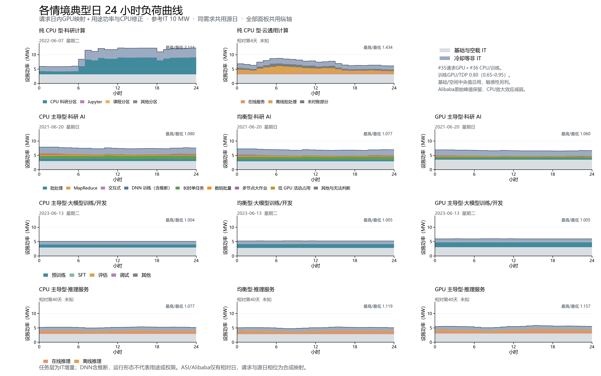

# 各情境分任务典型日负荷曲线：组合模型



参考IT 10MW，沿用冻结的设备台数与参考天气。功率超过或低于参考容量均保留，不按10MW截断。其他规模按整数设备台数比缩放。

完整日先最小化日电量与中位数的距离，并列时最小化与全部日平均24小时曲线的RMSE。科研AI、训练、推理分别以GPU主导型选日，三规格共用日期与资源构成。源日期与2025年天气重放日分开记录。

## 组合口径与来源

- #36（6c83cf1）：全部情境采用三份SPECpower归一化后拟合的单调CPU响应；八个非推理情境逐小时功率直接采用该PR结果。训练GPU/TDP中央0.80，敏感性0.65–0.95，700W H100对应560W、455–665W。分配轨迹保持原样，未添加固定小时训练周期。
- #35（520f68d）：推理在线GPU叠加BurstGPT 119日请求的输入/输出token各50%日内形状，离线推理保持原分配与固定每卡功率。在线能量按ASI分配加权标定至原年度GPU电量；CPU及基础部分采用#36，随后完整重算冷却和PUE。未使用#36冻结的推理GPU表覆盖#35。
- 两任务中央基础/空闲值一致，分别保留其已分配在线常驻空闲与未分配GPU空闲定义。推理在线SXM端点中央120/525W，PCIe60/262.5W；低到高波动敏感性为SXM空闲100–160W、高负载350–700W、曲率0.7–1.3，PCIe按TDP比例迁移。
- 基础与空闲独立敏感性：纯CPU型120–320W/台，CPU主导型195–500W/台，均衡型270–680W/台，GPU主导型1370–4110W/台；科研AI保持MIT的GPU空闲代理，只改变基础与CPU空闲。所有范围属于工程情境，均非置信区间。
- MIT六月完成版与#28 OTHER互斥六层保持；任务层为超过无任务整机端点的IT增量，基础与空载IT、冷却等非IT分别列示。推理在线/离线GPU增量分别计算，不按总GPU份额分摊不同每卡功率。
- Alibaba相对06时利用率高值来自原始观测；单份SPECpower 50%→60%陡升的放大效应已由#36三曲线平滑替换，双路CPU该区间动态增量由约125W降至41W。

| 情境 | 源典型日 | 星期 | 设施峰值MW | 设施谷值MW | 日内最高/最低比 | 日电量MWh | 与新全年日均之比 |
| --- | --- | --- | ---: | ---: | ---: | ---: | ---: |
| 纯 CPU 型·科研计算 | 2022-06-07 | 星期二 | 12.393 | 5.862 | 2.114 | 248.496 | 1.045 |
| 纯 CPU 型·云通用计算 | 相对第4天 | 未知 | 8.770 | 6.114 | 1.434 | 173.575 | 0.963 |
| CPU 主导型·科研 AI | 2021-06-20 | 星期日 | 7.906 | 7.319 | 1.080 | 180.711 | 1.112 |
| 均衡型·科研 AI | 2021-06-20 | 星期日 | 7.278 | 6.756 | 1.077 | 166.728 | 1.105 |
| GPU 主导型·科研 AI | 2021-06-20 | 星期日 | 6.914 | 6.521 | 1.060 | 160.473 | 1.078 |
| CPU 主导型·大模型训练/开发 | 2023-06-13 | 星期二 | 5.114 | 5.094 | 1.004 | 122.341 | 0.886 |
| 均衡型·大模型训练/开发 | 2023-06-13 | 星期二 | 5.270 | 5.246 | 1.005 | 125.989 | 0.875 |
| GPU 主导型·大模型训练/开发 | 2023-06-13 | 星期二 | 6.016 | 5.985 | 1.005 | 143.751 | 0.868 |
| CPU 主导型·推理服务 | 相对第40天 | 未知 | 5.369 | 4.983 | 1.077 | 125.052 | 0.943 |
| 均衡型·推理服务 | 相对第40天 | 未知 | 5.319 | 4.752 | 1.119 | 121.898 | 0.943 |
| GPU 主导型·推理服务 | 相对第40天 | 未知 | 5.862 | 5.066 | 1.157 | 132.483 | 0.943 |

## 核对与解释边界

comparison.csv对照上一版各自按同一规则选出的典型日，日期可能不同；matched-day-comparison.csv另对同一源日、同一天气小时比较功率。此处日内最高/最低比取所选日24个小时的最大/最小，区别于上游报告中全年按小时分组平均的比值。

sensitivity-hourly.csv在中央模型选中日分别改变训练GPU比例、推理波动参数和基础空闲端点；sensitivity-summary.csv给出同日及全年量。敏感性不重新选日，各因素单独改变，不将独立端点叠加成置信范围。

ASI与Alibaba真实日期和星期未知，BurstGPT的日历与时区未知；请求叠加采用#35规定的小时相位，属于合成映射。ASI索引126零资源异常沿用原值和质量标识。Acme缺少逐作业设备关联，不能给出各任务类型GPU实测功率；训练比例为用途级情境参数。

MIT源为Samsi等The MIT Supercloud Dataset，DOI:10.1109/HPEC49654.2021.9622850，许可CC BY-NC-ND 4.0。仅使用本地已核验分类资源小时汇总；逐作业输入、标识和全年组合小时中间表只留本机忽略目录，未访问MIT流式进程或STOP。

## 文件与复现

每情境PNG（300dpi）/SVG、24行hourly.csv和分任务by-task.csv；总览、选日评分、summary、comparison、annual-summary、敏感性与输入/代码SHA-256一并保存。idle-endpoints.csv列出各用途无任务整机低、中、高端点。图例、颜色沿用上一版。

```powershell
python -m pip install -r dc-flexibility-project/analysis/requirements-scenario-typical-days-v3.txt
$env:OPENBLAS_NUM_THREADS='1'
$env:OMP_NUM_THREADS='1'
python dc-flexibility-project/analysis/build_scenario_typical_days_v4.py --training-results "D:/codex-runs/trn-power-utilization-20261101/worktree/dc-flexibility-project/results/trn-power-model-20261101"
```

需要已核验的v3本地分类资源小时汇总，以及#36清单对应的本地全年小时文件；不重新扫描原始逐作业数据。简表按docs/job-flexibility-brief的重新生成说明构建，Word转PDF逐页检查。随后运行独立核验：

```powershell
python dc-flexibility-project/analysis/verify_scenario_typical_days_v4.py --pdf "<逐页检查后的PDF>" --visual-qa-confirmed
```

independent-verification.json记录CPU/GPU来源、功率公式、选日、分层、全年和敏感性核对，以及新选日OTHER的逐作业独立交集检查。manifest记录本地全年组合文件及文档和PDF指纹；人工检查标识只在实际逐页检查后设置。旧版结果均保持原样。
