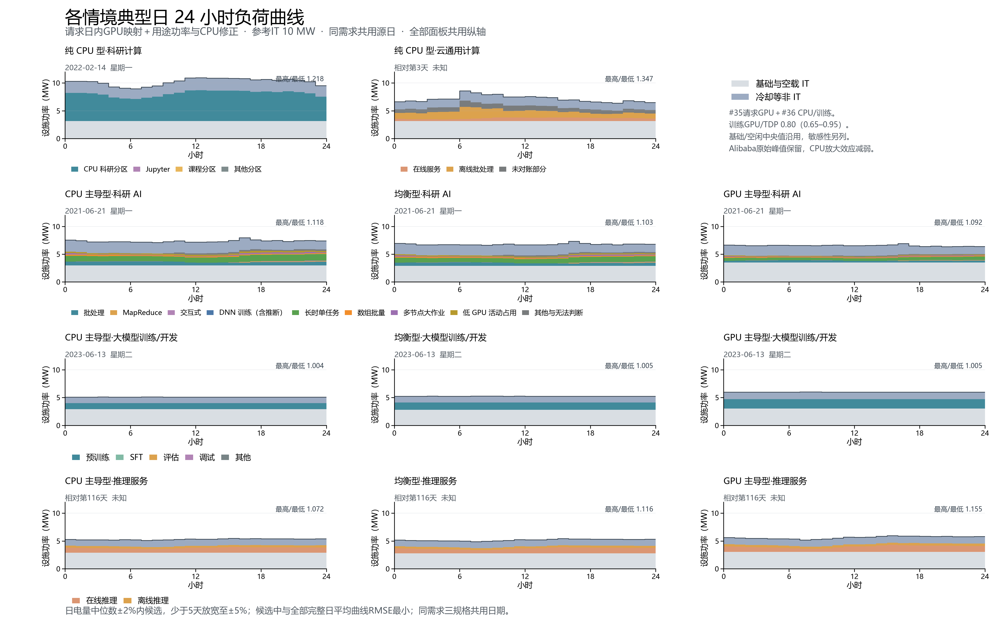

# 各情境典型日：中位电量窗口内按形状选日



日电量中位数±2%内候选，少于5天放宽至±5%；候选中与全部完整日平均曲线RMSE最小；RMSE相同则按电量绝对偏差、源日期依次排序。科研AI、训练、推理以GPU主导型选日，三种规格共用日期。

日电量和RMSE均由设施功率计算；RMSE参照全部完整日的平均24小时曲线。±2%候选少于5天时只放宽到±5%，若放宽后仍少于5天则使用实际候选；没有候选时明确报错。数值边界容差为1e-10个百分点。

模型、需求、天气及每小时功率保持v4组合模型（#35推理GPU映射＋#36训练与CPU），参考IT 10MW。直接读取并核对v4全年小时文件SHA-256，不重算或改写全年负荷，不访问流式进程和STOP。

## 新旧典型日

表中箭头为v4选日→新规则；电量单位MWh，RMSE单位MW，偏差为本情境自身中位数的有符号百分比。GPU需求统一按GPU主导型候选和RMSE选日，B/C自身偏差与参考偏差另列于CSV。

| 情境 | 日期 | 日电量 | 中位数偏差% | RMSE | 日内最高/最低比 |
| --- | --- | ---: | ---: | ---: | ---: |
| 纯 CPU 型·科研计算 | 2022-06-07 → 2022-02-14 | 248.50 → 245.28 | +0.00 → -1.29 | 2.452 → 0.468 | 2.114 → 1.218 |
| 纯 CPU 型·云通用计算 | 相对第4天 → 相对第3天 | 173.57 → 171.76 | +0.00 → -1.04 | 0.331 → 0.211 | 1.434 → 1.347 |
| CPU 主导型·科研 AI | 2021-06-20 → 2021-06-21 | 180.71 → 176.36 | -1.49 → -3.86 | 0.407 → 0.276 | 1.080 → 1.118 |
| 均衡型·科研 AI | 2021-06-20 → 2021-06-21 | 166.73 → 162.91 | -1.26 → -3.52 | 0.364 → 0.240 | 1.077 → 1.103 |
| GPU 主导型·科研 AI | 2021-06-20 → 2021-06-21 | 160.47 → 157.26 | +0.00 → -2.00 | 0.307 → 0.208 | 1.060 → 1.092 |
| CPU 主导型·大模型训练/开发 | 2023-06-13 → 2023-06-13 | 122.34 → 122.34 | -1.17 → -1.17 | 0.414 → 0.414 | 1.004 → 1.004 |
| 均衡型·大模型训练/开发 | 2023-06-13 → 2023-06-13 | 125.99 → 125.99 | -1.11 → -1.11 | 0.502 → 0.502 | 1.005 → 1.005 |
| GPU 主导型·大模型训练/开发 | 2023-06-13 → 2023-06-13 | 143.75 → 143.75 | -0.90 → -0.90 | 0.631 → 0.631 | 1.005 → 1.005 |
| CPU 主导型·推理服务 | 相对第40天 → 相对第116天 | 125.05 → 127.49 | +0.00 → +1.95 | 0.256 → 0.168 | 1.077 → 1.072 |
| 均衡型·推理服务 | 相对第40天 → 相对第116天 | 121.90 → 124.31 | +0.00 → +1.98 | 0.252 → 0.165 | 1.119 → 1.116 |
| GPU 主导型·推理服务 | 相对第40天 → 相对第116天 | 132.48 → 135.09 | +0.00 → +1.96 | 0.273 → 0.178 | 1.157 → 1.155 |

## 候选数量与筛查

| 需求 | ±2%候选数 | 实际窗口 | 实际候选数 | 新日期 |
| --- | ---: | ---: | ---: | --- |
| 纯 CPU 型·科研计算 | 27 | ±2% | 27 | 2022-02-14 |
| 纯 CPU 型·云通用计算 | 4 | ±5% | 5 | 相对第3天 |
| GPU 主导型·科研 AI | 17 | ±2% | 17 | 2021-06-21 |
| GPU 主导型·大模型训练/开发 | 11 | ±2% | 11 | 2023-06-13 |
| GPU 主导型·推理服务 | 71 | ±2% | 71 | 相对第116天 |

筛查采用固定提示条件：相邻小时IT变化超过全期IT均值的30%；连续至少3小时低于全期同小时IT均值的60%；设施曲线RMSE高于全期Q3+1.5IQR；来源有未解决质量标记。筛查不参与选日、不剔除候选，也不据此认定发生维护或停机。

旧日提示：纯 CPU 型·科研计算（2022-06-07）：相邻小时IT跳变超过全期IT均值30%；连续至少3小时IT低于全期同小时均值60%
新日提示：11个情境均未触发上述条件。

## 数据、图件与复现

day-selection-comparison.csv为11情境新旧对照；selected-day-diagnostics.csv为22个新旧日的指标和提示；五份*-day-selection.csv保留全部日、窗口、候选及选中标记。每情境另有PNG（300dpi）/SVG、24行hourly.csv及分任务by-task.csv。年度汇总和参数表按v4原字节复制，v4选日数据和图件原样保留。

敏感性参数、功率依据与原始来源见[固定的v4模型说明](../scenario-typical-day-by-task-20261101-v4/README.md)。ASI、Alibaba实际日历未知；请求相位为合成映射。MIT仍为六月完成版，DNN含官方标签和推断，逐作业数据仅留本机。

```powershell
$env:OPENBLAS_NUM_THREADS='1'
$env:OMP_NUM_THREADS='1'
python dc-flexibility-project/analysis/reselect_scenario_typical_days.py
```

脚本依赖沿用requirements-scenario-typical-days-v3.txt。需要已有v4冻结全年小时文件及本地分类资源小时汇总。简表继续由docs/job-flexibility-brief/build.js生成；Word转PDF逐页检查后运行verify_typical_day_reselection.py。
