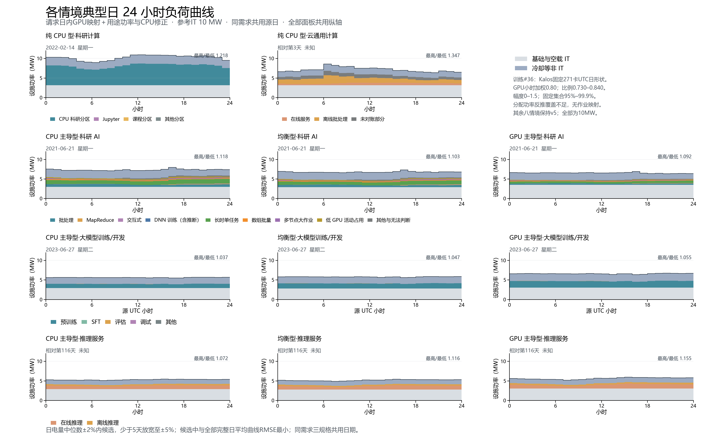

# 分任务典型日：Acme 训练日内形状



参考IT 10MW；科研计算、云通用计算、科研AI、推理服务的八套单图及逐小时数据按v5原字节保留。本次只更新三种大模型训练/开发规格及总览。

日电量中位数±2%内候选，少于5天放宽至±5%；候选中与全部完整日平均曲线RMSE最小；RMSE相同则按电量绝对偏差、源日期依次排序。科研AI、训练、推理以GPU主导型选日，三种规格共用日期。

日电量与RMSE均由设施功率计算，GPU需求以GPU主导型筛选，B/C/D共用源日期及作业构成。候选、评分、窗口见TRN-day-selection.csv。

## 训练来源与映射

- PR #36 `1594fb77148f3c9307d00230c25e864f6a286625`，功率实现`d7f6bca`，依赖#34原生窗口`c836bba`。采用2023-05-18至08-15的90个完整源UTC日；天气为参考网格2025同月日小时。只读下载其汇总小时文件，逐份匹配上游SHA-256并按#36公式独立复算。
- 中央方案：Kalos固定271卡（功率报送覆盖阈值99%）的各UTC小时设备均值等权合成形状s(h)，r(h)=0.80×s(h)/GPU分配小时加权均值[s(h)]。GPU/TDP为0.729818–0.839815，加权中央水平严格0.80。CPU三份SPEC平滑、服务器数及基础空载保持#36；按新IT功率重新计算冷却与PUE。
- 分配功率反推为[集群估计总功率−(全群设备数−分配设备数)×空闲功率]/分配设备数。估计总功率要求报送设备代表全群；原生窗口只重叠16.496采样小时、报送覆盖11.45%–35.84%，合格标定小时为零。因此反推只作诊断，采用固定集合的日形状迁移，未直接套用反推比例。
- 形状含混合业务、分配变化与运行状态，无作业映射，不能识别预训练专属周期或检查点原因；没有星期调制。A100集群形状迁移至H100属于工程假设，可能重复计入部分分配变化。
- 敏感性：形状幅度0/0.5/1/1.5，固定集合覆盖95%/99%/99.9%；每种形状均保持GPU小时加权中央0.80。中央水平0.65–0.95和基础空载端点沿用v4的独立敏感性，不与本次形状方案叠加，不合成为置信区间。

## 典型日新旧对照

旧列为PR31 v5所选典型日；新列为本次#36原生窗口重选日。设施功率包含冷却等非IT，表内比值为所选日24个小时最高/最低。上游的日内比是90天按源小时分组的均值比，两者不同。

| 情境 | 源日期，旧→新 | 设施峰值MW | 设施谷值MW | 最高/最低比 | 日电量MWh |
| --- | --- | ---: | ---: | ---: | ---: |
| CPU 主导型·大模型训练/开发 | 2023-06-13 → 2023-06-27 | 5.114 → 5.685 | 5.094 → 5.482 | 1.004 → 1.037 | 122.34 → 134.93 |
| 均衡型·大模型训练/开发 | 2023-06-13 → 2023-06-27 | 5.270 → 5.875 | 5.246 → 5.612 | 1.005 → 1.047 | 125.99 → 138.90 |
| GPU 主导型·大模型训练/开发 | 2023-06-13 → 2023-06-27 | 6.016 → 6.719 | 5.985 → 6.372 | 1.005 → 1.055 | 143.75 → 158.32 |

训练新日为2023-06-27（星期二），±5%候选18天。具体偏差与RMSE见评分表。

原生窗口下恒定0.80模型按同一规则也选中2023-06-27；日期从v5的2023-06-13切换同时涉及原生输入和天气口径，不能把日期变化单独归因于日形状。恒定模型评分另存TRN-constant-day-selection.csv。

comparison.csv另列IT峰谷，matched-day-comparison.csv保存新日同天气下恒定0.80与中央形状的24小时曲线；sensitivity-summary.csv/hourly.csv为新日及原生90天敏感性。敏感性不重新选日。

period-summary.csv明确每行时间范围；TRN用2160小时原生窗口的日电量均值，其他八情境沿用v5年度均值，不将90天外推为年电量。全部情境的典型日电量与各自期间日均之比保持同数量级。

任务层为超过基础空载的IT增量：按同小时资源份额分摊CPU和GPU增量；CPU分类代理严格采用#36的0.25×各类GPU占用。训练形状为所有已分配训练GPU共享的用途级情境参数，各类别功率均由模型推算。每小时IT层之和等于IT总功率，加非IT层等于设施功率。

## 复现与文件

```powershell
$env:OPENBLAS_NUM_THREADS='1'
$env:OMP_NUM_THREADS='1'
python dc-flexibility-project/analysis/update_chapter4_trn_diurnal.py
```

依赖本机已核验TRN分类资源小时缓存和已提交的#34原生小时文件。服务器共享卷results/trn-power-model-20261101/diurnal-acme/hourly/reference-grid下七个方案各三份*-TRN-10MW-2025-dated.parquet，只读复制到data/processed/scenario-typical-day-by-task-20261101-v6/upstream/<方案名>/，并由脚本逐份核对native-calculation-audit.json清单。不扫描逐作业原始数据，不访问MIT进程或STOP。所有输入、代码及保留文件有SHA-256记录。验证脚本verify_chapter4_trn_diurnal.py核对选日、上游功率、分层、其他八情境及文档PDF。

其他情境来源、请求映射、MIT含推断类别及Alibaba尖峰说明见[保留的v5报告](../scenario-typical-day-by-task-20261101-v5/README.md)与[v4模型报告](../scenario-typical-day-by-task-20261101-v4/README.md)。训练完整证据见[PR36报告](../trn-power-model-20261101/diurnal-acme/README.md)。
