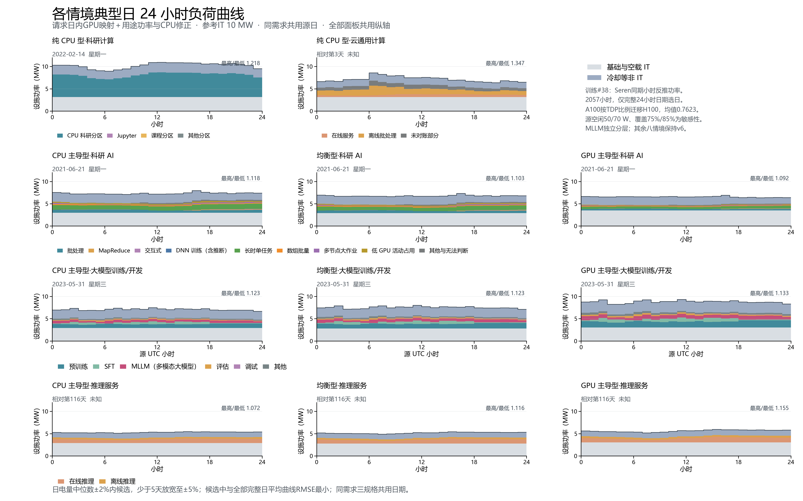

# 分任务典型日：Acme Seren同期功率



参考IT 10MW；训练采用PR #38正文方案main，其他八情境的日期、单图和逐小时数据按v6原字节复制。

日电量中位数±2%内候选，少于5天放宽至±5%；候选中与全部完整日平均曲线RMSE最小；RMSE相同则按电量绝对偏差、源日期依次排序。科研AI、训练、推理以GPU主导型选日，三种规格共用日期。

## 正文窗口与选日

Seren正文为UTC 2023-05-16 10:00至08-17 23:00之间的2057个合格观测小时。内部189小时缺口保持；不填零、不插值、不延续、不压缩时间，不采用补功率的完整4192小时对照。

仅55个具有00–23时全部观测的完整UTC日参与中位电量、全部日平均曲线及RMSE计算。GPU主导型参考选中2023-05-31（星期三），±2%候选8天，实际±2%候选8天；三种规格共用日期和任务构成。

TRN-day-availability.csv保存每个源日的观测数量和完整标记；TRN-day-selection.csv保存55个完整日的电量、偏差、RMSE、候选及选中标记。评分使用设施功率，RMSE参照全部完整日的逐小时平均设施曲线。

## 功率与任务分层

- PR #38 `bd6c8cdcb99a08b994136372881cee4a98d55d46`，采用同期逐小时Seren实测条件反推比例，目标CPU、基础空载、设备数及冷却沿用#36，按源月日小时对应参考网格2025天气。只读下载汇总小时文件，逐份匹配上游calculation-audit.json的SHA-256。
- 每15秒按报送GPU均功率×2288外推全群，再扣除未分配GPU×60W空闲并除以分配GPU×400W，聚合为同小时比例r(t)。依赖2288卡在线及缺测代表性假设，缺少作业—设备映射；不能将各类型功率解释为逐作业直接测量。
- A100-SXM 400W的比例迁移到B/C H100 PCIe 350W、D H100 SXM 700W；未保持同等吞吐、训练进度或运行时长。CPU代理为0.25×GPU分配份额；GPU需求按完整表瞬时峰值2032卡归一化。
- 源GPU采样时间加权均值0.762316、P10/中位/P90=0.613946/0.768276/0.896305；观测范围0.309131–1.062429，8小时超过1，原值及标记保留。正文没有额外日形状或星期修正。
- 敏感性：源空闲50/70W、零利用率代理67.300W、覆盖75%/85%、比例截断0–1；其中覆盖阈值会改变可用小时集合。目标GPU空闲仍50/70W，不随源反推假设一起改变。所选日完整覆盖的五个敏感性/对照方案另存sensitivity-hourly.csv及sensitivity-summary.csv，中央方案选日固定。
- 分任务GPU小时直接取作业开始/结束与小时重叠的累计值，加入MLLM（多模态大模型）；同小时CPU/GPU动态增量按各类别GPU份额分摊。基础空载IT与冷却等非IT单列，每小时分别与IT及设施总功率守恒。

## 典型日新旧对照

旧列为v6 Kalos所选典型日，新列为Seren正文所选典型日；来源、窗口、归一化、任务构成均变化，差值为描述性比较。日内最高/最低比取所选日24小时，区别于上游按源小时分组的期间均值比。

| 大模型训练/开发规格 | 日期，旧→新 | 设施峰值MW | 设施谷值MW | 最高/最低比 | 日电量MWh |
| --- | --- | ---: | ---: | ---: | ---: |
| CPU 主导型·大模型训练/开发 | 2023-06-27 → 2023-05-31 | 5.685 → 7.485 | 5.482 → 6.666 | 1.037 → 1.123 | 134.93 → 169.63 |
| 均衡型·大模型训练/开发 | 2023-06-27 → 2023-05-31 | 5.875 → 7.993 | 5.612 → 7.114 | 1.047 → 1.123 | 138.90 → 180.90 |
| GPU 主导型·大模型训练/开发 | 2023-06-27 → 2023-05-31 | 6.719 → 9.318 | 6.372 → 8.223 | 1.055 → 1.133 | 158.32 → 210.95 |

## 简表统计口径

seren-job-statistics.json/csv为重新只读扫描原始818327行作业表得到的六类GPU作业汇总。GPU作业450590条，独立CPU367737条。GPU小时、排队、运行时长和卡数均按原简表框架：有效执行时间end−start且排队start−submit非负；分位数按作业数线性插值；卡数取P50/P90。原始duration与执行时长一致，负排队为零。

简表第二章占比沿用完整GPU作业表分母5626519.861 GPU小时；正文2057小时的构成另列，避免混用两个窗口。H与恢复成本为研究假设，运行形态或业务标签不直接赋予调度权限。

| 类别 | 完整表GPU小时% | 正文GPU小时% | 典型日GPU小时% | 排队P50/P90秒 | 时长P50/P90秒 | 卡数P50/P90 |
| --- | ---: | ---: | ---: | ---: | ---: | ---: |
| 预训练 | 69.49 | 53.44 | 41.08 | 1/26 | 305/25477.5 | 128/768 |
| SFT | 6.38 | 6.80 | 15.73 | 1/175 | 200/1104 | 8/8 |
| MLLM（多模态大模型） | 8.61 | 16.51 | 23.05 | 1/11 | 255/5419.5 | 2/8 |
| 评估 | 6.24 | 11.33 | 8.16 | 2/322 | 130/1190 | 1/8 |
| 调试 | 1.71 | 1.72 | 1.13 | 1/2 | 114/925.4 | 8/32 |
| 其他 | 7.56 | 10.19 | 10.83 | 1/16 | 84/2720.4 | 1/8 |

## 复现与核验

```powershell
$env:OPENBLAS_NUM_THREADS='1'
$env:OMP_NUM_THREADS='1'
python dc-flexibility-project/analysis/update_chapter4_trn_seren.py
```

本机data/processed/scenario-typical-day-by-task-20261101-v7/upstream/<方案>/保存服务器results/trn-seren-20261101/hourly/reference-grid的18份10MW汇总文件。seren-job-statistics.json由summarize_seren_jobs_for_brief.py在服务器只读执行，输入原始作业表SHA-256与#38一致；逐作业结果不输出。

period-summary.csv区分TRN正文2057个实际小时与其他八情境历史全年范围，按各自每24保留小时均值检查电量数量级；TRN不外推全年。selected-day-diagnostics.csv保存三个新日提示，旧版结果全部保留。verify_chapter4_trn_seren.py核对来源、选日、分层、统计及Word/PDF。

简表一至四章、README数字来源和重新生成说明同步更新。其他来源及敏感性见[v6](../scenario-typical-day-by-task-20261101-v6/README.md)和[Seren正文报告](../trn-seren-20261101/README.md)。服务器原件、MIT进程及STOP未修改。
