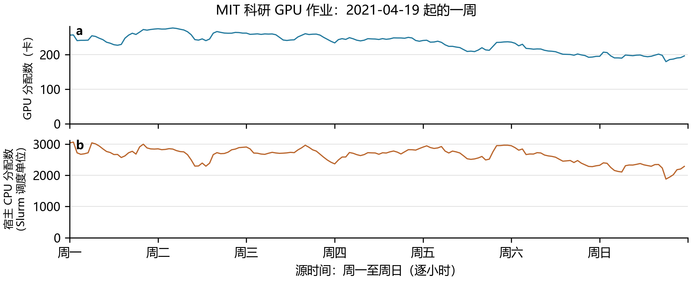
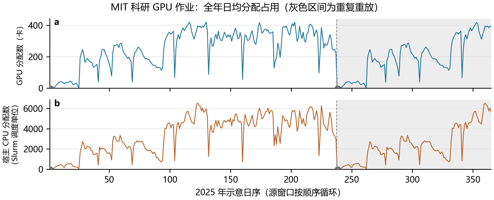

# 科研 GPU 需求与服务器配置矩阵（20261028-v2）

[Markdown 说明](科研GPU需求与服务器配置矩阵_20261028_v2.md) / [PDF 说明](科研GPU需求与服务器配置矩阵_20261028_v2.pdf)。采用 MIT Supercloud 科研 GPU 执行作业，五种配置、四档规模共 **52 个设计单元**。

| 配置 | 科研需求 | 其他需求 | 每档 | 四档 |
| --- | --- | --- | --- | --- |
| C20 | Lisa CPU | Alibaba CPU 2018（待完成下载核验） | 2 | 8 |
| C21 | MIT Supercloud GPU | Acme、ASI | 3 | 12 |
| C22 | MIT Supercloud GPU | Acme、ASI | 3 | 12 |
| C28 | MIT Supercloud GPU | Acme、ASI | 3 | 12 |
| R-GB200 | — | Acme、ASI | 2 | 8 |
| 合计 | 1 / 10 / 100 / 500 MW IT | 44 风冷＋8 直接液冷 | 13 | 52 |

Lisa 有 201,338 条 GPU 分区作业、308 个完整日时间窗；9 个作业字段没有 GPU 请求数、分配数、利用率或功率。节点库存无法补足作业卡数，可用 GPU 占用天数为 0。核查原始文件只读，官方 MD5 与前后 SHA-256 均通过；[证据](../../data/metadata/research-gpu-demand-20261028/lisa-gpu-audit.json)。官方独立监测包尚待获取核验。

采用 [MIT Supercloud 官方数据](https://registry.opendata.aws/dcc/) 202201 版。实际 Slurm 文件 395,914 行，筛选 98,176 条明确请求且获配 GPU 的执行作业；排除 1,168 条未请求 GPU 的整节点预留记录。源窗口为 2021-02-06 00:00:00 至 2021-10-01 00:00:00（右端不含），237 日、5688 小时。235 日有 GPU 分配记录，日志采集完整性与其余日期的空闲/漏报情况尚未证明。

GPU 与宿主 CPU 均来自同批作业的 `tres_alloc`，分别积分为卡小时和 Slurm CPU 资源小时；分配量不代表实测活跃利用率或功率。数据许可 **CC BY-NC-ND 4.0**，原始与逐作业表保留服务器；两份监测小样本只核验字段。所需下载总计 103,594,536 字节（约 98.80 MiB），全套约 TB 级的遥测未下载。来源、许可、字段及计数差异见[完整审计](../../data/metadata/research-gpu-demand-20261028/source-audit.json)。

[一周示意 PDF](research-gpu-week.pdf)。起点 2021-04-19 00:00:00；代表周选择见 [week-selection.csv](week-selection.csv)。

[全年日均示意 PDF](research-gpu-annual-daily.pdf)。237 日源窗口同相位循环为 365 日，灰色为重复段；空心点标记无 GPU 分配记录的日期。未补值、未添加季节变化。

[设备参数](server-configurations.json)逐字段继承旧版；[矩阵 CSV](scenario-matrix.csv) / [JSON](scenario-matrix.json)中科研 GPU 单元使用新标识 `规模MW_配置_mit-supercloud`。[validation.json](validation.json) / [manifest.json](manifest.json)保存验证与 SHA-256。

旧版 [20261028](../server-count-scenarios-20261028/README.md)、[20261027](../server-count-scenarios-20261027/README.md)及[典型曲线](../typical-load-curves-20261028/README.md)全部保持原字节。典型曲线中的 C21/C22/C28×Lisa CPU 属于原输入版本，当前科研 GPU 需求以后续统一重算结果为准。本次生成资源占用示意，未重算 IT/冷却曲线，未修改冷却模型。

复现：在服务器运行 `analysis/acquire_research_gpu_source.py` 与 `analysis/audit_research_gpu_demand.py`（各参数见 `--help`）；将 `source-audit.json` 与 `research-gpu-observed-hourly.csv` 恢复至 `data/processed/research-gpu-demand-20261028/`，执行 `python analysis/build_server_count_scenarios.py`。依赖为 `analysis/requirements-research-gpu-demand.txt`。逐小时及重放表保存在忽略的数据目录。验证执行 `python analysis/verify_research_gpu_demand.py`。

遗留：Lisa 监测、MIT 日志完整性/时区/CPU 单位、活跃利用率及 H100 性能与功率映射、Alibaba CPU 全表核验。服务截止时间及抢占权限保持未知。
