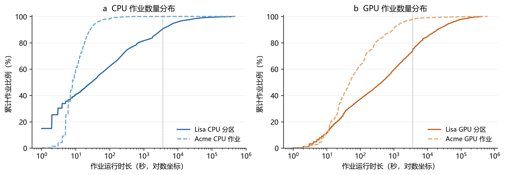
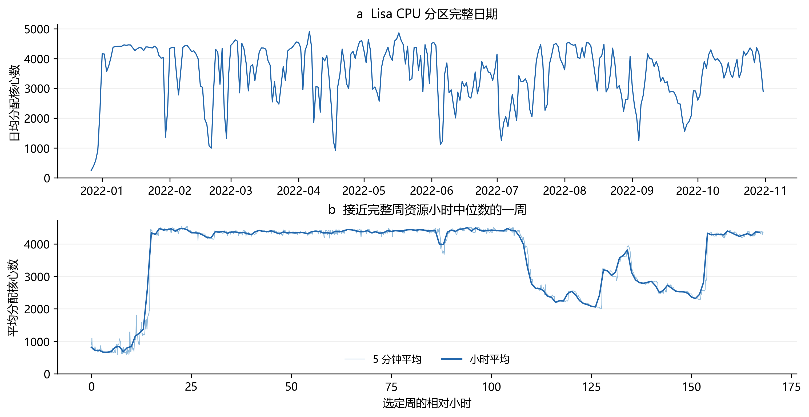
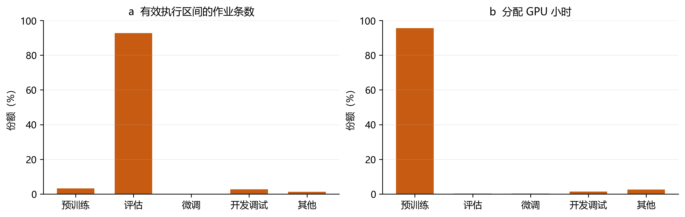
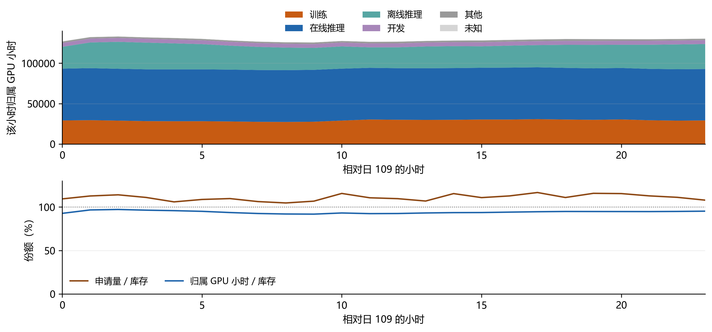
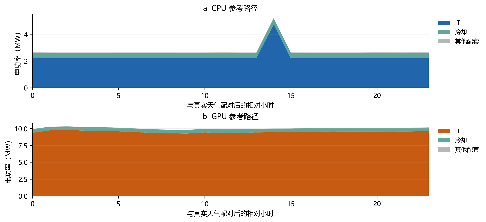

# CPU GPU 算力中心需求模式与柔性约束负荷报告

CPU GPU 算力中心

需求模式与柔性约束负荷报告

Lisa · AcmeTrace · Alibaba ASI | 设备构成与需求模式 | 2026 年 10 月 26 日 · v2

## 1 研究对象与计算范围

本报告以公开生产作业记录构建 CPU/GPU 资源需求，保留每项作业的提交、启动、结束和分配数量，再将执行区间累计为 5 分钟及小时曲线。资源需求通过参考整机功率与气象相关配套模型转换成设施负荷；任务柔性按业务期限、暂停权限及服务质量分别判断。

| 研究内容 | 数据与方法 | 当前证据范围 |

| --- | --- | --- |

| CPU 超算需求 | Lisa CPU 分区作业与核心数 | 已核对全部作业，生成 5 分钟与小时需求 |

| GPU 作业需求 | Acme Kalos 作业时间与卡数 | 保留预训练、微调、评估等任务类别 |

| GPU 运营构成 | ASI 类型、优先级和小时资源 | 核对完整一天；来源共覆盖 185 天 |

| 设施电力需求 | 参考节点功率与 ESIF 冷却响应 | 四档规模的 8 条 24 小时接口示例 |

| 任务柔性 | 提交、完成期限、暂停和恢复条件 | 公开记录缺少的业务权限保持未知 |

### 观测资源与参考用电的含义

作业运行区间、分配核心数、卡数与类型统计来自记录。将这些资源量转换成另一配置的节点利用率，以及将既有冷却响应迁移到参考设施，均属于模型假设。报告中的设施功率用于说明相同计算方法在不同规模下的结果，不作为 Lisa、Acme 或 ASI 原机房的实测用电。

任务标签已经支持更细的分类，但类别不能替代服务约束。训练任务可能要求连续运行，评估任务可能有很紧的期限，CPU 分区也可能包含交互式作业。小时能源模型与原始作业约束需要同时保留。

研究分别记录设备构成、需求模式、IT 规模和调度权限。需求模式分为科研超算型、大模型开发型、生产 AI 服务型，分别保留 Lisa、Acme、ASI 的来源与业务边界。混合中心的容量配比作为研究参数，平均资源占用由原始记录累计。

## 2 数据来源与时间粒度

| 输入 | 本报告读取范围 | 原始粒度 | 主要字段 |

| --- | --- | --- | --- |

| SURF Lisa [1] | 1596963 条唯一作业；CPU 分区 1395625 条，GPU 分区 201338 条 | 作业到秒；发布的节点监测为 30 秒 | 提交、启动、结束、节点、分区、核心数、状态 |

| Acme Kalos [2] | 62413 条作业；CPU 42506 条，GPU 19907 条 | 时间戳到秒 | 类型、分配 CPU/GPU 数、提交与执行时刻 |

| Alibaba ASI [3] | 相对日 109 完整 24 小时；2816548 条 GPU pod 小时观测 | 1 小时 | 类型、优先级、申请量、归属 GPU 小时、库存 |

Lisa 作业源时间从 2021 年 12 月 25 日的提交记录延伸至 2022 年 11 月 1 日的结束记录，文件没有附带时区。当前保留源时钟和相对小时，连接全球 UTC 气象前需要确认其时区。30 秒节点监测的粒度已由来源说明确认，完整监测文件尚未用于本报告的功率重标定。[1]

Acme 本次使用 Kalos 文件，覆盖 2023 年 5 月 17 日至 8 月 16 日，保留来源时区并转换为 UTC。不能把整个 Acme 项目的半年覆盖期直接套用到这一单独文件。GPU 的 Eval 标签保持评估含义，未改成在线推理。[2]

ASI 用相对日和小时表示时间，不发布实际日历日期。完整来源为 185 天、4440 小时；本报告的一天样本用来检验字段和小时接口，其任务份额不能解释为半年或全年均值。同一 pod 在多个小时出现时，各行代表不同的 pod 小时观测。[3]

### 时间与资源的质量控制

Acme 的 3 条 GPU 作业没有结束时间，保留原记录并排除于完整执行区间累计。62410 条完整作业的原 duration 等于提交至结束的总时长，执行负荷统一按启动至结束计算。Lisa 全部作业标识唯一，运行与等待时长非负，原始文件 MD5 与官方发布值一致。

## 2 需求模式分类与情境组合（续）

| 需求模式 | 来源与实际业务 | 用于构造的需求 | 证据边界 |

| --- | --- | --- | --- |

| 科研超算型 | Lisa：科研 CPU 作业与 GPU 加速分区 | CPU 核心需求为主；保留科研作业时序 | GPU 分区未给出逐任务实际卡数与业务用途 |

| 大模型开发型 | Acme：预训练、微调、评估与开发调试 | GPU 作业按原始卡数和执行区间累计 | 原论文不含线上部署服务；CPU 标签未说明业务用途 |

| 生产 AI 服务型 | ASI：训练、在线推理、离线推理与开发 | 保留逐小时类型、优先级和资源构成 | 当前核验一天；小时内部时序和业务期限缺失 |

三个模式对应不同业务环境。[7,8,9] CPU/GPU/混合描述设备构成，训练、推理等描述任务类型；两者分别记录。GPU 节点的宿主 CPU 随整机功率计入，独立 CPU 池只接收另行运行的 CPU 作业。

### 设备配比的研究比较点

| 设备情境 | CPU 池 IT 预算 | GPU 池 IT 预算 | 参数性质 |

| --- | --- | --- | --- |

| CPU 主导 | 75% | 25% | 研究比较点 |

| GPU 主导 | 25% | 75% | 研究比较点 |

| 均衡混合 | 50% | 50% | 研究比较点 |

配比按参考高负载 IT 容量定义，四档总规模均为 1、10、100、500 MW。例如 100 MW 的 CPU 主导情境包含 75 MW CPU 池和 25 MW GPU 池。这些比例为情境设定，真实设施配比需按节点配置核算；全年电量占比由计算结果给出。纯 CPU 与纯 GPU 保留为容量边界参照。

科研 CPU 需求采用 Lisa；大模型开发 GPU 需求采用 Acme；生产 GPU 需求采用 ASI。混合中心可将科研 CPU 池与一种 GPU 业务池组合，明确标为研究构造。新增组合目前用于定义实验，尚未计算其联合小时曲线，也未指定平均忙碌比例。

## 2 需求来源差异与重放规则（续）

下表按当前已处理样本统计资源占用。小时变异系数为标准差除以均值，峰均比为最高小时值除以均值；均只使用完整日期。ASI 统计归属 GPU 小时/库存，其余统计分配资源数。覆盖期和资源口径不同，数值用于描述各自样本。

| 资源路径 | 完整日期 | 小时变异系数 | 小时峰均比 | 零资源小时 |

| --- | --- | --- | --- | --- |

| Lisa CPU 分配核心 | 309 天 | 0.324 | 1.54 | 0.01% |

| Acme CPU 分配核心 | 90 天 | 26.773 | 1239.74 | 80.32% |

| Acme GPU 分配卡数 | 90 天 | 0.495 | 1.73 | 3.15% |

| ASI GPU 归属资源份额 | 1 天 | 0.015 | 1.03 | 0.00% |

Acme 独立 CPU 作业在 80.32% 的小时没有分配资源，一项大作业能显著改变峰值。Lisa 描述的科研 CPU 需求更适合作为科研超算模式输入。Acme GPU 与 ASI 分别保留开发和生产运营特征；ASI 当前一天的平稳程度不能解释为半年或全年特征。以上均为资源曲线，功率还包含空闲功耗与配套用电。

### 来源、形状和规模分别处理

每个需求模式分别读取自身任务序列，保留类型份额、作业持续时间、并发、连续高负荷时段及实际可确认的周内变化。规模外推采用明确的源容量和目标节点数，不把不同来源平均成共同模板，也不将源记录缺失填成零需求。

全年情境按连续周或月重放，登记样本选择、日历映射、重复次数和边界处理。不同重放起点分别计算，记录结果范围；保留任务跨小时与跨日期的完整执行。缺失月份的季节性保持未知，外推结果标为构造全年。历史执行路径与重新调度后的路径分别保存。

跨来源混合时，先将两类资源转换成各自设备池的 IT 功率，再合并散热与配套需求。优先使用同源同时段的共时关系；独立来源的相对起点属于研究假设，需要比较不同起点，保留相互关联不明的限制。气象位置和日历在同一组对照中一致。

## 3 从作业记录累计到小时需求

对作业 i，分配资源数量为 n_i，实际运行区间为 [s_i,e_i)。时间段 h 与该区间的交集决定本段占用。只要保留真实交集，持续几十秒的短作业也可以正确进入小时累计。

Wh = Σi ni × overlap_seconds([si,ei),h) / 3600

W_h 的单位为核心小时或分配 GPU 小时；除以时间段的小时长度，得到平均分配资源数量。例如 100 个核心运行 30 秒，贡献 0.8333 核心小时。运行时长不向上取整到整小时，也不将排队期间计为执行时间。

CPU 与 GPU 均存在大量短作业。Lisa CPU 分区 90.62% 的作业少于一小时；Acme GPU 有效执行区间中该比例为 98.18%。小时曲线适合能源平衡，短任务的启动次序、连续执行和完成期限仍应在原始作业层面约束。

## 4 CPU 超算需求的时间特征

Lisa CPU 分区的 1395625 条作业累计分配约 26040211 核心小时。作业运行时长中位数为 25 秒，90% 分位为 3280 秒，99% 分位约为 49460 秒。短作业占比较高，与少数长作业持有较多资源的情况可以同时存在。

在 309 个完整日期中，日均分配核心数的平均值为 3508.1，日间变异系数为 0.269。这一指标描述观测期内不同日期需求的离散程度；它不能单独说明负荷允许转移多少。

分配核心数表示调度器授予的资源，未等于 CPU 实际忙碌核心数或完成的 FLOP。分区包含 normal、shared、shared_jupyter 等标签，这些标签可用于服务审阅分组，不能单独证明作业可延后。CPU 功率标定需要配对的节点利用率和整机功率。

## 5 GPU 作业类型与资源需求

| GPU 任务类型 | 有效作业条数 | 分配 GPU 小时 | 资源小时份额 |

| --- | --- | --- | --- |

| 预训练 | 640 | 1,378,184.1 | 95.55% |

| 评估 | 18,469 | 3,357.7 | 0.23% |

| 微调 | 8 | 3,487.2 | 0.24% |

| 开发调试 | 537 | 20,422.8 | 1.42% |

| 其他 | 250 | 36,952.8 | 2.56% |

任务条数与 GPU 小时给出了不同的业务结构。较短的评估作业可以占据多数提交记录，持续时间较长或并行规模较大的预训练作业则可能占据较多资源小时。因此，不能用提交条数比例分配训练、推理或柔性电量。

本统计保留具有有效执行区间的各类终止状态，包括失败和取消产生的运行占用。它描述已发生的资源消耗，未等于成功完成的服务量。若优化模型要求完成相同服务，应另外定义成功任务、重试关系及质量要求。

## 5 GPU 作业类型与资源需求（续）

这一完整日内，在线推理、离线推理和训练的资源曲线可以分别观察。公开的优先级同时保留 HP、LP 与 Other。LP 表示来源中的低优先级或 spot 业务，尚未给出每项任务的检查点、最大等待或恢复成本。[3]

样本的申请量/库存为 104.63% 至 116.62%。这个比值不能直接作为物理利用率。GPU 功率接口使用另行保留的归属 GPU 小时份额，并保留其分配资源代理的性质。SM 利用字段存在缺失及大于 100 的值，未被截断或补零。

ASI 的小时记录能描述运营构成，但无法恢复小时内部的到达顺序、短时突发或暂停过程。秒级 GPU 作业可用 Acme 检查执行约束，小时构成可用 ASI 核对；两个来源需要分别解释，不能将其任务标识或业务权限直接连接。

## 6 柔性识别与服务约束

| 允许的操作 | 必需证据 | 可用记录与限制 |

| --- | --- | --- |

| 延后启动并连续执行 | 数据就绪时刻、最晚完成时刻、所需资源与运行时长 | 秒级作业可约束执行区间；业务期限缺失 |

| 暂停与恢复 | 抢占权限、检查点间隔、恢复时间和额外工作量 | 取消或失败记录不能证明可无损恢复 |

| 改变资源或功率 | 资源/功率与性能关系，以及服务质量要求 | 分配数量与整机功率需要配对标定 |

| 跨地点调度 | 数据位置、传输、时延和接收余量 | 当前数据没有完整迁移许可及代价 |

三套公开记录均未给出可直接使用的逐任务业务截止时间和暂停权限。当前每项任务的柔性状态保持未知，训练、离线推理、微调和评估仅进入服务约束审阅候选。CPU 的硬件类别、GPU 的业务类别和历史排队不能替代用户允许的操作范围。

### 可复现的柔性情境

若研究采用明确的完成期限 d_i、就绪时间 r_i 和固定执行时长 p_i，则连续作业满足 r_i ≤ s_i 且 s_i+p_i ≤ d_i，同时受核心、卡数、内存和并行规模约束。可暂停作业还必须计入检查点与恢复开销。不存在这些权限时，模型只重建原执行路径。

允许额外延后 1、6 或 24 小时等数值应登记为研究情境参数。采用不晚于历史完成时间的对照，也需要说明这一服务基准属于研究定义，并检查依赖与数据就绪条件。历史已等待多久不能直接转换为可新增的等待额度。

### 小时能源优化与作业调度的连接

在相同任务和服务要求下比较固定派发与柔性派发。每次调度后重新累计资源、计算 IT 功率及气象相关冷却，再进入供电平衡。任务连续执行与最小并行规模保留在作业层面，不能把每个小时的工作量任意拆分而仍声称满足原任务约束。

## 6 ASI 电力柔性分析的文献结果（续）

Li 的独立研究使用 ASI 185 天记录重建 4439 个有效小时，报告平均设施功率约 55.8 MW、即时可削减候选负荷平均 3.55 MW，约为前者的 6.35%。这属于预印本模型结果，保留被分配 GPU 的空闲功耗。[10]

| 响应持续时间 | 95% 可用率的候选容量 | 条件 |

| --- | --- | --- |

| 1 小时 | 2.51 MW | 全部候选能力可实现 |

| 4 小时 | 2.32 MW | 同上 |

| 24 小时 | 1.95 MW | 同上 |

按平均候选份额标定的固定比例法分别高估上述容量 17%、25%、47%。这是历史可用性，假定窗口内能压低同期候选任务，回收资源不被新任务填补。实际实现比例 q 未识别，调节对后续任务的影响未验证；功率与固定 PUE 保留其模型性质。[10]

### 本研究的参数使用方式

上述数值作为文献对照，保留其需求样本、统计边界和控制假设。本研究各情境仍从原任务重建需求，逐项登记允许延后、暂停、恢复和降功率的证据。先在可证明的权限内计算候选路径，再评估持续时长、可用率和恢复负担。

文献报告 185 天中有一个小时缺失；本报告目前只核验相对日 109 的完整一天。扩展全部 ASI 数据时需重新检查小时完整性与执行记录的连接范围，不将文献清洗结果当作本工作区已完成的验证。

## 7 设备规模与节点功率

1、10、100、500 MW 表示参考高负载 IT 预算，不包含外部冷却。CPU 节点采用双路 EPYC 7763 的 128 核心整机参考，最高测试功率 546 W；GPU 节点采用 8×H100 HGX，联合高负载参考为 8430 W。[4,5]

| IT 预算 | CPU 节点 / 核心 | GPU 节点 | H100 参考卡数 |

| --- | --- | --- | --- |

| 1 MW | 1,831 / 234,368 | 118 | 944 |

| 10 MW | 18,315 / 2,344,320 | 1,186 | 9,488 |

| 100 MW | 183,150 / 23,443,200 | 11,862 | 94,896 |

| 500 MW | 915,750 / 117,216,000 | 59,311 | 474,488 |

![图5 参考节点的整机功率点。CPU 来自 SPECpower 测试，GPU 来自 H100 HGX 训练及联合压力观测。曲线按相邻实测点线性插值，分配资源份额到相应利用率仍需验证。[4,5]](05-reference-node-power.png)

节点数量 N=floor(10⁶S/p_ref)。资源代理份额 u_t 输入节点功率 p(u_t)，计算 P_IT,t=N×p(u_t)/10⁶。宿主 CPU、内存和机内组件已经随整机功率计入；公共网络与存储如另行配置，需要保持同一计费和用电范围。

500 MW GPU 参考预算对应 59311 个节点、474488 张参考 H100。按论文所列 10.2 kW/节点额定参照约为 604.97 MW，工程配电与冷却还要核对设计温度和冗余。不同代际卡数不能直接作为等吞吐量换算。

混合中心以 CPU 参考 IT 容量份额 α 分配总预算 S，两个池分别取整为节点数。若节点功率 p 以 W 计，则合计 IT 功率 P_IT,t=[N_CPU×p_CPU(u_CPU,t)+N_GPU×p_GPU(u_GPU,t)]/10⁶，单位为 MW。GPU 宿主 CPU 保留在 GPU 池；共享冷却按合计热负荷计算一次，固定配套按实际设施边界计入。

## 8 散热需求与温湿度相关负荷

小时尺度忽略蓄热和额外建筑得热时，设备散热需求约等于 IT 电功率：Q_IT,t≈P_IT,t。散热需求采用热功率单位，设施电力需求按 IT、冷却和其他配套电功率相加。节点内风扇已随整机计入。

P_facility,t = P_IT,t + P_cooling,t + P_other,t

冷却采用 ESIF 同时间 IT、室外温湿度和分项电功率标定的响应。令 C 为安装参考 IT 容量，q_t=P_IT,t/C；室外干球为 T_t、露点为 Td_t。每个分项 j 使用 P_j,t=CΣ_kβ_kjX_k,t，分项为室外冷却、HVAC、泵和其他配套。

| 特征项 | 表达式或作用 |

| --- | --- |

| 固定配套与热负载 | 1、q、q² |

| 干球响应 | q×max(T−3.969434,0)、q×max(T−20.685997,0) |

| 露点响应 | q×max(Td+8.236311,0)、q×max(Td−7.992787,0) |

| 低温固定响应 | max(−3.280123−T,0) |

| 湿度输入 | 由当地温度与相对湿度计算露点，或直接提供露点 |

模型采用 5447 个配对小时，前 4775 小时拟合、最后 672 小时检验；温湿度模型的留出冷却 RMSE 为 17.754 kW，约为测试均值的 10.276%，随后全样本重拟合部署系数。校准干球范围约为 −19.31 至 38.13℃、露点约为 −29.42 至 17.68℃，q 为 0.2315 至 1。[6]

这些检验只描述该冷却配置的时间留出表现。目标设施的 COP、供水温度、冷却设备启停和规模效率尚未识别。CPU 科研任务、GPU 训练和在线推理也需要对应功率标定；共享参考节点曲线不能证明三类业务具有相同的实际能效。

外推时保留超标定天气和负载标记。相同任务放在不同网格可以用于比较气候引起的配套用电差异；它不能自动预测该地点的业务到达，也不能证明目标机房具有相同冷却设备。

## 9 四档规模的小时负荷示例

| 类型 / 预算 | 平均 IT
MW | 冷却电量
MWh | 设施电量
MWh | 最高设施
MW |

| --- | --- | --- | --- | --- |

| CPU / 1 MW | 0.230 | 1.021 | 6.579 | 0.520 |

| CPU / 10 MW | 2.303 | 10.208 | 65.812 | 5.203 |

| CPU / 100 MW | 23.034 | 102.079 | 658.122 | 52.035 |

| CPU / 500 MW | 115.171 | 510.395 | 3290.611 | 260.173 |

| GPU / 1 MW | 0.944 | 1.285 | 23.969 | 1.025 |

| GPU / 10 MW | 9.486 | 12.913 | 240.907 | 10.306 |

| GPU / 100 MW | 94.879 | 129.149 | 2409.472 | 103.077 |

| GPU / 500 MW | 474.404 | 645.756 | 12047.564 | 515.393 |

CPU 示例的归一化分母为观测并发峰值 15360 核心，GPU 分母为各小时的异构卡库存。天气取网格 g05_r100_c592 的 2025 年 1 月 1 日 UTC 24 小时。两种业务路径不同，不能据此作同等服务的 CPU/GPU 能效比较。Lisa 是 CPU 任务结构的主要资料，当前示例尚未将其无时区时间直接连接气象。

CPU 尖峰对应源记录中 2023 年 8 月 15 日 14:11:29 至 14:29:06 UTC 的作业：128 节点、15360 核心，持续 1057 秒，占当日 CPU 资源小时约 99.92%。折线连接显示小时平均，原作业持续约 18 分钟；该峰值日期作为接口示例保留。科研超算模式采用第 4 章的 Lisa 需求序列。

## 10 年度累计 成本与全球网格接入

### 完整年度的构造和累计

完整 UTC 日历年要求 8760 或 8784 个无缺口小时。电量 E_year=Σ_tP_tΔt，年度 PUE=全年设施电量/全年 IT 电量。任务层同时累计核心小时、GPU 小时和成功完成的服务量，并分别报告。

Lisa 作业约覆盖十个月，Acme 本次文件约三个月，ASI 当前读取一天。它们足以验证任务到小时负荷的计算方法，尚未提供完整年度实测需求。全年重放需要明确时钟、工作日与季节映射、跨年作业、未完成任务及年末补做边界；不能把一天直接乘 365 作为实测全年。

### 规模与成本系数

设备投资可按同配置节点数量乘单节点报价线性外推，年化费用再采用各资产寿命和折现条件。机房、供配电、制冷、公共网络与存储分别计价；需要额外算力余量时计入新增设备及空闲功耗。未经报价或工程证据支持的价格和规模效率保留为待定参数。

固定派发与柔性派发完成相同服务，成本范围和候选资产保持一致。储能、风光、购电和任务调整费用按研究情境计入；数据缺少业务期限时，本报告不赋予默认可移峰比例，也不生成柔性净收益。

### 可复现模块与验证

任务入口保留原始时间、类型、资源和状态，生成 5 分钟及小时需求；参考功率模块接收当地逐小时温湿度，按四档规模计算 IT、散热、冷却与设施总负荷。全球网格供电模型接收这些曲线时，保持 UTC、单位及服务边界一致。

| 检查 | 核验结果 |

| --- | --- |

| Lisa 文件及作业 | 官方 MD5 一致；1596963 个唯一标识；运行与等待时长非负 |

| 资源累计 | 原始运行区间总量与 5 分钟、小时累计守恒 |

| 独立计算 | 48 个时间段通过逐作业交集核对；5 项无效输入被拒绝 |

| 功率接口 | CPU/GPU 四档规模共 8 条各 24 小时；分项电功率守恒 |

| 服务权限 | 缺失截止时间与暂停权限保持未知 |

## 参考资料与文件索引

<a href="https://zenodo.org/records/13685426" color="#1C5675">[1] Chu 等，Generic and ML Workloads in an HPC Datacenter，SURF Lisa 数据，Zenodo v3，2024。</a>

<a href="https://github.com/InternLM/AcmeTrace" color="#1C5675">[2] Shanghai AI Lab，AcmeTrace 官方数据与字段；Hu 等，Characterization of Large Language Model Development in the Datacenter，NSDI 2024。</a>

<a href="https://github.com/alibaba/clusterdata/blob/master/cluster-trace-gpu-v2026/docs/schema.md" color="#1C5675">[3] Alibaba Cluster Trace GPU v2026，ASI 公开字段、任务类型、优先级、资源及时间定义。</a>

<a href="https://ftp.spec.org/power_ssj2008/results/res2021q1/power_ssj2008-20210221-01063.html" color="#1C5675">[4] SPECpower_ssj2008，HPE ProLiant DL385 Gen10 Plus，双路 AMD EPYC 7763，2021 年公开结果。</a>

<a href="https://arxiv.org/html/2412.08602v1" color="#1C5675">[5] Latif 等，Empirical Measurements of AI Training Power Demand on a GPU-Accelerated Node，2024，Table I。</a>

<a href="https://github.com/TuzzyT-Laiii/33/tree/main/dc-flexibility-project/results/compute-center-data-audit-20261022/coupled-power-weather-20261025-v4" color="#1C5675">[6] 研究工作区 CPU/GPU IT 散热与温湿度耦合负荷工作包，20261025-v4；ESIF 配对记录、冷却留出检验与部署系数。</a>

<a href="https://research.vu.nl/en/publications/generic-and-ml-workloads-in-an-hpc-datacenter-node-energy-job-fai/" color="#1C5675">[7] Chu 等，Generic and ML Workloads in an HPC Datacenter: Node Energy, Job Failures, and Node-Job Analysis，ICPADS 2024，710–719。DOI: 10.1109/ICPADS63350.2024.00097。</a>

<a href="https://www.usenix.org/conference/nsdi24/presentation/hu" color="#1C5675">[8] Hu 等，Characterization of Large Language Model Development in the Datacenter，NSDI 2024，709–729。</a>

<a href="https://www.usenix.org/conference/osdi26/presentation/li-suyi" color="#1C5675">[9] Li 等，Heterogeneity at Hyperscale: Characterization and Scheduling of Large Production AI Clusters at Alibaba (Operational Systems)，OSDI 2026，2187–2203。</a>

<a href="https://arxiv.org/abs/2609.05406v1" color="#1C5675">[10] Meiyi Li，Beyond Scalar Flexibility: From Eligible AI Workloads to Dependable Load Relief，arXiv:2609.05406v1，2026-09-04，预印本。</a>

## 文件索引与复现范围

| 内容 | 文件或目录 |

| --- | --- |

| 报告图件与汇总 | results/task-driven-load-report-20261026-v2/ |

| 任务输入和读取 | analysis/task_trace_inputs.py；fetch_task_trace_samples.py |

| 作业核对 | analysis/audit_task_trace_sources.py；audit_lisa_tasks.py |

| 负荷模块 | analysis/compute_load/；docs/compute-load-module.md |

| 验证与来源 | data/metadata/task-trace-audit-20261026/ |

| 源记录与派生任务 | data/raw/ 与 data/processed/ 下的 task-trace-audit-20261026/ |

| 报告生成 | analysis/build_task_driven_load_report_v2.py |

| 已核验的原图件 | results/task-driven-load-report-20261026/ |

报告与汇总按文件校验值固定输入版本。带任务标识的原始记录和派生表保留在研究数据目录，公开仓库保存报告、图件、生成代码和汇总核验。服务器工作目录为 /data3/dataset/ljt/global-grid-flexibility-20261023。

报告中的任务规模、资源小时、气象及节点功率保留各自的单位和来源。完整年度的任务外推、逐任务服务合同及目标设施功率标定完成后，才能进一步把情境下的可调节潜力解释为特定业务和机房可实施的柔性。

### 情境结果的登记

每个案例保存设备构成、CPU 容量份额、需求模式、源文件版本、资源分母、重放规则、天气网格、总 IT 规模和服务权限。科研与开发模式的秒级任务可生成 5 分钟及小时资源量；生产模式保留 ASI 的原生小时粒度。统计按任务数、资源小时、电量和服务完成量分别汇总。

本次增补需求模式分类、来源波动统计与文献结果；图件及八种功率示例与已核验版本保持同一数值。75/25、25/75、50/50 为新增设备构成的研究比较点，混合小时曲线、构造全年及柔性收益尚未计算。原报告及其生成程序保留。