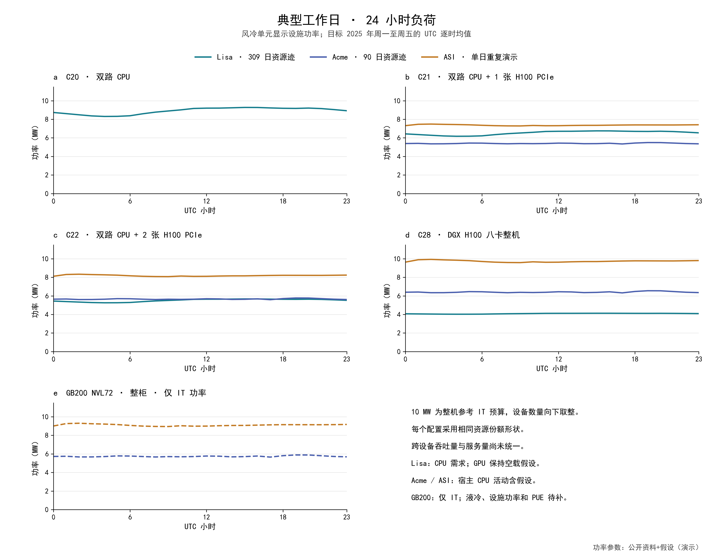
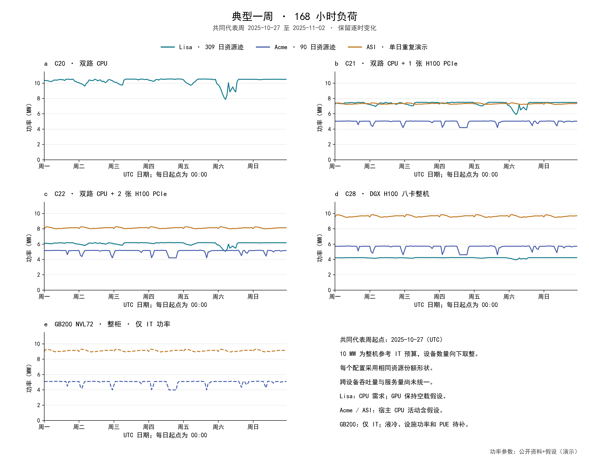
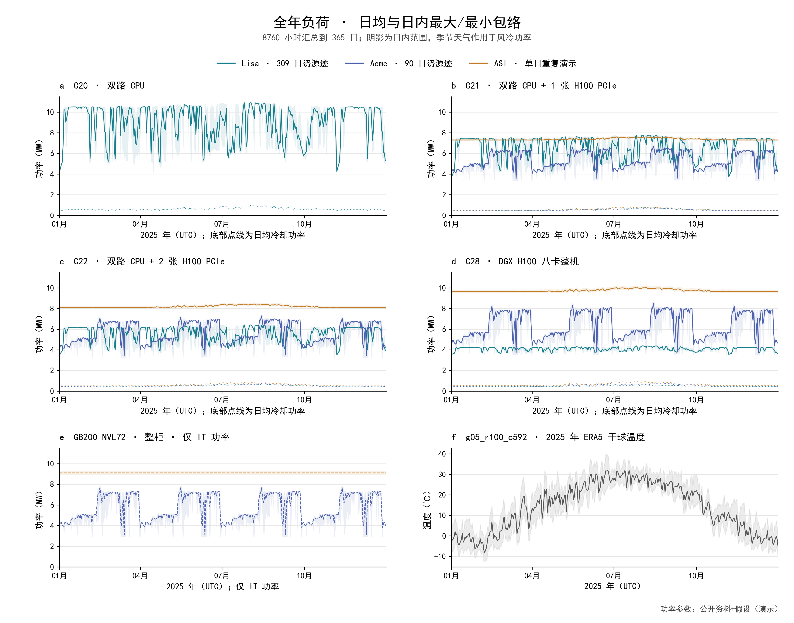
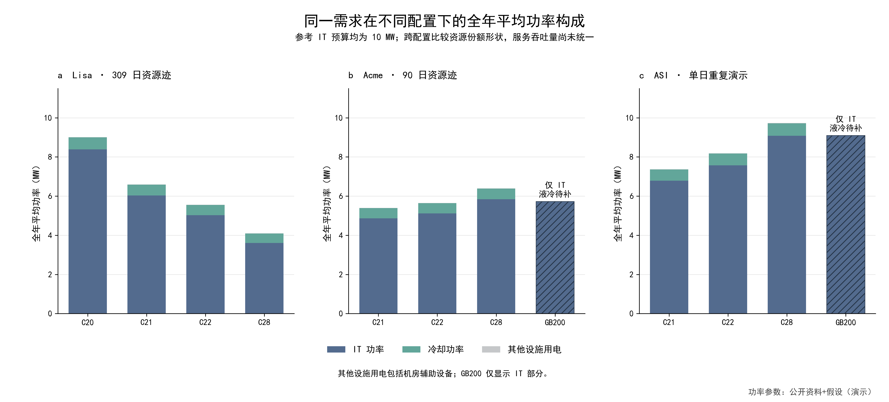

# 五种设备配置的典型负荷曲线

10 MW 参考 IT 预算，2025 年，天气网格 g05_r100_c592。本次生成 **12 条基准曲线**，每条 8760 小时；连同高、低两档共 36 条、315360 条小时记录。Lisa 和 Acme 的需求形状有真实资源记录依据，目标设备绝对功率含假设；ASI 全部标记为“单日重复演示”。GB200 本轮仅计算 IT 功率，液冷和设施指标待补。

设备矩阵采用已合并的 [PR #12](https://github.com/TuzzyT-Laiii/33/pull/12) 中五种配置和 52 单元定义。设备/需求定义已随 #12 纳入 main；本任务独立 PR 面向 main，审阅新增功率假设及曲线。当前成果只展示负荷，没有开展调度优化、收益计算或 CFE 匹配。

## 四张图



图1：[PNG](figure1-typical-weekday.png) / [PDF](figure1-typical-weekday.pdf)。目标 2025 年周一至周五按 UTC 小时求平均，形成 24 小时曲线。工作日来自目标日历分组，未识别原迹真实时区、节假日或工作日习惯。



图2：[PNG](figure2-typical-week.png) / [PDF](figure2-typical-week.pdf)。共同代表周为 **2025-10-27 至 2025-11-02 UTC**。对全年完整的周一至周日候选周，以 Lisa、Acme GPU、ASI 和干球温度的 168 小时标准化形状，选择距候选周平均模板最近的一周。各配置使用同一周，保留全部小时起伏；候选得分见 [representative-week-selection.csv](representative-week-selection.csv)。



图3：[PNG](figure3-annual-envelope.png) / [PDF](figure3-annual-envelope.pdf)。8760 小时按日汇总为均值及日内最小/最大包络；包络来自小时起伏，不表示置信区间。底部点线显示风冷配置的日均冷却功率，最后一个面板展示同一气象节点的干球温度。需求重放没有添加季节增长，天气驱动冷却的季节变化。



图4：[PNG](figure4-power-components.png) / [PDF](figure4-power-components.pdf)。全年平均 IT、冷却和其他设施用电。GB200 斜线柱仅显示 IT。配置间的设备数量和服务吞吐量不同，不能用此图判断完成相同工作量的设备能效。

所有 PNG 为 300 dpi，PDF 嵌入中文字体。四张图均标注“功率参数：公开资料+假设（演示）”。

## 功率模型与敏感性

完整公式、端点、合理区间、映射和来源见 [power-sources.md](power-sources.md)；机器可读参数见 [power-parameters.csv](power-parameters.csv)，公开 SPECpower 的 22 行整机实测值见 [specpower-evidence.csv](specpower-evidence.csv)。

`P_unit=P_base+n_cpu×P_cpu(u_cpu)+n_gpu×P_gpu(u_gpu)`。`P_base` 包含内存、风扇、机内存储/网络、主板、电源转换等；DGX/GB200 另含机内/柜内交换设备。CPU 形状从公开 SPECpower 整机结果归一化转移，组件分解和端点均保留 assumption 标记。GPU 采用有空载截距的响应，满载端点参考厂商 TDP。

| 配置 | 单位 | P_base W | 每 CPU 空载→满载 W | 每 GPU 空载→满载 W | 整机空载 W | 参考满载 W | 10 MW 数量 |
| --- | --- | ---: | ---: | ---: | ---: | ---: | ---: |
| C20 | 双路服务器 | 150 | 20→225 | — | 190 | 600 | 16666 |
| C21 | 双路＋1 GPU 服务器 | 200 | 20→225 | 50→350 | 290 | 1000 | 10000 |
| C22 | 双路＋2 GPU 服务器 | 250 | 20→225 | 50→350 | 390 | 1400 | 7142 |
| C28 | 双路＋8 GPU DGX H100 | 1800 | 50→350 | 70→700 | 2460 | 8100 | 1234 |
| GB200 NVL72 | 36 CPU＋72 GPU 整柜 | 24600 | 40→250 | 120→1200 | 34680 | 120000 | 83 |

这些值是本轮中央假设；C28 官方最大规格为 10.2 kW，GB200 约 120 kW 的官方整柜值没有指定测试工况。C20/C21/C22 的 CPU 满载端点以 225 W TDP 为参考，H100 PCIe/SXM 的 350/700 W、GB200 Blackwell 的 1200 W 为公开 GPU TDP 参考。工作功率与空载分项需要后续实测。

[sensitivity-summary.csv](sensitivity-summary.csv) 保存固定中央设备数量的低、中央、高三档。它们联合改变基础功率、组件端点、CPU/GPU 响应形状及宿主 CPU 代理。高档没有强制截断到 10 MW；`above_10mw_it_hours` 记录超出参考预算的小时。图1—4显示中央情景，高低范围用于检查参数选择影响，没有概率或置信区间含义。

## 基准汇总

完整精度和全部指标见 [annual-summary.csv](annual-summary.csv)。年电量和峰值采用风冷配置的设施边界；GB200 两行采用 IT 边界。平均负荷率＝年均功率/最高小时功率；峰谷比＝最高/最低小时功率；年均 PUE＝全年设施电量/IT 电量；冷却占比＝冷却电量/设施电量。

| 配置×需求 | 年电量 MWh | 峰值 MW | 平均负荷率 | 峰谷比 | 年均 PUE | 冷却占比 |
| --- | ---: | ---: | ---: | ---: | ---: | ---: |
| C20×Lisa | 78931.3 | 10.991 | 82.0% | 3.028 | 1.075 | 6.80% |
| C21×Lisa | 57763.7 | 7.819 | 84.3% | 2.328 | 1.093 | 8.34% |
| C21×Acme | 47280.8 | 6.813 | 79.2% | 2.036 | 1.110 | 9.64% |
| C21×ASI | 64561.2 | 7.728 | 95.4% | 1.073 | 1.086 | 7.77% |
| C22×Lisa | 48686.4 | 6.459 | 86.1% | 1.993 | 1.107 | 9.41% |
| C22×Acme | 49512.8 | 7.420 | 76.2% | 2.297 | 1.106 | 9.33% |
| C22×ASI | 71695.4 | 8.606 | 95.1% | 1.078 | 1.080 | 7.27% |
| C28×Lisa | 35917.6 | 4.414 | 92.9% | 1.262 | 1.139 | 11.85% |
| C28×Acme | 56051.8 | 8.677 | 73.7% | 2.491 | 1.096 | 8.54% |
| C28×ASI | 85251.4 | 10.258 | 94.9% | 1.083 | 1.071 | 6.53% |
| GB200×Acme（IT） | 50189.2 | 7.857 | 72.9% | 2.730 | 待补 | 待补 |
| GB200×ASI（IT） | 79740.6 | 9.301 | 97.9% | 1.040 | 待补 | 待补 |

## 输入与可信度

| 输入/输出 | 证据与使用范围 |
| --- | --- |
| Lisa×C20/C21/C22/C28 | 309 个完整日的真实分配核心小时；按原顺序循环至全年。可追溯需求形状，绝对 MW 为假设功率映射 |
| Acme×C21/C22/C28/GB200 | 90 个完整日的真实 CPU/GPU 作业分配迹；宿主 CPU 开销与跨型号利用率转换为假设，未识别全年季节需求 |
| ASI×C21/C22/C28/GB200 | 相对日109的 24 小时重复365次，全部为“单日重复演示”；无法确认周波动或年内需求变化 |
| 风冷四配置 | 沿用 ESIF 标定冷却模块，迁移至目标设备/机房；基准每条有 **1903 小时**超出温湿度联合标定范围，已逐小时标记，没有裁切天气或填补 |
| GB200 | 公开完整机柜组成＋假设功率，台数以整柜计；冷却/设施/PUE 保持缺失，不能与风冷设施电量直接进行完整边界比较 |
| Alibaba 2018 | 官方 machine_usage 压缩表为1774523160字节，约1.65 GiB；本轮在 pku-test 下载约14 MiB后，实测速率约40 KB/s，预计约12小时，已终止本轮下载并保留 `.part` 供后续续传；C20×Alibaba 待补，没有生成替代曲线 |

资源文件使用现有 `annual_task_profiles.load_sources()` 验证审计清单 SHA-256，全年映射沿用 `replay_hourly()` 的完整日顺序循环，相位为零。天气通过现有 `grid_weather()` 读取网格中心节点 native_flat_index=289905，核对既有年度包的天气文件和映射文件哈希，再取2025年完整UTC时间轴。原始需求时区没有新推断。

## 文件与复现

- [manifest.json](manifest.json)：依赖提交、配置、天气、源迹、代码和逐小时结果校验值。
- [validation.json](validation.json)：8760小时、分量守恒、台数预算、敏感性顺序、原冷却模块逐小时一致性、来源重放和图件检查。
- [typical-weekday.csv](typical-weekday.csv) 与 [daily-envelope.csv](daily-envelope.csv)：图1及图3的汇总数据。
- `data/processed/typical-load-curves-20261028/`：36份小时 Parquet、4份源小时映射；数据目录按既有惯例不入Git。
- [数据来源与可用性记录](../../data/metadata/typical-load-curves-20261028.json)：公开源读取记录、Alibaba体积与获取状态。

在项目根目录执行，`--input-project` 指向已恢复现有需求与气象数据的项目目录；输入目录只读，输出写入当前项目：

```powershell
python -m pip install -r analysis/requirements-typical-load-curves.txt
python analysis/build_typical_load_curves.py --input-project C:/path/to/input/dc-flexibility-project
python analysis/verify_typical_load_curves.py
```

完成 Alibaba 全表校验及小时汇总后，可用 `--alibaba-hourly <CSV路径>` 接入 C20。CSV需包含 `source_time` 与 `[0,1]` 范围内的 `cpu_fraction`，具备无缺口完整日期；必须同时保留全表校验和、无效值过滤、机器容量加权和每小时覆盖率证据。本轮没有用未完成的下载参与计算。

后续优先补充五种配置一致 BOM 和空载/CPU单独/GPU单独/联合负载档的交流功率测量；补充 CPU/GPU 分配与实际活跃利用率、吞吐量的配对；取得 GB200 CDU/供回液/流量/残余风冷及机房辅助用电；扩大 ASI 到多日；续传 Alibaba 所需 machine_usage 与 machine_meta 并完成质量核验。
