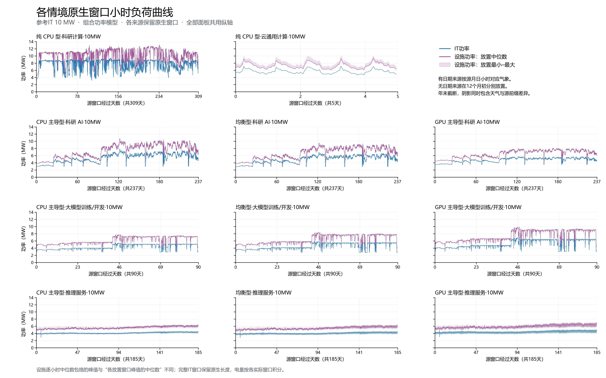
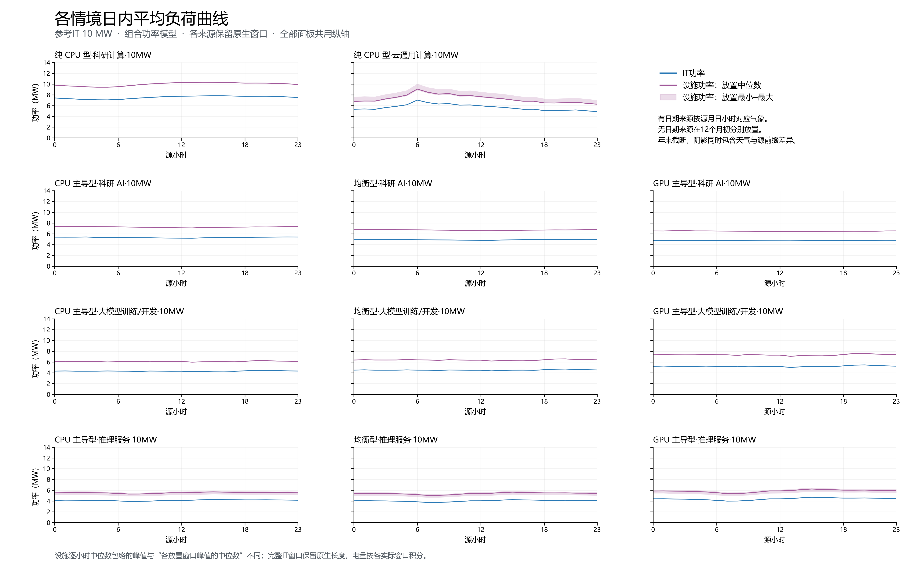
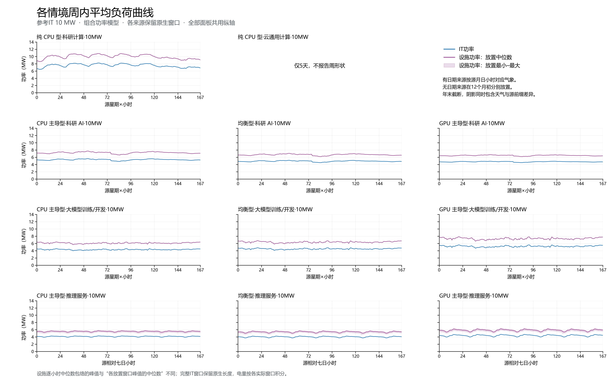
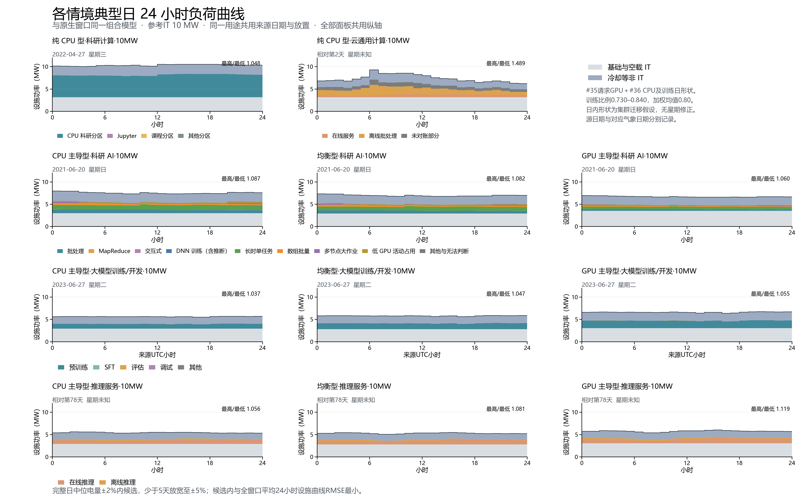

# 组合功率模型下的原生窗口负荷曲线

采用11个服务器类型×用途组合、1/10/100/500MW四档，共44个风冷情境。参考IT规模用于设备整数台数，逐小时功率保持模型结果，不按参考规模截断。

## 原生窗口和统一模型

不循环成全年、不补齐来源。Lisa为309天（2021-12-27至2022-10-31），MIT为237天（2021-02-06至09-30），Acme Kalos为90天（2023-05-18至08-15 UTC）；按源月日小时对应目标气象年。Lisa原文件无时区，直接对应UTC属于假设；MIT保留既有Slurm epoch小时。

Alibaba仅5个完整日（相对第2–6天，120小时），ASI为185天（相对第0–184天，4440小时），两者真实日期及时区未知。各自在12个月1日00:00 UTC放置，超过年末截断源尾部。ASI七至十二月实际长度为184/153/122/92/61/31天；放置范围同时包含气象和源前缀变化。Alibaba不报告周形状，ASI周形状仅指相对七日。

CPU采用#36三份SPECpower归一化单调响应，基础与空闲采用中央值。推理GPU沿用#35 BurstGPT输入/输出token各50%的日形状和逐地点气象年冻结gain，离线推理维持固定分配功率；原生窗口不重新标定gain，也不要求其短窗口在线电量等于固定每卡模型。训练采用#36固定271张GPU集群日形状shape_central，GPU/TDP为0.730–0.840，原生90天GPU小时加权均值0.80。科研AI采用MIT六月完成版标定，迁移至目标H100。所有设施功率完整重算cooling-20261028-v2。

## 10MW汇总

IT指标取完整原生窗口；设施指标取参考网格2025年各次实际窗口统计的中位数，有日期来源只有一次对应。设施峰值为窗口峰值的中位数，日内比为各源小时均值的最大/最小再取放置中位数。范围为各次设施均值最小–最大。窗口电量不年化。

| 情境（参考IT 10MW） | 原生天数 | IT平均MW | IT峰值MW | 设施平均MW | 设施峰值MW | 设施日内峰谷比 | 设施平均范围MW |
| --- | ---: | ---: | ---: | ---: | ---: | ---: | ---: |
| 纯 CPU 型·科研计算·10MW | 309 | 7.520 | 10.000 | 9.963 | 13.033 | 1.097 | — |
| 纯 CPU 型·云通用计算·10MW | 5 | 5.669 | 7.158 | 7.275 | 9.410 | 1.429 | 7.178–8.143 |
| CPU 主导型·科研 AI·10MW | 237 | 5.318 | 7.844 | 7.252 | 10.762 | 1.044 | — |
| 均衡型·科研 AI·10MW | 237 | 4.906 | 6.920 | 6.702 | 9.523 | 1.041 | — |
| GPU 主导型·科研 AI·10MW | 237 | 4.758 | 5.741 | 6.487 | 8.064 | 1.027 | — |
| CPU 主导型·大模型训练/开发·10MW | 90 | 4.320 | 5.458 | 6.119 | 7.793 | 1.046 | — |
| 均衡型·大模型训练/开发·10MW | 90 | 4.514 | 5.919 | 6.385 | 8.431 | 1.064 | — |
| GPU 主导型·大模型训练/开发·10MW | 90 | 5.214 | 7.001 | 7.343 | 9.926 | 1.078 | — |
| CPU 主导型·推理服务·10MW | 185 | 4.137 | 4.602 | 5.526 | 6.143 | 1.076 | 5.101–5.751 |
| 均衡型·推理服务·10MW | 185 | 4.031 | 4.583 | 5.389 | 6.107 | 1.120 | 4.969–5.609 |
| GPU 主导型·推理服务·10MW | 185 | 4.392 | 5.074 | 5.855 | 6.742 | 1.159 | 5.401–6.093 |

时序阴影为每个源小时可用放置的设施功率最小–最大；ASI后段可用放置数逐步减少。逐小时中位数包络的峰值与表中“窗口峰值的中位数”具有不同聚合顺序。

## 与旧模型同窗口比较

对照#34 c836bba原生结果，所有需求、整数台数、源顺序、天气小时和截断长度均保持；这里的差异来自功率模型。

| 情境 | IT平均MW 旧→新 | IT峰值MW 旧→新 | 设施平均MW 旧→新 | 设施峰值MW 旧→新 |
| --- | ---: | ---: | ---: | ---: |
| 纯 CPU 型·科研计算·10MW | 8.336→7.520 | 10.000→10.000 | 11.013→9.963 | 14.320→13.033 |
| 纯 CPU 型·云通用计算·10MW | 5.639→5.669 | 8.137→7.158 | 7.238→7.275 | 10.510→9.410 |
| CPU 主导型·科研 AI·10MW | 5.674→5.318 | 7.861→7.844 | 7.730→7.252 | 11.122→10.762 |
| 均衡型·科研 AI·10MW | 5.160→4.906 | 6.944→6.920 | 7.044→6.702 | 9.857→9.523 |
| GPU 主导型·科研 AI·10MW | 4.822→4.758 | 5.774→5.741 | 6.574→6.487 | 8.256→8.064 |
| CPU 主导型·大模型训练/开发·10MW | 3.867→4.320 | 4.350→5.458 | 5.495→6.119 | 6.294→7.793 |
| 均衡型·大模型训练/开发·10MW | 3.686→4.514 | 4.184→5.919 | 5.247→6.385 | 6.062→8.431 |
| GPU 主导型·大模型训练/开发·10MW | 3.866→5.214 | 4.433→7.001 | 5.494→7.343 | 6.408→9.926 |
| CPU 主导型·推理服务·10MW | 4.353→4.137 | 4.674→4.602 | 5.815→5.526 | 6.426→6.143 |
| 均衡型·推理服务·10MW | 4.186→4.031 | 4.535→4.583 | 5.595→5.389 | 6.197→6.107 |
| GPU 主导型·推理服务·10MW | 4.431→4.392 | 4.864→5.074 | 5.908→5.855 | 6.569→6.742 |

## 第四章同源典型日

第四章直接读取本目录小时文件，按完整原生窗口选日。无日期来源先限定完整窗口的放置，再取设施均值最接近12次中位数者；同一GPU需求按GPU主导型共用放置与源日。候选日电量为中位数±2%，少于5天放宽至±5%，候选中按与全部完整日平均24小时设施曲线的RMSE最小选日。

| 情境 | 源日 | 放置 | 设施峰值MW | 日电量MWh | 当日峰谷比 |
| --- | --- | --- | ---: | ---: | ---: |
| 纯 CPU 型·科研计算·10MW | 2022-04-27 | 源月日对应 | 10.543 | 248.055 | 1.048 |
| 纯 CPU 型·云通用计算·10MW | 相对第2天 | 5月初 | 9.290 | 177.091 | 1.489 |
| CPU 主导型·科研 AI·10MW | 2021-06-20 | 源月日对应 | 7.952 | 180.986 | 1.087 |
| 均衡型·科研 AI·10MW | 2021-06-20 | 源月日对应 | 7.321 | 166.982 | 1.082 |
| GPU 主导型·科研 AI·10MW | 2021-06-20 | 源月日对应 | 6.955 | 160.715 | 1.060 |
| CPU 主导型·大模型训练/开发·10MW | 2023-06-27 | 源月日对应 | 5.685 | 134.932 | 1.037 |
| 均衡型·大模型训练/开发·10MW | 2023-06-27 | 源月日对应 | 5.875 | 138.896 | 1.047 |
| GPU 主导型·大模型训练/开发·10MW | 2023-06-27 | 源月日对应 | 6.719 | 158.320 | 1.055 |
| CPU 主导型·推理服务·10MW | 相对第78天 | 2月初 | 5.607 | 130.414 | 1.056 |
| 均衡型·推理服务·10MW | 相对第78天 | 2月初 | 5.467 | 127.023 | 1.081 |
| GPU 主导型·推理服务·10MW | 相对第78天 | 2月初 | 6.025 | 137.993 | 1.119 |

chapter4-comparison.csv保存前版第四章与本版典型日对照，以及本版第四章与第五章完整IT均值、逐小时取值的零差异核对。前版与本版的典型日变化包含模型、气象映射和选日影响。第四章峰谷比为所选日24小时的最大/最小，第五章为整个原生窗口按小时分组平均的比值。

## 数据与验证

native-summary.csv覆盖44个情境，包含完整IT的均值/峰值/最小值、日内及周内峰谷比、电量，并保存设施各指标12次放置的中位数与范围。all-44-scenarios.csv为精简数值表；placement-summary.csv为参考网格220个逐放置窗口，window-summary-all-locations.csv覆盖25组地点年份、5500个窗口、15,861,600行小时数据。source-hourly保存44条完整IT源曲线，hourly保存参考网格220条气象匹配曲线；城市小时文件保存在服务器data/processed同名目录。

manifest.json记录依赖提交、全部输入/输出SHA-256、冻结的#35标定口径及冷却版本。verification.json独立对照上游小时结果，并检查所有窗口、资源、天气、功率分项、热平衡、统计及放置聚合；原有目录逐字节保持。selected-days保留每日候选、诊断、24小时数值与分任务表，任务层加总还原设施功率。

## 解释边界

Alibaba五天不足以识别长期或星期规律；ASI与Alibaba无真实日期，月初放置和请求相位均为情境假设。MIT使用单月功率标定迁移H100，监测有效覆盖68.33%，合格验证仅3小时。Acme原生需求与监测仅重叠16.496个采样小时、功率报送覆盖11.45%–35.84%，直接按分配GPU反推功率比例没有合格标定小时；采用的集群日形状混合了分配与运行状态，不能识别预训练或检查点的因果日周期。功率变化和低优先级均不提供延后、暂停或恢复的调度权限。

## 复现与审阅

后台运行analysis/launch_native_combined.sh，读取已冻结#34原生小时输入；只写新的结果与处理目录。运行verify_native_combined.py全量核验，再运行prepare_native_combined_brief.py、plot_native_combined.py及本脚本。Word由docs/job-flexibility-brief/build.js生成，经Word原生导出PDF并逐页检查。

依赖审阅顺序：#27；#30→#32、#33；#34、#35、#36；#31；本PR。各依赖分支保持原状，本PR待审。
