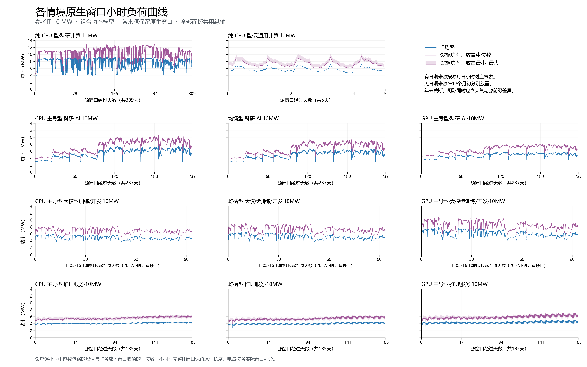
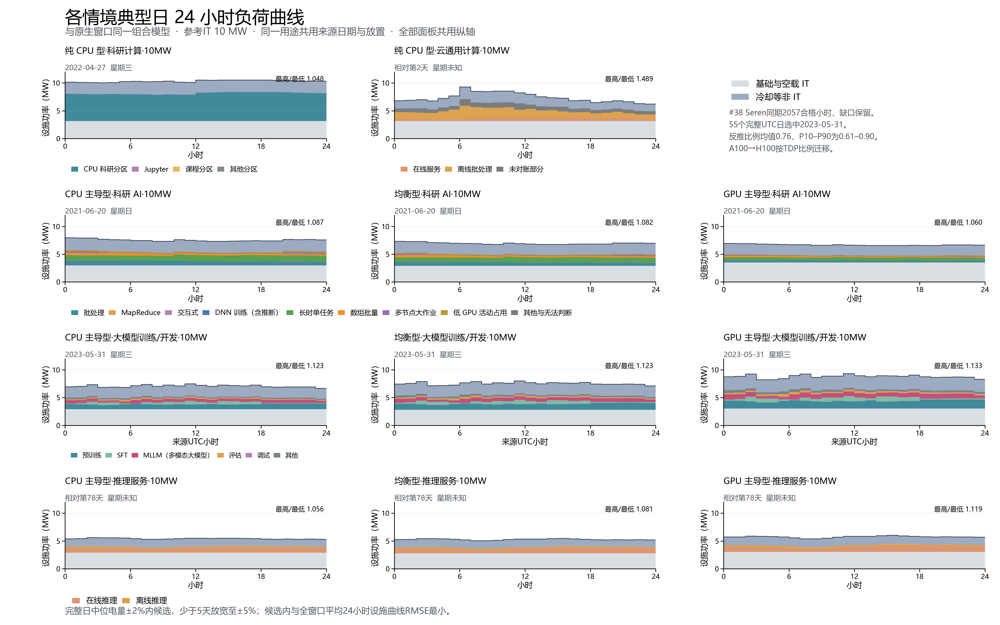

# Seren训练与组合模型原生窗口简表

训练采用PR #38 bd6c8cd正文main：2023-05-16 10:00至08-17 23:00 UTC范围内2057个合格小时，合计85.7083天小时量。范围内189小时缺口保留，54个连续片段；不填充、不循环、不压缩时间、不年化。

Seren同期GPU监测反推已分配GPU功率/TDP：源GPU采样时间加权均值0.7623，P10/P50/P90=0.6139/0.7683/0.8963。2288卡在线库存、报送均功率代表缺测GPU、源未分配GPU空闲60W为假设；无逐作业设备映射。A100 400W按TDP比例迁移至H100 PCIe 350W或SXM 700W，吞吐及进度未标定。8个超过TDP的小时保留原值及标记。4192小时观测＋UTC日形状补缺方案仅为上游对照。

其余八个组合、32个规模情境原生源、208份参考气象时序与8套典型日图/表按上一版原字节复制。推理#35、CPU/基础空闲#36、科研AI的MIT六月标定与冷却cooling-20261028-v2保持。Lisa309天、MIT237天按源月日小时对应气象；Lisa时区对应UTC为假设，MIT保留Slurm epoch。Alibaba5天与ASI185天无真实日期，在12个月初放置、年末截断，范围同时含气象及源前缀变化；Alibaba不报告周形状，ASI为相对七日。

## 10MW原生窗口

参考网格2025气象。IT取全部原生合格小时；设施为各放置指标中位数，有日期来源一次对应。日内峰谷比为全窗口按源小时算术均值的最大/最小；周内同理按源星期小时分组。窗口电量为实际小时求和，均不年化。

| 情境（参考IT 10MW） | 原生长度 | IT平均MW | IT峰值MW | 设施平均MW | 设施峰值MW | 设施日内峰谷比 | 设施平均范围MW |
| --- | --- | --- | --- | --- | --- | --- | --- |
| 纯 CPU 型·科研计算·10MW | 309天 | 7.520 | 10.000 | 9.963 | 13.033 | 1.097 | — |
| 纯 CPU 型·云通用计算·10MW | 5天 | 5.669 | 7.158 | 7.275 | 9.410 | 1.429 | 7.178–8.143 |
| CPU 主导型·科研 AI·10MW | 237天 | 5.318 | 7.844 | 7.252 | 10.762 | 1.044 | — |
| 均衡型·科研 AI·10MW | 237天 | 4.906 | 6.920 | 6.702 | 9.523 | 1.041 | — |
| GPU 主导型·科研 AI·10MW | 237天 | 4.758 | 5.741 | 6.487 | 8.064 | 1.027 | — |
| CPU 主导型·大模型训练/开发·10MW | 2057小时；约86天；有缺口 | 4.935 | 5.995 | 6.937 | 8.292 | 1.029 | — |
| 均衡型·大模型训练/开发·10MW | 2057小时；约86天；有缺口 | 5.244 | 6.600 | 7.355 | 9.076 | 1.033 | — |
| GPU 主导型·大模型训练/开发·10MW | 2057小时；约86天；有缺口 | 6.118 | 7.882 | 8.542 | 10.789 | 1.036 | — |
| CPU 主导型·推理服务·10MW | 185天 | 4.137 | 4.602 | 5.526 | 6.143 | 1.076 | 5.101–5.751 |
| 均衡型·推理服务·10MW | 185天 | 4.031 | 4.583 | 5.389 | 6.107 | 1.120 | 4.969–5.609 |
| GPU 主导型·推理服务·10MW | 185天 | 4.392 | 5.074 | 5.855 | 6.742 | 1.159 | 5.401–6.093 |

训练面板以真实UTC经过天数显示，缺口插入NaN仅供绘图断线；数值表与时序不插入任何补缺值。其他面板源经过天数保持。

## 第四章典型日

仅55个完整UTC日参与训练选日，中位电量±2%内8个候选，按与全部完整日平均24小时设施曲线RMSE最小选中2023-05-31；GPU主导型选日、三种规格共日。部分日不参与选日和RMSE参照，仍保留在第五章2057小时窗口统计中。

训练任务分层共用同小时集群反推功率比例，CPU/GPU动态IT增量按各类别GPU分配小时占比分摊；MLLM独立单列。分任务功率为模型归因，未使用文献或受控实验的逐类型功率比例。

## 与PR #37上一版训练数字对照

旧版为Kalos90天，GPU功率与日形状为旧情境假设；本表为历史对照。来源、窗口、归一化、任务构成及功率均变化，差值不能归因于单独的功率模型。

| 训练情境 | IT平均MW | IT峰值MW | 设施平均MW | 设施峰值MW | 设施日内比 | 典型日 |
| --- | ---: | ---: | ---: | ---: | ---: | --- |
| CPU 主导型·大模型训练/开发·10MW | 4.320→4.935 | 5.458→5.995 | 6.119→6.937 | 7.793→8.292 | 1.046→1.029 | 2023-06-27→2023-05-31 |
| 均衡型·大模型训练/开发·10MW | 4.514→5.244 | 5.919→6.600 | 6.385→7.355 | 8.431→9.076 | 1.064→1.033 | 2023-06-27→2023-05-31 |
| GPU 主导型·大模型训练/开发·10MW | 5.214→6.118 | 7.001→7.882 | 7.343→8.542 | 9.926→10.789 | 1.078→1.036 | 2023-06-27→2023-05-31 |

## 文件、验证与复现

native-summary.csv为44情境，placement-summary.csv为参考网格220次放置；window-summary-all-locations.csv为25组地点年份5500次放置，训练替换300行。source-hourly保留32条未变源和12条Seren源；hourly保留208条未变时序及12条与#38 SHA-256完全相同的Seren正文时序。城市训练小时读取上游缓存，全部300份匹配#38指纹；汇总与上游指标逐项核对。

training-10MW-comparison.csv保存训练新旧平均/峰值、日内比和典型日日期；chapter4-comparison.csv核对11情境第四章逐小时值与第五章原生时序一致。selected-days保存完整日可用性、选日评分、诊断、24小时与任务分层。第二章Seren任务统计来自#31 c16ac75重新扫描原始作业所得seren-job-statistics.json，完整作业分母与正文合格小时构成分别记录。

manifest.json保存上游300份小时指纹、旧目录全部文件指纹及非训练保留文件指纹。脚本校验非训练汇总全部值不变、上游GPU/CPU/基础公式、任务分层加总及两章小时取值。brief-audit.json记录Word/PDF页数、表格边界与逐页检查。

已核验的#38小时文件缓存置于项目.codex-temp/seren-brief-inputs/hourly/<地点>/main/。运行python analysis/update_brief_seren.py后，在docs/job-flexibility-brief运行node build.js 数据中心任务时间柔性简表.docx README.md，再运行analysis/export_brief_pdf.ps1及analysis/audit_brief_seren.py。旧结果目录保持原字节。

## 局限与审阅

Seren无逐作业设备映射，反推依赖在线库存与缺测代表性；A100→H100按TDP迁移，未标定吞吐。MIT单月标定迁移H100；Alibaba仅5天、ASI/Alibaba日期未知。任务标签、历史排队与功率变化均不赋予延后或暂停权限。

依赖顺序：#27；#30→#32、#33；#34、#35、#36→#38；#31；#37。本PR保持待审，不合并。
